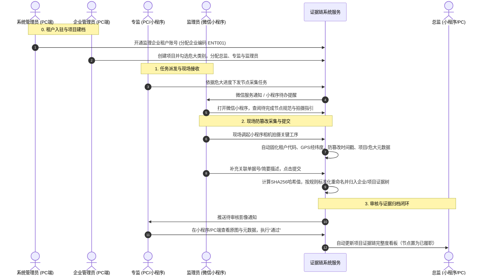
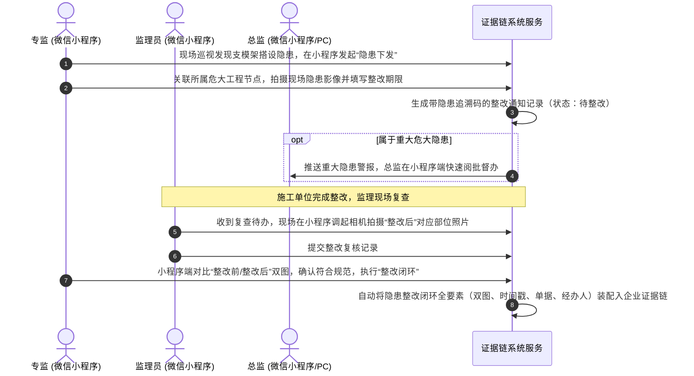
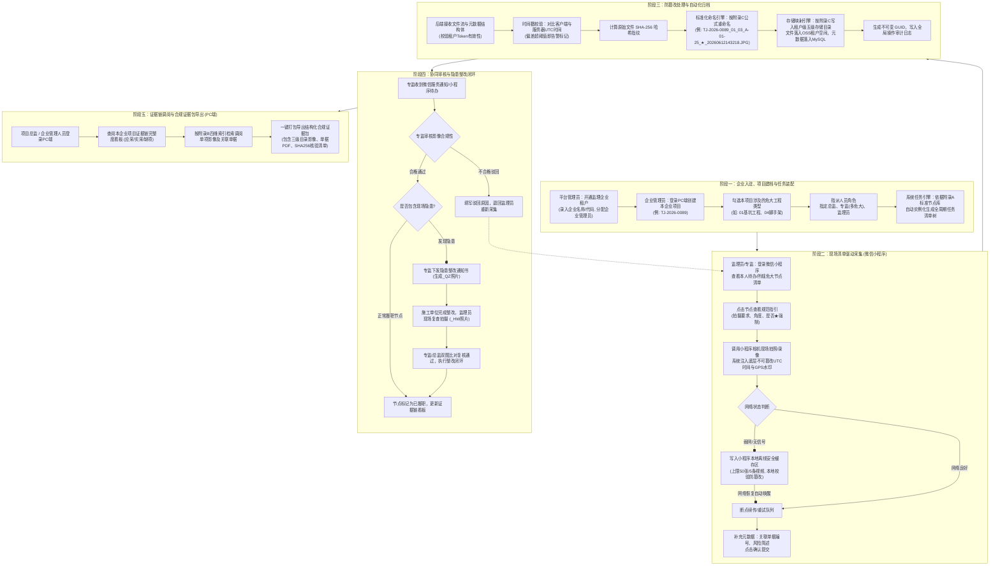
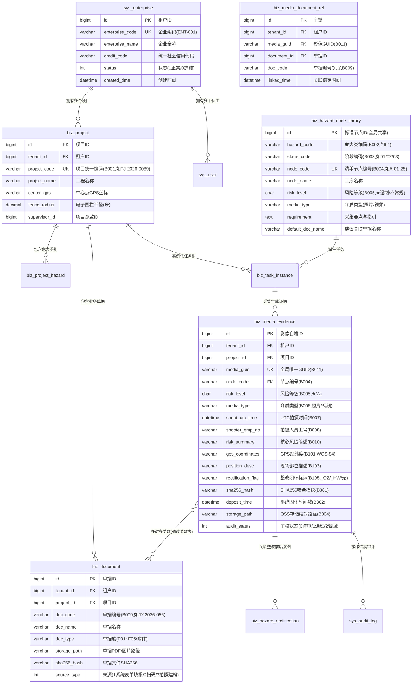
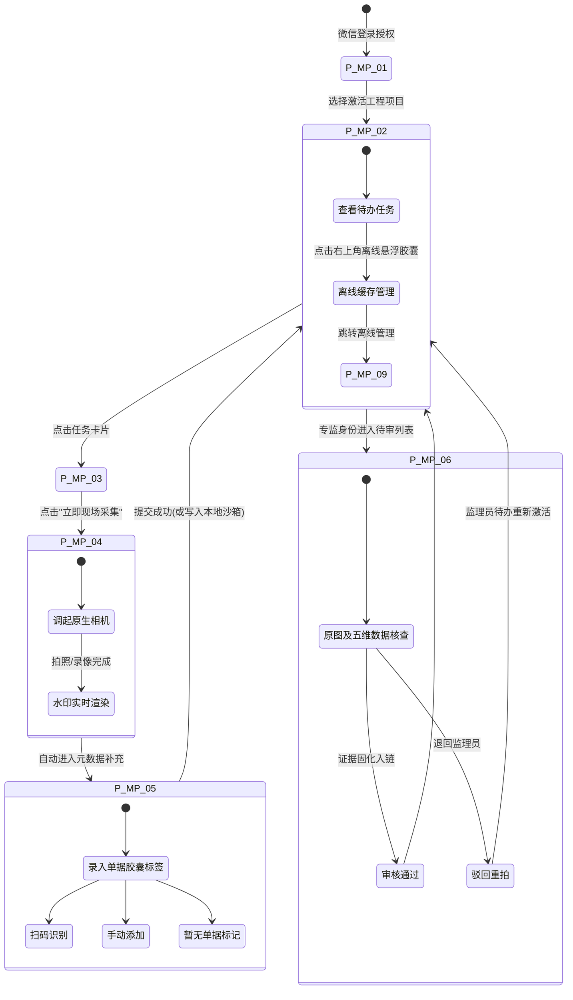
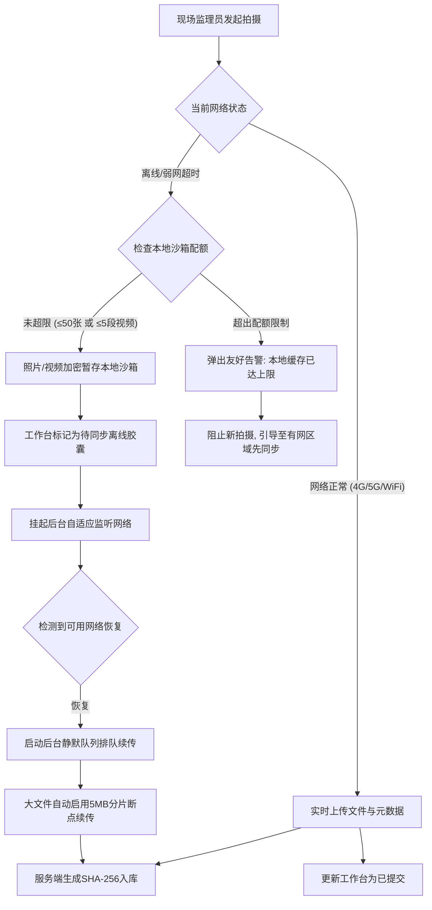

---
文档名称：危大工程监理履职数字化证据链系统 产品需求文档（PRD）
系统版本：v1.1 正式版（加入超级管理员全权限体系）
更新时间：2026-10-19
作者：产品团队
密级：内部受限（机密）
---

# 危大工程监理履职数字化证据链系统 产品需求文档（PRD）

> **系统版本**：v1.1 正式版（已全面加入超级管理员全权限体系）  
> **编制单位**：课题研发团队 / 产品团队  
> **定稿日期**：2026-10-19  
> **适用对象**：内部研发团队（前端、后端、测试、架构、项目管理）、试点监理企业、课题评审专家组  
> **保密级别**：内部受限（未经许可，禁止向第三方外传）

---

## 全书宏观目录（Table of Contents）

- [第1章 文档说明](#第1章-文档说明)
  - [1.1 编写目的与读者对象](#11-编写目的与读者对象)
  - [1.2 项目背景与建设使命](#12-项目背景与建设使命)
  - [1.3 核心术语与定义（Glossary）](#13-核心术语与定义glossary)
  - [1.4 参考标准与合规法规依据](#14-参考标准与合规法规依据)
  - [1.5 文档密级与使用约束](#15-文档密级与使用约束)
- [第2章 项目背景与问题定义](#第2章-项目背景与问题定义)
  - [2.1 行业宏观背景与政策合规驱动](#21-行业宏观背景与政策合规驱动)
  - [2.2 传统监理现场履职痛点与证据灭失风险](#22-传统监理现场履职痛点与证据灭失风险)
  - [2.3 数字化证据链构建的核心突破与解决路径](#23-数字化证据链构建的核心突破与解决路径)
  - [2.4 项目一期建设目标与边界定义](#24-项目一期建设目标与边界定义)
- [第3章 用户与角色分析](#第3章-用户与角色分析)
  - [3.1 系统用户画像全景矩阵](#31-系统用户画像全景矩阵)
  - [3.2 角色细分与典型用户特征](#32-角色细分与典型用户特征)
  - [3.3 角色权限控制矩阵（RBAC）](#33-角色权限控制矩阵rbac)
  - [3.4 核心用户旅程与协作交互视图](#34-核心用户旅程与协作交互视图)
- [第4章 系统总体设计](#第4章-系统总体设计)
  - [4.1 总体业务架构全景图](#41-总体业务架构全景图)
  - [4.2 技术架构与轻量级多租户设计](#42-技术架构与轻量级多租户设计)
  - [4.3 软硬件部署与网络拓扑架构](#43-软硬件部署与网络拓扑架构)
  - [4.4 司法级证据链防篡改与完整性设计](#44-司法级证据链防篡改与完整性设计)
- [第5章 功能需求详述](#第5章-功能需求详述)
  - [5.1 系统管理中心](#51-系统管理中心)
  - [5.2 项目配置中心](#52-项目配置中心)
  - [5.3 节点任务中心](#53-节点任务中心)
  - [5.4 现场移动取证中心（微信小程序端）](#54-现场移动取证中心微信小程序端)
  - [5.5 影像资料审核中心（专监/总监）](#55-影像资料审核中心专监总监)
  - [5.6 安全隐患闭环中心](#56-安全隐患闭环中心)
  - [5.7 核心监理表单管理中心](#57-核心监理表单管理中心)
  - [5.8 证据链调阅与合规出证中心](#58-证据链调阅与合规出证中心)
- [第6章 数据规范与存储规则](#第6章-数据规范与存储规则)
  - [6.1 影像采集元数据标准化规范（26项标准字段）](#61-影像采集元数据标准化规范26项标准字段)
  - [6.2 影像与文件规范命名规则](#62-影像与文件规范命名规则)
  - [6.3 对象存储（OSS）五级树形目录组织规范](#63-对象存储oss五级树形目录组织规范)
  - [6.4 证据数据全生命周期存储策略](#64-证据数据全生命周期存储策略)
- [第7章 非功能性需求](#第7章-非功能性需求)
  - [7.1 系统性能与响应时效指标](#71-系统性能与响应时效指标)
  - [7.2 弱网、离线与断点续传可靠性](#72-弱网离线与断点续传可靠性)
  - [7.3 司法防篡改与存证安全标准](#73-司法防篡改与存证安全标准)
  - [7.4 系统高可用与灾备恢复](#74-系统高可用与灾备恢复)
  - [7.5 现场移动端工程可用性设计](#75-现场移动端工程可用性设计)
- [第8章 原型页面清单与交互说明](#第8章-原型页面清单与交互说明)
  - [8.1 页面架构与终端布局总览](#81-页面架构与终端布局总览)
  - [8.2 微信小程序端（现场移动端）页面清单与交互说明](#82-微信小程序端现场移动端页面清单与交互说明)
  - [8.3 PC Web 管理端（中后台）页面清单与交互说明](#83-pc-web-管理端中后台页面清单与交互说明)
  - [8.4 页面跳转流转图与交互状态机](#84-页面跳转流转图与交互状态机)
- [第9章 验收标准与测试要点](#第9章-验收标准与测试要点)
  - [9.1 验收总体原则与测试策略](#91-验收总体原则与测试策略)
  - [9.2 功能验收用例与判定矩阵（按6大业务中心）](#92-功能验收用例与判定矩阵按6大业务中心)
  - [9.3 弱网、离线与高容错专项测试要点](#93-弱网离线与高容错专项测试要点)
  - [9.4 司法防篡改与证据有效性专项验收](#94-司法防篡改与证据有效性专项验收)
  - [9.5 性能、压力与安全性测试标准](#95-性能压力与安全性测试标准)
  - [9.6 UAT 用户验收测试准入与准出标准](#96-uat-用户验收测试准入与准出标准)
- [第10章 附录（标准对照、映射矩阵与修订说明）](#第10章-附录标准对照映射矩阵与修订说明)
  - [10.1 附录一：危大工程12大分类与标准编码对照表](#101-附录一危大工程12大分类与标准编码对照表)
  - [10.2 附录二：5大核心监理表单族（F01~F05）与典型危大节点映射对照表](#102-附录二5大核心监理表单族f01f05与典型危大节点映射对照表)
  - [10.3 附录三：系统元数据26项标准字段与业务/数据库物理字段映射全览表](#103-附录三系统元数据26项标准字段与业务数据库物理字段映射全览表)
  - [10.4 附录四：附录C五级目录树结构与文件规范重命名映射速查表](#104-附录四附录c五级目录树结构与文件规范重命名映射速查表)
  - [10.5 附录五：PRD 文档修订记录与全生命周期版本历史](#105-附录五prd-文档修订记录与全生命周期版本历史)

---

---

# 第1章 文档说明

## 1.1 文档目的与适用范围

### 1.1.1 文档目的

本文档为「危大工程监理履职数字化证据链系统」一期产品的需求规格说明书（PRD），主要服务于以下目标：

1. **明确产品边界**：界定一期系统的功能范围，防止需求蔓延；
2. **统一团队认知**：为产品、开发、测试团队提供唯一的需求参考基准；
3. **指导原型与开发**：为后续 UI 原型设计和技术开发提供可执行的输入；
4. **支撑验收评审**：作为功能验收的依据文档。

### 1.1.2 适用范围

- **适用系统**：危大工程监理履职数字化证据链系统（一期 MVP）
- **适用阶段**：一期，不包含 AI 识别、区块链上链、政府平台对接等二期/三期功能
- **适用读者**：内部研发团队（产品、前端、后端、测试、项目管理）、系统运维团队及企业决策层

---

## 1.2 阅读指引（各角色速查）

| 读者角色 | 建议重点阅读章节 |
|---------|----------------|
| **产品经理** | 全文 |
| **前端工程师** | 第3章（角色与RBAC）、第5章（功能需求）、第8章（页面清单与路由矩阵） |
| **后端工程师** | 第3章（角色权限）、第4章（多租户设计）、第5章（功能需求）、第6章（数据规范） |
| **测试工程师** | 第3章（权限矩阵）、第5章（功能需求）、第9章（验收标准与越权测试） |
| **项目经理 / 架构师** | 第2章（背景）、第3章（用户角色）、第4章（总体设计）、第9章（验收标准） |

---

## 1.3 名词与缩略语表

| 名词/缩写 | 全称/解释 |
|----------|---------|
| **超级管理员** | Super Administrator（ROLE_SUPERADMIN），系统全局最高特权角色，拥有跨租户所有业务与管理权限 |
| **危大工程** | 危险性较大的分部分项工程，依住建部令第37号定义，包含基坑、模板支撑、起重吊装等12大类 |
| **数字化证据链** | 由时间戳、地理位置、人员身份、影像资料、业务单据等多维数字信息关联构成的不可篡改证据集合体 |
| **监理履职** | 监理机构依法定要求对危大工程实施的审查、巡视、旁站、验收等监督行为 |
| **★ 强制采集** | 高风险节点影像，法定必须留存，永久保存 |
| **△ 常规采集** | 日常巡视影像，按存储周期保存 |
| **采集节点** | 清单中明确规定"需拍摄影像"的具体工序动作点，如"基坑五方验槽" |
| **元数据** | 描述影像文件属性的结构化信息，包含项目编码、拍摄时间、人员工号等字段 |
| **GUID** | Globally Unique Identifier，全局唯一标识符，系统自动生成 |
| **哈希值** | 文件内容的 SHA256 数字指纹，用于验证文件是否被篡改 |
| **旁站** | 监理人员在施工现场全程陪同监督的履职行为 |
| **隐患闭环** | 隐患发现 → 下发整改通知 → 整改复查 → 闭环归档的完整流程 |
| **PRD** | Product Requirements Document，产品需求文档 |
| **MVP** | Minimum Viable Product，最小可行产品 |
| **OSS** | Object Storage Service，对象存储服务（如阿里云OSS） |
| **RBAC** | Role-Based Access Control，基于角色的权限访问控制 |

---

## 1.4 版本历史

| 版本号 | 日期 | 修改内容 | 修改人（角色） |
|-------|------|---------|--------------|
| v0.1 | 2026-10-09 | 初稿创建，完成第1章文档说明 | 产品经理 |
| v0.2 | 2026-10-09 | 新增1.5密级说明；版本历史"修改人"改为角色名；待确认问题全部关闭 | 产品经理 |
| v0.3 | 2026-10-19 | 依据团队讨论决议，术语表补充“超级管理员”与RBAC定义，全篇启动权限体系升级 | 产品经理 |

---

## 1.5 密级说明

> **【内部机密】** 本文档为企业内部研发资料，涉及系统业务规则、数据规范及架构设计，**仅限内部研发团队阅读**，未经授权不得对外传阅、转发或发布。文档内容以最新版本为准，旧版本自动失效。

---

## 本章待确认问题

| # | 问题描述 | 影响内容 | 状态 |
|---|---------|---------|------|
| 1-1 | 文档是否需要增加"密级/保密说明"章节？ | 文档说明 | ✅ 已确认：需要，已新增1.5节 |
| 1-2 | "版本历史"中的修改人，使用真实姓名还是角色名？ | 1.4 版本历史 | ✅ 已确认：使用角色名 |

---

## 本章更新摘要（v0.3）

- **新增**：1.3 名词表补充了“超级管理员”与“RBAC”术语定义；
- **修改**：版本号升级至 v0.3，更新时间标定为 2026-10-19，记录超级管理员权限体系演进；
- **未解决问题**：0项（本章全部已确认）。

---

# 第2章 项目背景与问题定义

## 2.1 行业背景与政策依据

### 2.1.1 危大工程监管背景

危险性较大的分部分项工程（简称"危大工程"）是建筑施工安全事故的高发领域。依据住建部令第37号，危大工程涵盖基坑工程、模板工程及支撑体系、起重吊装及起重机械安装拆卸、脚手架工程等12大类，其施工过程容易导致人员群死群伤或重大经济损失。

监理单位作为法定安全监督主体，须对危大工程全过程实施方案审查、巡视检查、旁站监理、见证取样、验收监督等履职行为。

### 2.1.2 核心政策依据

| 法规/标准 | 核心要求与系统关联 |
|---------|----------------|
| 住建部令第37号《危险性较大的分部分项工程安全管理规定》 | 规定危大工程分类、监理法定职责 |
| GB/T 50319《建设工程监理规范》 | 明确监理旁站、巡视、验收等行为规范 |
| 《安全生产法》 | 安全履职法律责任依据 |
| 天津市危大工程实施细则（2022年） | 地方执行标准，本系统优先适配 |
| 天津市智慧住建平台建设指导意见（2022年） | 数据接口对接方向（二期/三期规划，一期不涉及） |

### 2.1.3 一个核心认知

> **"做了，但没有形成有效记录，在法律和监管意义上等同于没做。"**

这是本系统建设的根本出发点。监理单位在事故追责中被动的核心原因，往往不是没有履职，而是履职证据链不完整、无关联、不具备司法效力。

---

## 2.2 现状痛点分析

### 2.2.1 调研数据支撑

基于对天津市5家骨干监理企业、10个在建危大工程项目的调研（发放问卷120份，回收有效问卷108份，深度访谈20人），发现以下核心问题：

| 痛点维度 | 现状数据 | 后果 |
|---------|---------|------|
| **无标准清单** | 89%的项目没有明确到采集节点的影像采集清单 | 凭经验随意拍，节点漏拍 |
| **节点模糊** | 仅12%的人员能说清楚"何时拍、拍什么"的标准 | 多拍或漏拍，无法证明关键履职 |
| **设备证据力差** | 70%以上关键节点用个人手机拍摄 | 时间可篡改、无GPS水印、EXIF可删除 |
| **影像孤岛** | 影像与报验单、验收记录等业务单据无关联 | 事后无法形成完整证据链 |
| **归档混乱** | 无统一命名规则和目录结构 | 查找困难，证据无法快速调取 |

### 2.2.2 45起事故案例的反向验证

研究报告对天津地区45起危大工程安全事故进行复盘分析，结论显示：

- **监理被追责的核心诱因**，不是事故本身，而是"履职影像证据链断裂"；
- 常见缺陷：漏拍关键节点、影像与单据无关联、影像不具备司法证明力；
- 完整、有效的证据链，是监理单位免责或减责的关键依据。

---

## 2.3 核心概念：数字化证据链

### 2.3.1 定义

**数字化证据链** = 在危大工程全生命周期中，为证明监理单位已按法规和合同约定全面、恰当地履行安全职责，而构建的由以下元素组成的完整证据集合体：

- **时间戳**：精确到秒的UTC拍摄时间，防止伪造时序
- **地理位置**：GPS坐标，证明拍摄地点真实
- **人员身份**：拍摄人工号，绑定履职责任人
- **影像资料**：照片/视频，具备证据力的原始媒体文件
- **业务单据**：与影像关联的报验单、验收记录、监理通知单等

### 2.3.2 证据"三性"要求

| 性质 | 含义 | 系统实现方式（一期） |
|------|------|-------------------|
| **真实性** | 影像未被篡改，时间地点真实 | SHA256哈希值 + 服务器时间戳 |
| **关联性** | 影像与具体工序、人员、单据逻辑绑定 | 元数据标注 + 节点编号关联 |
| **合法性** | 采集和存储符合法律法规要求 | 标准化采集规范 + 合规存储 |

### 2.3.3 证据链的层次

```
单张照片（点）
    ↓
按标准采集的系列照片（线）
    ↓
照片 + 视频 + 时间 + 人员 + 整改单 + 验收记录 = 完整证据链（链）
```

---

## 2.4 一期目标与边界说明

### 2.4.1 一期核心目标

> **在首批试点监理单位的真实危大项目上跑通"企业入驻 → 项目配置 → 采集 → 归档 → 查证"完整闭环，用真实数据验证证据链的业务价值。**

一期不追求功能全覆盖，目标是：
1. 解决"拍什么"的问题（清单化驱动采集）
2. 解决"怎么归档"的问题（自动化命名与目录）
3. 解决"怎么查证"的问题（可检索的证据链视图）
4. 解决"多企业安全使用"的问题（企业间数据严格隔离，满足预估100多家监理单位逐步入驻需求）

### 2.4.2 一期功能边界

> **已确认变更（2-2）：一期支持多企业（多家监理单位）同时使用，预估行业有100多家监理单位，前期使用企业较少。采用轻量多租户架构，各企业数据严格隔离。**

**纳入一期：**

| 功能模块 | 说明 |
|---------|------|
| 多企业数据隔离 | 轻量多租户机制，各企业账号、项目、人员、证据链完全隔离 |
| 企业与组织管理 | 平台分配企业租户，各企业自主管理下属组织、项目与人员 |
| 危大节点库配置 | 系统内置12大类采集节点标准库，全局共享 |
| 项目管理 | 项目创建、危大类型挂载、人员分配（企业内独立管理） |
| 采集任务管理 | 按节点库自动生成任务清单、任务分配与状态跟踪 |
| 移动端影像采集 | 微信小程序拍照/录像、元数据标注、上传（防篡改水印） |
| 自动归档命名 | 按规范自动生成文件名、归入五级目录树（带企业代码隔离） |
| 哈希值与时间戳 | 上传时自动生成SHA256哈希值和服务器UTC时间戳 |
| 隐患整改闭环 | 支持"整改前-整改中-整改完成"闭环拍摄与复查 |
| 证据链查看与导出 | 按企业/项目/危大类/阶段检索查看影像证据，支持一键导出 |
| 监理表单（核心） | 旁站记录、验收记录、巡视记录等核心表单（具体范围在第5章确定） |
| 账号与权限管理 | 超级管理员（全系统最高特权）、平台管理员、企业管理员、总监、专监、监理员多级权限体系 |

**不纳入一期（后续规划）：**

| 功能 | 规划阶段 | 原因 |
|------|---------|------|
| 电子签章/可信时间戳 | 二期 | 需第三方CA对接 |
| 区块链上链存证 | 二期 | 成本高，先跑通业务与多企试点 |
| 企业商业计费与套餐 | 二期 | 前期重点在免费试点与推广，暂不上计费系统 |
| AI风险自动识别 | 三期 | 用户明确放后期 |
| 天津智慧住建平台对接 | 三期 | 待政府接口成熟 |
| BIM构件编码关联 | 待定 | 一期项目不涉及 |

### 2.4.3 一期验证场景

> **已确认（2-1）：试点项目暂未确定，以下为建议场景，待试点项目确定后更新。**

建议优先覆盖以下高频场景：
- **基坑工程**（节点数量多，最具代表性）
- **脚手架工程**（现场最常见）
- **隐患整改闭环**（通用场景，所有危大类型适用）

---

## 本章待确认问题

| # | 问题描述 | 影响内容 | 状态 |
|---|---------|---------|------|
| 2-1 | 一期试点项目是否已确定？ | 2.4.3 验证场景 | ✅ 已确认：暂未确定，待后续补充 |
| 2-2 | 一期支持单企业还是多企业？ | 系统架构、权限设计、数据隔离 | ✅ **已确认变更**：一期支持多企业（预估总数100多家，前期少量试点），采用轻量租户隔离 |
| 2-3 | "核心表单"的具体范围是哪些？是否有现成纸质模板？ | 第5章功能需求 | ✅ 已确认：目前无具体范围和模板，将在第5章由产品根据原始清单整理建议后再确认 |

---

## 本章更新摘要（v0.4）

- **新增**：
  1. 补充了多企业数据隔离与企业组织管理功能边界说明；
  2. 2.4.2 明确纳入“超级管理员（全系统最高特权）”的多级权限体系。
- **修改**：
  1. 版本号升级至 v0.4，更新时间标定为 2026-10-19；
  2. 将 2.4.1、2.4.2 范围由“单企业”变更为“支持多企业（预估100多家，前期少量先行）”；
  3. 不纳入一期表格中移除多租户，调整为企业商业计费；
  4. 待确认问题 2-2 状态更新为“已确认变更”。
- **未解决问题**：0项（本章全部已确认）。

---

\---  
文档名称：危大工程监理履职数字化证据链系统 产品需求文档（PRD）  
章节：第3章 用户与角色分析  
版本：v0.4  
状态：已确认  
更新时间：2026-10-19  
作者：产品团队  
\---

# 第3章 用户与角色分析

## 3.1 用户角色总览

本系统面向**多企业（多监理单位，行业预估100多家，一期前期少量试点企业先行接入）**&#x4F7F;用，采用轻量多租户架构，各企业之间业务数据与证据链严格物理/逻辑隔离。系统不设置外部“业主方/建设单位”只读角色（3-2已确认）。

系统设置 **6 个核心角色**，划分为系统最高特权层、平台运维层、企业管理层、项目管理层和现场执行层五个层次：

```
┌────────────────────────────────────────────────────────┐
│                    系统最高特权层                       │
│   超级管理员（全平台最高特权：跨租户穿透、全量业务与系统权限）  │
├────────────────────────────────────────────────────────┤
│                      平台运维层                         │
│   系统管理员（平台级PC端：企业租户开通、全局节点库维护、运维监控） │
├────────────────────────────────────────────────────────┤
│                      企业管理层                         │
│   企业管理员（租户级PC端：本企业项目配置、人员管理、企业级台账）│
├────────────────────────────────────────────────────────┤
│                      项目管理层                         │
│   项目总监（PC端 + 微信小程序：全局把控、审批、告警监控）   │
│   专业监理工程师（PC端 + 微信小程序：多类危大管理、任务分派、审核）│
├────────────────────────────────────────────────────────┤
│                      现场执行层                         │
│   监理员（微信小程序：现场任务采集、防篡改拍照、表单填报）   │
└────────────────────────────────────────────────────────┘
```

> **多租户数据隔离与特权穿透基本原则**：
>
> 1. **平台与企业隔离**：系统管理员仅负责全局基础字典、标准危大节点库以及企业租户开通运维，常规情况下无权窥探或审批各监理企业的实际业务数据与履职影像。
> 2. **企业与企业隔离**：各监理单位作为独立租户，其下属的项目、组织架构、人员账号、任务流转、表单及证据链数据相互完全不可见，保证商业机密与履职数据安全。
> 3. **项目级分权**：在同一企业内部，严格按项目和角色进行权限控制。
> 4. **超级管理员全局穿透与刚性审计（新增）**：超级管理员（ROLE_SUPERADMIN）作为系统顶层特权角色，**拥有全系统所有业务中心与管理模块的最高权限**，允许跨租户调阅与管理全量数据，支撑集团化统筹监管、司法鉴定取证与突发重大事故调查；其所有跨租户特权操作 100% 纳入全生命周期只读审计日志留痕，防范特权滥用。

---

## 3.2 各角色详细描述

### 3.2.1 监理员

| 项目       | 内容                                        |
| -------- | ----------------------------------------- |
| **角色标识** | ROLE_MONITOR                              |
| **所属层级** | 现场执行层（企业租户内）                              |
| **人员来源** | 各监理企业派驻项目现场的一线监理人员，包括现场监理员、实习监理           |
| **使用设备** | 微信小程序（手机端）；一期原则上无需使用PC端                   |
| **工作场景** | 在施工现场按采集任务清单拍摄防篡改影像、填写基础标注信息、离线缓存与在线归档    |
| **核心诉求** | 操作极简，最小化现场录入负担；清晰提示“当前拍什么、怎么拍”；网络不稳定时离线可用 |
| **关键痛点** | 现场基坑、地下等区域网络信号差；手机存储空间紧张；对各危大类别细分节点要求记不全  |

**核心操作：**

1. 在微信小程序端查看本人待完成的现场采集任务清单（仅限所属项目与分派任务）。
2. 按危大节点规范要求拍照/录像（水印防篡改采集、支持离线缓存）。
3. 补充关键业务标注（系统自动填充企业代码、项目、危大类型、节点、时间、GPS经纬度）。
4. 上传影像归档至系统（网络恢复后支持一键同步与离线重传）。
5. 执行隐患现场复核拍摄（整改前拍照取证 → 整改后拍照复查）。

---

### 3.2.2 专业监理工程师（专监）

| 项目       | 内容                                                 |
| -------- | -------------------------------------------------- |
| **角色标识** | ROLE_ENGINEER                                      |
| **所属层级** | 项目管理层（企业租户内）                                       |
| **人员来源** | 具备监理工程师资格的专业技术人员；**单个专监可同时负责同一项目下的多类危大工程**（3-3已确认） |
| **使用设备** | 微信小程序（现场巡视/移动审核） + PC端（后台精细化审核与数据看板）               |
| **工作场景** | 掌控所负责的多类危大工程采集进度，现场抽查与移动审核影像，编制专项表单与下发隐患通知         |
| **核心诉求** | 按负责的危大类型多维度过滤任务；及时收到待审核提醒；快速驳回不合规影像；便捷下发整改         |
| **关键痛点** | 一个人兼顾多类危大（如既管深基坑又管起重吊装），纸质记录与零散照片极易遗漏或混淆           |

**核心操作：**

1. 查看所负责多类危大工程的任务进度看板与预警列表（小程序/PC）。
2. 审核监理员上传的影像资料（支持合格通过、不合格驳回并填写原因）。
3. 向监理员分派临时或计划内采集任务。
4. 填写专项监理表单（旁站记录、隐患排查、巡视记录等）。
5. 下发隐患整改通知书（关联具体危大类型、节点与现场影像）。

---

### 3.2.3 项目总监（总监理工程师）

| 项目       | 内容                                                            |
| -------- | ------------------------------------------------------------- |
| **角色标识** | ROLE_SUPERVISOR                                               |
| **所属层级** | 项目管理层（企业租户内）                                                  |
| **人员来源** | 总监理工程师（总监），项目监理机构法定负责人                                        |
| **使用设备** | **PC端 + 微信小程序双端协同**（3-4已确认）                                   |
| **工作场景** | **手机端**用于移动审批、关键风险告警实时查阅、现场抽查；**PC端**用于证据链完整度大屏研判、专项方案审批、检查导出 |
| **核心诉求** | 一眼看清项目整体履职证据链完整度；手机端随时随地完成核心审批；检查前一键打包合规证据包                   |
| **关键痛点** | 总监经常不在电脑前，审批流滞后；面对外部住建执法检查时，现场难以快速调取完整闭环材料                    |

**核心操作：**

1. **微信小程序端**：
   - 查阅项目证据链完整度总览与风险红黄灯告警看板。
   - 移动端审批核心表单（专项方案审核、停复工指令、重大隐患闭环核批等）。
   - 快速调阅现场重点危大节点影像与隐患整改闭环情况。
2. **PC管理端**：
   - 查阅项目全生命周期证据链目录树与节点关联关系图。
   - 导出结构化合规证据包（ZIP压缩包，内含防篡改影像、PDF表单与哈希校验清单）。
   - 查看全项目专监与监理员的履职时效统计报表。

---

### 3.2.4 企业管理员

| 项目       | 内容                                      |
| -------- | --------------------------------------- |
| **角色标识** | ROLE_ADMIN                              |
| **所属层级** | 企业管理层（各监理单位内部）                          |
| **人员来源** | 各监理企业技术质量部、安全管理部或企业数字化专员                |
| **使用设备** | PC端管理后台                                 |
| **工作场景** | 负责本企业内部项目初始化、人员账号分配与角色授权、企业全局项目履职风险监控   |
| **核心诉求** | 项目建档与危大类型勾选快速配置；企业人员跨项目调度便捷；企业级履职数据清晰可溯 |
| **关键痛点** | 难以宏观监控各分支项目总监与专监是否真实履职，缺乏数字化风控抓手        |

**核心操作：**

1. 本企业项目建档管理（录入项目基本信息、勾选本项目涉及的危大工程类型清单）。
2. 本企业项目成员配置与授权（指定总监、为专监绑定所辖危大类别、添加监理员）。
3. 本企业人员账号全生命周期管理（账号开通、重置密码、离职停用）。
4. 查阅本企业多项目履职对比台账与证据链完整度排名。
5. 导出本企业级归档台账。

---

### 3.2.5 系统管理员

| 项目       | 内容                                       |
| -------- | ---------------------------------------- |
| **角色标识** | ROLE_SYSADMIN                            |
| **所属层级** | 平台运维层（全局顶层）                              |
| **人员来源** | 平台运营与IT技术支持人员                            |
| **使用设备** | PC端系统运维后台                                |
| **工作场景** | 负责监理企业租户开通、维护全局危大工程标准化节点知识库、配置防篡改存储与运行监控 |
| **核心诉求** | 企业租户开通流程轻量；节点规则库可配置、可扩展；底层存储与命名规则稳定可靠    |

**核心操作：**

1. **企业租户全生命周期管理**：录入入驻监理企业信息（企业名称、统一社会信用代码、企业编码），创建并初始化企业管理员账号。
2. **全局标准节点库维护**：维护12大类危大工程国家/地方标准采集节点库（新增、编辑、版本更迭，供各企业共享复用）。
3. **系统基础参数配置**：配置文件命名规范参数、多租户对象存储路径隔离规则及时间戳防篡改校验规则。
4. **运行与安全监控**：监控系统操作日志、租户数据隔离状态及接口健康度。

---

---

### 3.2.6 超级管理员（全权限最高特权角色）

| 项目       | 内容                                                                 |
| -------- | ------------------------------------------------------------------ |
| **角色标识** | ROLE_SUPERADMIN                                                    |
| **所属层级** | 系统最高特权层（超越常规企业多租户隔离边界，系统顶层）                                   |
| **人员来源** | 平台最高技术主管、集团技术质量安全总监、司法仲裁与政府联合工作专班授权人员                          |
| **使用设备** | **PC端管理后台 + 微信小程序全功能自适应穿透端**                                        |
| **工作场景** | 跨企业宏观风控、全量业务数据质检、全系统特权配置、司法纠纷抗辩调证、企业租户争议仲裁介入、全量数据恢复与重大隐患越级督办 |
| **核心诉求** | **无限制拥有系统所有功能与数据权限**；跨租户一键穿透任何企业与工程；支持直接发起、审核、下发、导出所有业务；全过程审计保障免责 |
| **关键痛点** | 传统系统多租户隔离死板，在面对政府综合巡视检查、跨单位重大事故调查或企业间数据纠纷时，无法一键打通查看全局证据链条       |

**核心操作：**

1. **全局租户穿透管理**：无障碍检索、切换并穿透进入全行业所有（100+家）监理企业租户，查阅其内部所有工程项目、人员配置与履职数据。
2. **全生命周期业务直达操作**：
   - 现场采集与表单操作：拥有监理员与专监的全部表单填报与审核管理权限；在微信小程序端拥有完整的现场拍摄取证权限（PC端不支持且严禁拍照取证）；
   - 审核与批准终审：支持对任意项目的节点影像进行审核/驳回，审批关键表单（F01~F05）与开复工指令；
   - 隐患越级督办闭环：对全平台任意工程的安全隐患进行发起、挂牌督办或直接执行复查闭环。
3. **全局证据链穿透调阅与出证**：支持跨租户按危大类、节点、日期检索全库影像，一键导出任意项目或跨项目的合规证据包（ZIP）与脱机光盘备份镜像。
4. **系统级全局配置与账号管理**：维护全局标准危大节点库、开通/冻结企业租户、直接管理/重置所有企业管理员与总监账号。
5. **不可篡改特权操作审计追踪**：系统自动记录超级管理员所有跨租户调阅与修改指令至独立 WORM 只读审计日志表，支持备查与合规鉴真。

---

## 3.3 角色权限矩阵

> **图例说明**：
>
> - `✅`：拥有完整操作权限（增删改查）
> - `📝`：拥有部分/条件性操作权限（如本人或负责范围内）
> - `👁`：只读查看权限
> - `❌`：无权访问
> - **注**：所有企业管理人员、项目管理人员及执行人员的操作严格限定在**本企业租户数据范围**内；**超级管理员（ROLE_SUPERADMIN）拥有全系统所有权限，且不受单个租户边界限制，支持全域穿透操作，所有特权行为均受审计日志全程监控**。
> - **【核心红线规则】PC端严禁拍照取证**：为确保数字化证据链司法效力，防止办公室导入外来图片作弊，**所有现场工序防篡改影像采集、隐患拍照取证（_QZ）与整改复查拍照（_HW），唯一合法入口为微信小程序现场移动端**。PC端完全不提供任何摄像头调取、现场拍照取证或本地图片导入作为工序现场证据的入口。

| 功能模块 / 操作权限        |     监理员    |   专业监理工程师  |    项目总监    |    企业管理员   |   系统管理员  |    超级管理员   | 终端支持说明    |
| :----------------- | :--------: | :--------: | :--------: | :--------: | :------: | :--------: | :-------- |
| **企业租户开通与初始化**     |      ❌     |      ❌     |      ❌     |      ❌     |  ✅（全局租户） |   ✅（全特权）   | 仅PC端      |
| **标准危大节点库维护**      |      ❌     |      ❌     |      ❌     |      ❌     |  ✅（全局共享） |   ✅（全特权）   | 仅PC端      |
| **项目创建与危大类型配置**    |      ❌     |      ❌     |      ❌     |   ✅（本企业）   |     ❌    |   ✅（跨租户）   | 仅PC端      |
| **项目成员与角色绑定**      |      ❌     |      ❌     | 📝（可提调配建议） |   ✅（本企业）   |     ❌    |   ✅（跨租户）   | 仅PC端      |
| **账号开通与状态管理**      |      ❌     |      ❌     |      ❌     |   ✅（本企业）   | 👁（租户状态） |   ✅（全特权）   | 仅PC端      |
| **查看采集任务清单**       |  📝（仅本人待办） | 📝（所管多类危大） |   ✅（全项目）   | 👁（企业项目概览） |     ❌    |   ✅（全平台）   | 小程序 + PC端 |
| **采集任务下发与分派**      |      ❌     |  ✅（所管危大工程） |   ✅（全项目）   |      ❌     |     ❌    |   ✅（全权限）   | 小程序 + PC端 |
| **现场影像防篡改采集与上传**   |      ✅     |      ✅     |  👁（可查不可拍） |      ❌     |     ❌    |   ✅（仅小程序）   | 仅限微信小程序（PC端严禁拍照取证与上传现场照片） |
| **影像合规性审核（通过/驳回）** |      ❌     |  ✅（所管危大工程） |  ✅（全项目/复核） |      ❌     |     ❌    |   ✅（全特权）   | 小程序 + PC端 |
| **过程表单填报（旁站/巡视）**  | 📝（指定基础表单） |   ✅（专项表单）  |      ✅     |      ❌     |     ❌    |   ✅（全权限）   | 小程序 + PC端 |
| **核心节点与关键指令审批**    |      ❌     |   📝（初审）   |   ✅（终审批准）  |      ❌     |     ❌    |   ✅（终极审批）  | 小程序 + PC端 |
| **隐患下发与整改复查**      | 📝（现场复查拍照） |  ✅（发起与审核）  |  ✅（重大隐患督办） |   👁（本企业）  |     ❌    |   ✅（全特权）   | 小程序+PC（现场拍照仅限小程序） |
| **证据链树状图与完整度看板**   | 👁（本人提交部分） | 👁（所辖危大类别） |  ✅（全项目看板）  |  👁（企业级总览） |     ❌    |   ✅（全域看板）  | 小程序 + PC端 |
| **履职证据包结构化一键导出**   |      ❌     |      ❌     |  ✅（项目级证据包） |  ✅（企业级归档包） |     ❌    |   ✅（全量导出）  | 仅PC端      |

---

## 3.4 核心用户旅程（场景化协同）

### 场景一：日常规范化防篡改采集与审核旅程



### 场景二：现场隐患排查、下发整改与复查闭环旅程



---

## 本章待确认问题

| #   | 问题描述                       | 影响内容             | 确认结论 / 处理状态                                    |
| --- | -------------------------- | ---------------- | ---------------------------------------------- |
| 3-1 | 移动端采用微信小程序还是原生App？         | 第5章移动端架构、第8章页面设计 | ✅ **已确认**：统一采用**微信小程序**，轻量便携、现场无需繁琐安装。         |
| 3-2 | 是否需要“业主方/建设单位”只读角色？一期是否涉及？ | 角色权限划分、权限矩阵      | ✅ **已确认**：**不需要**业主方只读角色，一期专注监理企业内部闭环。         |
| 3-3 | 专监是否可以同时负责多类危大工程？          | 专监权限范围、数据过滤逻辑    | ✅ **已确认**：**支持**专监同时负责多类危大工程，权限支持多选危大工程类型。     |
| 3-4 | 总监是否需要在手机端操作，还是只用PC端？      | 移动端功能范围、第8章原型清单  | ✅ **已确认**：**总监需在手机端操作**（微信小程序移动端审批、看板查阅、风险告警）。 |

---

## 本章更新摘要（v0.4）

- **新增**：
  1. 依据团队决策，**新增系统全局最高特权角色：超级管理员（ROLE_SUPERADMIN）**，确立其拥有全系统所有业务中心与管理功能的操作权限（3.1、3.2.6）；
  2. 确立了超级管理员跨租户穿透与刚性只读审计留痕原则（3.1）；
  3. 在 3.3 角色权限矩阵中全面增加【超级管理员】权限列，全项授予完全控制权限（✅）；
  4. 完善了多企业多租户数据隔离与超级管理员特权穿透并存的体系设计。
- **修改**：
  1. 头部版本号升级至 `v0.4`，更新时间标定为 `2026-10-19`；
  2. 角色体系层级从四层扩展至五层（增加系统最高特权层），角色数量由 5 个更新为 6 个。
- **未解决问题**：0项（本章全部已确认）。

---

# 第4章 系统总体设计

## 4.1 系统建设定位与核心设计原则

### 4.1.1 系统定位
本系统定位为**面向多企业（多监理单位，行业预估100多家，一期前期少量试点企业先行接入）的危大工程监理履职数字化证据链管控平台**。系统以住建部令第37号及天津市地方细则为法规依据，以“清单化驱动采集、时空身份多维绑定、底层规则自动归档、全周期链式闭环查证”为核心主线，实现施工现场监理履职过程的“留痕、防伪、可溯、闭环”，彻底解决现场“漏拍补拍、随意归档、单据脱节、举证无力”的行业痛点。

### 4.1.2 核心设计原则
1. **法定合规与证据有效原则**：严格围绕司法与住建监管的“真实性、关联性、合法性”证据三性要求构建，从源头确保数字化证据具备法律证明力。
2. **轻量多租户与严格隔离原则**：一期支持多家监理单位同时入驻（预估总数100多家，前期少量先行）。采用轻量多租户架构，各监理企业间的人员、项目、业务流转与证据链文件在逻辑和存储层面严格物理/逻辑隔离，严防跨企业越权访问与商业信息泄露。
3. **轻量便携与减负增效原则**：一线监理人员免除复杂手工输入，现场采用微信小程序即开即用（3-1已确认），任务节点明确告知“拍什么、怎么拍”，绝大部分元数据由系统自动获取与组装。
4. **架构稳健与标准先行原则**：严格执行附录B元数据字段规范与附录C标准化命名及三级存储目录规则，规范先行，代码解耦。
5. **离线容错与断网续传原则**：针对深基坑、地下暗挖等现场无信号/弱网高频场景，必须具备离线缓存、本地哈希防篡改与网络恢复自动同步能力。
6. **演进兼容原则**：一期不上区块链与第三方CA，但在数据模型与接口规范上预留扩展槽位，保证二期平滑演进至电子签章、企业商业计费及区块链存证。

---

## 4.2 系统逻辑架构与分层设计

系统整体采用标准的纵向分层、横向解耦架构设计，划分为表现层、网关与安全层、业务中台层、核心规则引擎层、数据存储层以及底层基础设施层。

### 4.2.1 整体分层架构图

```mermaid
graph TD
    subgraph 表现层_Clients["1、 表现层（多端协同）"]
        C0["超级管理员 (PC端+微信小程序)<br>· 跨租户全系统最高特权/全量业务与出证"]
        C1["监理员 (微信小程序)<br>· 清单指引/防篡改采集<br>· 弱网离线缓存/隐患取证"]
        C2["专监 (双端协同)<br>· 小程序现场抽查/移动审核<br>· PC端专项看板/表单填报"]
        C3["项目总监 (双端协同)<br>· 小程序移动审批/红黄灯告警<br>· PC端证据链总览/证据包导出"]
        C4["企业管理员 (PC端)<br>· 本企业项目配置/人员授权/企业台账"]
        C5["平台管理员 (PC端)<br>· 企业租户开通/全局标准节点库运维"]
    end

    subgraph 网关与安全层_Gateway["2、 API网关与安全控制层"]
        GW1["统一API网关 (Spring Cloud Gateway / Nginx)"]
        GW2["身份认证与租户鉴权 (JWT携带tenant_id / RBAC拦截)"]
        GW3["接口限流与防刷 / HTTPS链路加密 / WAF防护"]
    end

    subgraph 业务服务层_Services["3、 核心业务能力层 (业务中台)"]
        S0["企业租户中心<br>· 企业入驻开通<br>· 企业编码分配<br>· 租户状态管理"]
        S1["项目与配置中心<br>· 本企业项目建档<br>· 12大类危大挂载<br>· 人员角色分派"]
        S2["任务驱动中心<br>· 节点任务自动装配<br>· 临时/常规派发<br>· 履职进度跟踪"]
        S3["防篡改采集中心<br>· EXIF/元数据提取<br>· 水印固化注入<br>· 弱网断点续传"]
        S4["流转与闭环中心<br>· 专监/总监审核流<br>· 隐患整改闭环<br>· 催办预警通知"]
        S5["证据链装配中心<br>· 五维证据链装配<br>· 链式索引与检索<br>· ZIP证据包导出"]
        S6["核心表单中心<br>· 旁站/巡视表单<br>· 关联单据绑定<br>· 打印版式还原"]
    end

    subgraph 核心规则引擎层_Engines["4、 基础支撑与规则引擎层"]
        E0["多租户数据隔离引擎 (MyBatis-Plus租户SQL自动拦截)"]
        E1["标准化命名引擎 (执行附录C命名公式)"]
        E2["标准化目录映射引擎 (映射附录C多租户五级树形目录)"]
        E3["SHA-256摘要与防篡改比对引擎"]
        E4["UTC高精度时间戳服务 (防止本地时钟伪造)"]
        E5["全生命周期操作审计留痕日志 (WORM只读原则)"]
    end

    subgraph 数据存储层_Data["5、 数据存储与持久化层"]
        DB1[("关系型数据库<br>MySQL 8.0 (多租户表结构)<br>业务数据/元数据表/权限")]
        DB2[("分布式缓存<br>Redis 7.x<br>Session/租户缓存/任务字典/分布式锁")]
        DB3[("分布式对象存储<br>阿里云OSS (首选) / MinIO<br>租户目录隔离/照片/视频/PDF/证据包")]
    end

    表现层_Clients --> 网关与安全层_Gateway
    网关与安全层_Gateway --> 业务服务层_Services
    业务服务层_Services --> 核心规则引擎层_Engines
    业务服务层_Services --> 数据存储层_Data
    核心规则引擎层_Engines --> 数据存储层_Data
```



### 4.2.2 分层与多租户机制详细说明
1. **轻量多租户数据隔离机制（核心）**：
   - **数据存储模式**：采用“**共享数据库、共享数据表、租户字段逻辑隔离（tenant_id / enterprise_id）**”方案。针对行业预估100多家监理单位、前期少量试点企业先行接入的业务特征，该模式开发效率最高、硬件资源开销最小、运维复杂度极低。
   - **拦截与防穿透**：用户登录鉴权后，JWT Token 内固化所属 `enterprise_id`。后端 ORM（MyBatis-Plus 租户插件）在 SQL 执行层全局自动注入 `AND tenant_id = #{currentTenantId}`。**对于超级管理员（ROLE_SUPERADMIN），系统放行全局穿透过滤，允许跨租户调阅与管理全量数据**；对于普通企业租户角色，底层杜绝数据跨租户泄露。
   - **文件存储隔离**：对象存储（OSS/MinIO）中，各企业以统一企业编码作为顶级路径命名空间：`/{enterprise_code}/{project_code}/...`，物理隔离不同企业的影像资产。
2. **表现层（多端协同）**：
   - **微信小程序端**：面向现场一线（监理员、专监、总监移动端），基于微信生态即开即用，作为**全系统唯一的现场原始影像拍摄取证入口**，调用底层原生相机实施防篡改带水印采集与离线暂存。
   - **PC Web管理端**：面向管理决策与中后台（超级管理员、平台管理员、企业管理员、项目总监、专监），提供大屏看板、富交互表单、多租户配置与证据包导出。**【刚性红线】PC端完全不支持且严禁拍照取证与上传现场影像照片**，坚决不设摄像头调用与本地图片导入现场证据入口，从源头杜绝作弊。
3. **业务服务层**：
   - 贯彻“业务语言重新组织”的原则，聚焦危大工程全生命周期核心业务能力：企业租户中心、项目配置中心、任务驱动中心、防篡改采集中心、流转闭环中心、证据链装配中心与核心表单中心。
4. **核心规则引擎层**：
   - 沉淀系统合规防篡改能力。文件上传后，由多租户隔离引擎、命名引擎、目录映射引擎、哈希摘要引擎与时间戳引擎协同处理，全程操作不可逆记录。
5. **数据存储层**：
   - 结构化业务数据及元数据入 MySQL 8.0；文件实体（JPG、MP4、PDF）入阿里云 OSS；热点字典、租户缓存与分布式锁入 Redis 7.x。

---

## 4.3 技术路线选型、方案比选与推荐

### 4.3.1 移动端技术选型对比与推荐
移动端已明确采用**微信小程序**（3-1已确认），针对小程序的技术开发框架展开比选：

| 方案 | 优势 | 劣势 | 适用场景 | 综合评估 |
|:---|:---|:---|:---|:---|
| **方案A：微信原生框架（MINA + TS）** | 性能最高、底层相机与GPS API无封装损耗、无跨端框架升级兼容风险、包体积小 | 只能在微信生态运行，未来若需要打包原生独立App需重构代码 | 确定仅在微信生态运行、对原生硬件接口依赖极高的项目 | **推荐（首选）** |
| **方案B：Uni-app（Vue3 + TS）** | 一套代码可跨微信小程序、H5、iOS/Android App，开发上手快，生态组件多 | 多层抽象封装导致相机、录像和底层文件IO存在微小性能损耗及偶发兼容问题 | 需短期内同时上线小程序和原生App的项目 | 备选（次优） |
| **方案C：Taro（React / Vue）** | 适合已有成熟React技术栈团队，跨端能力强 | 学习成本略高，小程序端调优和原生相机深度定制略复杂 | 团队主打React技术栈 | 不推荐 |

> **【架构推荐】**：**推荐方案A（微信小程序原生框架）**。
> **理由**：一期核心诉求是现场采集的稳定性、拍照录像无延迟、防篡改水印与EXIF硬件信息获取准确度极高。方案A无额外中间层封装，直接调用微信底层硬件能力，运行最稳健；若技术团队已有极强的Vue3积淀，亦可采用方案B（Uni-app）仅编译至微信小程序。

---

### 4.3.2 PC端前端技术选型对比与推荐

| 方案 | 优势 | 劣势 | 综合评估 |
|:---|:---|:---|:---|
| **方案A：Vue 3 + Vite + TypeScript + Element Plus** | 国内建设工程与政企软件主流，中文生态极度成熟，表格、树形控件、大屏可视化适配优异，研发人力易招募，开箱即用 | 国际化大厂生态略弱（本项目不涉及） | **推荐（首选）** |
| **方案B：React 18 + Vite + TypeScript + Ant Design** | 架构严谨，状态管理强大，适合极度复杂的动态交互系统 | 表单版式自定义微调略繁琐，国内政企工程类项目二开普及率略低于Vue | 备选 |

> **【架构推荐】**：**推荐方案A（Vue 3 + Element Plus）**。
> **理由**：工程监理后台包含大量的复杂表格、三级树形目录展示、审批流程轴以及数据看板，Element Plus 对此类管理后台具备极高的成熟度和开发效率。

---

### 4.3.3 后端架构模式对比与推荐

针对一期支持多企业（100多家监理单位、前期少量试点先行）的业务边界，后端架构模式展开比选：

| 维度 | 方案A：微服务架构（Spring Cloud Alibaba） | 方案B：模块化单体架构（Modular Monolith, Spring Boot 3） |
|:---|:---|:---|
| **架构复杂度** | 极高，涉及服务拆分、注册中心、配置中心、分布式事务、链路追踪 | 适中，单个部署包内部按业务严格划分为高内聚低耦合的独立模块（Package） |
| **多租户适配度** | 跨服务传递 tenant_id 链条长，调试与分布式排查成本高 | MyBatis-Plus 多租户插件原生支持 ThreadLocal 租户隔离，简单高效安全 |
| **交付周期** | 较长，需额外投入约1~1.5人月搭建并维护DevOps与服务治理底座 | 极短，开箱即用，代码与环境简单，专注核心证据链业务逻辑交付 |
| **运维与成本** | 需至少3~5台服务器部署基础设施，公有云费用高 | 1~2台云主机即可满足多企业初期运行，资源开销极低 |
| **后续演进能力** | 天生支持独立扩展 | 代码层面通过模块解耦，未来二期企业规模爆发时可平滑拆分为微服务 |

> **【架构推荐】**：**推荐方案B（基于 Spring Boot 3 的模块化单体架构）**。
> **理由**：一期面对100多家监理单位但前期试点企业有限，业务核心在于跑通“多企业独立使用、证据链合规闭环”，而非应对千万级高并发。采用模块化单体架构，结合成熟的多租户拦截插件，可在极短周期和极低服务器成本下高品质交付；未来根据业务发展可平滑微服务化。

---

### 4.3.4 数据存储与对象存储选型

#### 1. 关系型数据库选型（业务与元数据持久化）
- **推荐**：**MySQL 8.0（InnoDB引擎，utf8mb4字符集）**。
- **多租户表结构标准**：除系统字典表和全局危大节点库表外，所有项目、人员、任务、影像元数据、表单及日志表均硬编码包含 `tenant_id`（企业租户ID）字段，并建立 `(tenant_id, ...)` 复合索引，兼顾数据隔离安全与高性能检索。

#### 2. 对象存储选型（海量影像、视频与PDF存储）
- **选型结论（4-1已确认）**：采用**阿里云 OSS 公有云对象存储**作为生产首选，同时封装标准 S3 协议客户端接口，保留自建 MinIO 私有化部署兼容能力。
- **配置策略**：开启跨区域容灾备份、同城多可用区冗余与 WORM 只读保护策略。

---

## 4.4 端到端核心业务流转主图（全生命周期闭环）

系统核心业务流转贯穿“企业入驻开通 → 项目配置与危大挂载 → 任务驱动下发 → 现场防篡改采集 → 专监/总监审核 → 隐患整改闭环 → 自动归档命名 → 证据包导出”全流程。

### 4.4.1 端到端业务全景流转图



---

## 4.5 数字化证据链构建与防篡改核心机制

### 4.5.1 五维一体证据绑定模型
系统任何一条生效的证据链记录，必须在底层完成以下要素的原子化强绑定，杜绝“孤岛照片”和“事后编造”：

$$\text{有效证据链元组} = \langle \text{企业租户 } E_{\text{TENANT}},\ \text{时间戳 } T_{\text{UTC}},\ \text{地理坐标 } S_{\text{GPS}},\ \text{身份工号 } U_{\text{ID}},\ \text{原始多媒体 } M_{\text{RAW}},\ \text{业务单据 } D_{\text{DOC}} \rangle$$

即：有效证据链 = 企业租户 + 可信时间戳 + 地理坐标 + 采集人身份 + 原始多媒体 + 关联业务单据


1. **企业租户维度（$E_{\text{TENANT}}$）**：固化所属监理企业统一代码，保障证据归属法定监理实体。
2. **真实时间维度（$T_{\text{UTC}}$）**：拍摄瞬间的小程序时间戳与服务器接入时间双重校核，采用 UTC 统一时间，防止本地时钟伪造。
3. **空间坐标维度（$S_{\text{GPS}}$）**：调取微信小程序底层 GPS 定位，精确至小数点后4位（经纬度），自动匹配项目物理围栏。
4. **人员身份维度（$U_{\text{ID}}$）**：绑定登录人员企业工号、真实姓名及岗位资格，杜绝非持证人员违规替代采集。
5. **原始多媒体（$M_{\text{RAW}}$）**：未经修图裁剪的高清原始文件流，内嵌防篡改可见水印与隐式 EXIF 元数据。
6. **业务关联单据（$D_{\text{DOC}}$）**：与报审表、旁站记录、验槽记录、监理通知单等业务编号一一建立外键映射，实现“图文表一体化”。


---

### 4.5.2 多层防篡改保障机制

```
┌─────────────────────────────────────────────────────────────┐
│ 1. 采集端防篡改（微信小程序端）                               │
│    · 必须现场实时调起相机拍摄，禁用手机相册读取与本地修图导入     │
│    · 底层硬编码写入防篡改可见水印（企业、项目、节点、时间、工号、GPS）│
│    · 弱网环境基于本地安全存储计算指纹，禁止外部文件替换         │
├─────────────────────────────────────────────────────────────┤
│ 2. 传输端防篡改（网络通讯层）                                 │
│    · 全站强制实施 TLS 1.3 / HTTPS 传输加密                  │
│    · 接口采用 API 签名认证（Timestamp + Nonce + HMAC-SHA256） │
├─────────────────────────────────────────────────────────────┤
│ 3. 存储端防篡改（核心规则引擎层）                             │
│    · 服务端接收文件瞬间立即计算 SHA-256 64位哈希摘要          │
│    · 哈希摘要写入元数据数据库并锁定，成为该文件唯一数字指纹        │
│    · 对象存储开启 WORM (Write Once, Read Many) 策略，禁止覆盖   │
├─────────────────────────────────────────────────────────────┤
│ 4. 查验与举证防篡改（验证与导出层）                           │
│    · 任何调阅、下载或导出时，实时重新计算文件哈希值并与底库比对     │
│    · 哈希值不一致立即红字标黄“证据已失效/被篡改”，禁止举证出证     │
│    · 导出证据包附带《SHA-256哈希指纹防篡改校验清单.csv》         │
└─────────────────────────────────────────────────────────────┘
```

---

### 4.5.3 自动化命名规则引擎实现

系统严格按照**附录C 6.2.1**所规定的标准化命名公式执行自动化转码重命名，彻底杜绝人工随意命名：

#### 1. 统一命名公式
$$\text{文件名} = \text{项目编码}\_\text{危大类编码}\_\text{阶段编码}\_\text{清单节点号}\_\text{风险标记}\_\text{拍摄时间}\_[\text{附加标识}].\text{后缀}$$

#### 2. 分段映射与规则说明
| 字段位置 | 字段名称 | 格式规范 | 示例 | 说明 |
|:---|:---|:---|:---|:---|
| 第1段 | **项目编码** | 字符型，与备案统一 | `TJ-2026-0089` | 对应附录B B001字段，禁止中文与特殊符号 |
| 第2段 | **危大类编码** | 2位数字编码 | `01` | 01基坑 / 02模板 / 03起重 / 04脚手架 ... 12应急 |
| 第3段 | **阶段编码** | 2位数字编码 | `03` | 01施工准备 / 02施工过程 / 03分部分项验收 |
| 第4段 | **清单节点号** | 与附录A完全一致 | `A-01-25` | 严格对应附录A清单编号 |
| 第5段 | **风险标记** | 英文符号写入 | `★` 或 `△` | `★`代表高风险强制留存，`△`代表日常常规巡视 |
| 第6段 | **拍摄时间** | yyyyMMddHHmmss | `20260612143218` | 14位无分隔符紧凑时间戳 |
| 第7段（可选） | **附加标识** | 英文大写下划线标识 | `_QZ` | `_QZ`整改前 / `_GZ`整改中 / `_HW`整改完成 / `_LZ`论证 / `_YJ`应急 / `_JC`督查；无附加标识则省略 |
| 扩展名 | **后缀名** | 大写扩展名 | `.JPG` / `.MP4` | 照片统一为`.JPG`，视频统一为`.MP4` |

#### 3. 命名示例对照
- **基础常规验收照片**：`TJ-2026-0089_01_03_A-01-25_★_20260612143218.JPG`
- **日常巡视视频**：`TJ-2026-0089_04_02_A-04-12_△_20260615091542.MP4`
- **隐患整改前照片**：`TJ-2026-0089_01_02_A-01-20_★_20260608162012_QZ.JPG`
- **隐患整改后照片**：`TJ-2026-0089_02_02_A-02-11_★_20260610141500_HW.JPG`

---

### 4.5.4 多租户五级标准化树形存储目录映射机制

依据**附录C C.3**规定，在对象存储（OSS）中以企业租户编码为顶级命名空间，建立严格映射的五级标准化目录结构：

```
ENT-001/                                           # [租户顶层] 企业编码 (多租户物理路径隔离)
└── TJ-2026-0089/                                  # [一级目录] 项目总文件夹 (名称 = 项目编码)
    ├── 00_竣工归档总索引/                           # [竣工目录] 验收后系统自动归档
    │   ├── 影像元数据总表.xlsx                      # 包含附录B全部26项元数据字段
    │   └── 01_12分危大类证据索引分表.xlsx
    ├── 01_基坑工程/                                # [二级目录] 12类危大工程及应急专项 (01~12)
    │   ├── 01_施工准备阶段/                        # [三级目录] 3大施工阶段 (01准备/02过程/03验收)
    │   ├── 02_施工过程阶段/
    │   │   ├── 20260608/                         # [四级目录] 按日划分 (yyyyMMdd)
    │   │   │   ├── photo/                        # [五级目录] 照片分类子目录 (.JPG)
    │   │   │   │   └── TJ-2026-0089_01_02_A-01-20_★_20260608162012_QZ.JPG
    │   │   │   ├── video/                        # [五级目录] 视频分类子目录 (.MP4)
    │   │   │   └── paper/                        # [同级目录] 配套纸质单据扫描件/PDF
    │   │   │       └── TJ-2026-0089_01_02_A-01-20_TZ-2026-018.pdf
    │   │   └── 20260610/
    │   └── 03_分部分项验收阶段/
    ├── 02_模板及支撑体系/
    ├── 03_起重吊装及安拆/
    ├── 04_脚手架工程/
    └── 12_应急处置通用影像/
```

---

## 4.6 弱网与离线采集可靠性保障设计

施工现场基坑底、地下管廊及电梯井等作业面通常属于 4G/5G 弱网或完全无信号区域。系统必须提供完备的离线采集保障机制：

### 4.6.1 离线预加载机制
- **任务离线包**：监理人员在 WiFi 环境下打开小程序时，系统自动拉取当日及近期的危大节点采集清单、拍摄规范与水印配置，保存在小程序本地存储中。
- **离线字典库**：所属企业危大类别、单据类型字典本地常驻，无需现场实时联网查询。

### 4.6.2 本地安全暂存与配额管理（4-3已确认）
- 现场无网络时，小程序拍照完成后直接将原始文件保存至小程序本地私有沙箱目录（`wx.getFileSystemManager()`）。
- 本地同时记录一条暂存元数据记录，包含拍摄时间戳、GPS（若有）、节点ID、关联单据号，并计算本地校验指纹。
- **本地暂存配额上限（4-3已确认）**：小程序本地缓存上限设定为 **50张照片或5段短视频**。达到上限后，拍照按钮置灰并弹窗提示：“本地暂存已达上限（50张照片/5段视频），请移步至有网络区域同步上传后再继续采集”，防止手机机身存储耗尽导致崩溃。

### 4.6.3 智能网络感知与断点续传（4-2已确认）
- 小程序后台监听网络状态变化事件（`wx.onNetworkStatusChange`）。当检测到网络恢复为 4G/5G 或连上 WiFi 时，系统提示或在用户确认后启动后台队列并发上传。
- **影像规格控制（4-2已确认）**：
  - **照片规格**：分辨率限定在 1920×1080 ~ 4000×3000，质量压缩至 **2MB ~ 5MB**，兼顾取证清晰度与弱网传输性能。
  - **视频规格**：单段时长最长限制为 **180秒（3分钟）**，720P/1080P，大小控制在 **60MB** 以内。
- **分片上传与断点续传**：超过 20MB 的视频文件采用分片上传（Chunk Upload），记录已传偏移量，网络波动中断后无需重传。
- **指数退避重试**：接口超时时按 1s、2s、4s 指数退避重试，最大重试 3 次后转入手动重试模式。

---

## 4.7 运行环境与部署架构

### 4.7.1 软硬件运行环境与配置（4-1已确认公有云）

根据 **4-1 确认结论**，一期采用**公有云（阿里云）**标准商业化套件部署，开箱即用，支持多企业入驻并保留平滑扩容能力：

| 基础设施层 | 推荐配置规格（支持100+监理单位逐步入驻、前期少量先行） | 演进规划（二期参考） |
|:---|:---|:---|
| **部署形态** | **公有云部署（阿里云ECS + 阿里云OSS）**（4-1已确认） | 混合云 / 企业专属私有化节点 |
| **应用服务器** | 2台 ECS云服务器，8核CPU / 16GB内存 / 100GB SSD系统盘（SLB负载均衡） | 弹性伸缩组，按并发自动扩容 |
| **数据库服务器** | 1台 阿里云RDS MySQL 8.0高可用版，4核 / 16GB内存 / 200GB SSD（开启自动每日备份） | 读写分离集群 + 分库分表 |
| **缓存服务器** | 1台 阿里云Redis 7.0云托管版，2核 / 4GB内存 | Redis 哨兵/集群架构 |
| **对象存储** | **阿里云 OSS 标准存储**，初始分配 500GB 存储空间（开启同城容灾与WORM保护） | 自动转低频/冷归档存储 |
| **网络与公网带宽** | 弹性公网带宽 30Mbps~50Mbps，配置阿里云 CDN 加速 | CDN动态加速 + 专线接入 |

### 4.7.2 客户端终端运行要求
1. **移动采集端（微信小程序）**：
   - 支持 iOS 13.0 及以上、Android 10.0 及以上主流智能手机；
   - 微信客户端版本不低于 8.0.30；
   - 手机摄像头物理分辨率不低于 800 万像素，支持自动对焦；
   - 手机可用机身存储空间建议不低于 4GB。
2. **PC管理端**：
   - 推荐使用 Google Chrome 100+、Microsoft Edge 100+、Firefox 最新版；
   - 屏幕推荐分辨率 1920×1080 及以上。

---

## 本章待确认问题

| # | 问题描述 | 影响章节/模块 | 确认结论 / 处理状态 |
|:---|:---|:---|:---|
| 4-1 | **一期系统部署环境形式**：采用公有云还是企业自建机房私有化部署？ | 4.3.4、4.7.1 服务器与存储选型 | ✅ **已确认**：采用**公有云（阿里云ECS + 阿里云OSS）**部署，轻量高效、免硬件运维、支持多企业统一接入。 |
| 4-2 | **单张照片与单段视频的容量及规格限制**：是否设立硬性上传阈值？ | 4.5.2、4.6.3 存储与传输性能 | ✅ **已确认**：照片压缩至 **2MB~5MB**（清晰度满足举证）；视频最长限制 **180秒（3分钟）**、大小控制在 **60MB** 以内。 |
| 4-3 | **弱网离线缓存本地保留上限**：小程序本地缓存最多允许保留多少条待上传影像？ | 4.6.2 离线存储与设备安全 | ✅ **已确认**：上限设定为 **50张照片或5段短视频**，达到上限时阻断并引导至有网区域同步上传。 |

---

## 本章更新摘要（v0.3）

- **新增**：
  1. 表现层与逻辑架构明确纳入超级管理员（ROLE_SUPERADMIN）端到端能力支撑；
  2. 细化了多租户拦截器针对超级管理员合法跨租户穿透与全量数据调阅的放行规则。
- **修改**：
  1. 头部版本号升级至 `v0.3`，更新时间标定为 `2026-10-19`；
  2. PC Web 管理端用户矩阵补充超级管理员。
- **未解决问题**：0项（本章待确认问题已全部关闭）。

---

## 历史更新摘要（v0.2）

- **新增**：
  1. 增加了**轻量多租户架构与数据隔离机制**（共享库、共享表、tenant_id逻辑隔离、OSS租户前缀隔离）；
  2. 明确了平台管理员开通企业租户、分配企业编码（如ENT-001）的端到端业务流转闭环；
  3. 细化了五级目录树顶层租户命名空间（`ENT-001/TJ-2026-0089/...`）；
  4. 固化了公有云部署方案（4-1）、影像容量限制（4-2）及本地离线配额（4-3）的正式实现参数。
- **修改**：
  1. 4.1.1 系统定位与4.1.2设计原则由“单企业”变更为“支持多企业（行业预估100多家，前期少量先行）”；
  2. 表现层与业务服务层补充了平台管理员与企业租户中心能力，保留了用户修订的Mermaid图序号格式（`1、`等）；
  3. 待确认问题 4-1 ~ 4-3 全部标注为“✅ 已确认”并记录了明确结论。
- **未解决问题**：0项（本章待确认问题已全部关闭）。

---

# 第5章 功能需求详述（一期）

## 5.1 功能架构与业务语言重组全景

为彻底摒弃纯技术视角的模块割裂，本章以**“危大工程现场监理履职全生命周期闭环”**为主线，使用业务语言将一期系统功能重组为六大业务功能中心。

一期系统全面支持**多企业（多监理单位）轻量多租户**运行（预估100多家企业，前期少量先行接入），并贯彻微信小程序现场端与 PC 管理端双端协同机制。

```
┌────────────────────────────────────────────────────────────────────────┐
│              危大工程监理履职数字化证据链系统（一期业务功能全景）             │
├──────────────────────────────────┬─────────────────────────────────────┤
│ 1. 企业租户与多项目管理中心 (PC)  │ 2. 标准节点库与任务驱动中心 (PC/小程序)│
│  · 平台租户开通与企业编码分配     │  · 全局12大类342个标准节点库维护    │
│  · 本企业项目建档与危大类型挂载  │  · 项目节点任务清单自动实例化装配    │
│  · 项目成员指派与专监多危大绑定  │  · 计划任务与临时巡视任务分派驱动    │
├──────────────────────────────────┼─────────────────────────────────────┤
│ 3. 现场防篡改移动采集中心 (小程序)│ 4. 监理审核流转与隐患闭环中心 (双端) │
│  · 清单化任务引导与拍照拍摄指引  │  · 专监影像合规审核（合格/驳回）    │
│  · 现场防篡改水印与EXIF硬件固化   │  · 现场隐患快速下发（生成_QZ取证）  │
│  · 弱网离线安全缓存与断点续传    │  · 施工整改复查闭环（生成_HW复核）  │
│  · 核心元数据（单据/风险）快速标注│  · 总监移动审批与重大红黄灯告警监控 │
├──────────────────────────────────┼─────────────────────────────────────┤
│ 5. 核心监理表单管理中心 (PC/双端)│ 6. 证据链检索调阅与合规出证中心 (PC)│
│  · 5大高频核心表单在线规范填报   │  · 五级标准化目录树检索与证据调阅   │
│  · 纸质表单扫描件/拍照上传绑定   │  · 项目履职完整度红黄灯看板         │
│  · 关联影像一键穿透与图表一体化  │  · 一键打包导出结构化合规证据包     │
│  · 监理表单PDF版式还原与打印导出 │  · SHA-256防篡改指纹清单自动生成    │
└──────────────────────────────────┴─────────────────────────────────────┘
```

---

> **【全局角色特权规则】**：
> 系统设立的**超级管理员（ROLE_SUPERADMIN）**拥有全系统所有业务中心的完全控制权限。在 5.2 至 5.8 所述的所有功能模块中，超级管理员均具备跨租户无障碍访问、配置、审核、驳回、修改、导出及干预的最高特权；普通系统管理员与企业角色则严格受限于各自的职责与租户边界。

---

## 5.2 业务中心一：企业租户与多项目管理中心

### 5.2.1 平台级企业租户开通（PC端）
- **业务目的**：平台管理员为新入驻的监理企业开通独立运行空间，配置唯一企业编码，实现各监理单位数据的严格隔离。
- **使用角色**：平台管理员（系统管理员）、超级管理员。
- **业务规则与处理逻辑**：
  1. 平台管理员录入监理企业基础档案：企业全称、统一社会信用代码、企业简称、预分配企业编码（格式：`ENT-三位流水号`，如 `ENT-001`）、企业法定代表人、企业联系人及手机号。
  2. 系统自动初始化该企业的首个**企业管理员账号**（默认用户名为企业管理员手机号，初始密码随机生成并通过短信发送）。
  3. 系统自动为该企业建立专属租户空间（租户ID绑定，在对象存储创建 `/{enterprise_code}/` 顶级根路径）。
  4. 支持平台管理员对企业租户状态进行管理（正常、冻结、停用）。冻结后该企业下所有用户无法登录系统。

---

### 5.2.2 本企业项目建档与危大类型挂载（PC端）
- **业务目的**：企业管理员录入新承接的监理项目，勾选本项目实际涉及的危大工程类型，作为后续自动生成采集任务的依据。
- **使用角色**：企业管理员。
- **业务输入**：
  - **项目基本信息**：项目名称、工程统一编码（如住建备案编号 `TJ-2026-0089`，对应附录B B001）、建设单位名称、施工总包单位名称、工程地址、地理围栏范围（项目中心点经纬度及有效半径，默认500米）、计划开工日期、计划竣工日期。
  - **危大工程类型挂载（多选）**：从系统预置的12大类危大工程库中勾选本项目实际存在的类型（如勾选：`01 基坑工程`、`02 模板及支撑体系`、`04 脚手架工程`）。
- **业务规则与处理逻辑**：
  1. 项目编码在企业内部必须全局唯一，格式统一规范，禁止特殊字符。
  2. 勾选的危大工程类型将作为该项目的有效管理范围，只有被勾选的危大类型才会自动加载对应的采集节点库。后续允许动态追加新增危大类型，但不允许随意删除已产生影像记录的危大类型。

---

### 5.2.3 项目成员指派与专监多危大绑定（PC端）
- **业务目的**：组建现场项目监理机构（项目部），明确岗位职责与数据管辖边界。
- **使用角色**：企业管理员。
- **业务规则与处理逻辑**：
  1. **指定项目总监（总监理工程师）**：每个项目必须且仅能指定1名总监，负责全项目履职把控与终审。
  2. **配置专业监理工程师（专监）与多危大绑定（5-2已确认）**：
     - 从企业人员库中添加专监；
     - **支持单个专监同时绑定负责本项目下的多类危大工程**（3-3已确认，例如：指定“张工”同时负责本项目中的 `01 基坑工程` 和 `03 起重吊装`）；
     - **数量上限与业务风险提示（5-2已确认）**：系统在产品规则上**不设硬性绑定上限**，支持灵活多选（适配现场人手紧缺的实际情况）；但当单个专监兼任负责超过 **3类** 危大工程时，系统在分配弹窗和人员列表弹出温和的业务安全提示：“【履职风险提示】当前专监已负责超过3类危大工程，请确认现场监理力量是否充足，避免遗漏关键验收工序”，落实防范责任。
     - 专监进入系统后，默认仅可查看和审核自己所管辖危大类型下的任务与影像。
  3. **配置监理员**：从企业人员库中添加现场一线监理员，可指派具体跟踪的危大分项，也可设置为全项目通用采集员。
  4. 人员账号与企业员工工号（对应附录B B008）强绑定，不可混用。

---

## 5.3 业务中心二：标准节点库与任务驱动中心

### 5.3.1 全局标准危大采集节点库管理（PC端）
- **业务目的**：维护符合住建部令第37号及地方细则的标准影像采集节点库，为全企业所有项目提供统一的采集依据。
- **使用角色**：平台管理员（系统管理员）、超级管理员。
- **业务内容与数据底座**：
  - 系统内置覆盖 **12大类危大工程（含应急通用模块）、共342个标准节点** 的标准化知识库；
  - 节点字段包含：危大类编码（B002，如 `01`）、施工阶段编码（B003，`01`准备/`02`过程/`03`验收）、节点编号（B004，如 `A-01-25`）、工序名称（如“基坑五方验槽”）、风险标记（B005，`★`强制/`△`常规）、建议采集介质（照片/视频）、采集要点与拍摄指引、关联纸质单据建议名称。
  - 节点库支持版本更新管理，更新后已生效项目可自主选择是否同步新版本。

---

### 5.3.2 项目任务清单自动装配与分派（PC端 / 小程序端）
- **业务目的**：改变过去“拍多拍漏靠经验”的现状，将规范化的节点库转化为现场监理人员每天清晰可见的任务待办。
- **使用角色**：专监（分派）、监理员（执行）、总监（全局调配）。
- **业务规则与处理逻辑**：
  1. **自动实例化**：企业管理员在项目中勾选了某类危大工程后，系统根据项目实际施工阶段，自动加载该大类下所有的标准节点，生成该项目的**“危大工程履职证据链应采清单”**。
  2. **任务批量与分期分派**：
     - 专监可在 PC 端或微信小程序端，按施工进度（准备阶段、过程阶段、验收阶段）选择一批节点任务，指派给具体的监理员，设定要求完成时限；
     - 系统自动生成唯一任务流水号，向监理员推送微信小程序待办提醒。
  3. **临时/巡视任务快速发起**：专监或总监巡视时，如需对某特殊部位临时追加取证，可在小程序端一键发起“临时采集任务”，指定关联危大类别与部位描述后派发。

---

## 5.4 业务中心三：现场防篡改移动采集中心（微信小程序端专属）

> **【终端能力刚性红线：PC端严禁拍照取证与上传现场照片】**
> 为确保数字化证据链的司法效力与源头鉴真刚性，全系统所有现场工序影像采集、旁站录像、隐患现场取证（`_QZ`）与整改复查拍照（`_HW`），**必须且仅能通过微信小程序移动端调用底层硬件摄像头实时拍摄完成**。
> **PC管理端完全不支持且严禁拍照取证与上传现场照片**：
> 1. PC端坚决不提供任何摄像头调取、现场拍照取证或本地图片导入作为工序现场证据的入口；
> 2. PC端仅允许上传后台辅助文档（如专项方案PDF文本、五方签字盖章的纸质单据原件扫描件/照片附件），严禁上传现场照片冒充工序证据；
> 3. 后端 API 对影像上传接口执行严格的客户端环境鉴权，非小程序底层拍摄通道提交的数据一律直接阻断拦截。

### 5.4.1 任务列表导引与拍摄指引（微信小程序端）
- **业务目的**：一线监理员到达现场后，无需查找规范手册，打开小程序即可清晰获知“拍什么、怎么拍、拍几张”。
- **使用角色**：监理员、专监。
- **业务流程与界面交互**：
  1. **待办任务列表**：按“紧急程度 / 截止时限 / 危大类型 / 节点状态”清晰展示待完成采集项；醒目标注 `★ 强制采集`（红星）与 `△ 常规巡视`（蓝三角）。
  2. **节点采集作业指引卡**：点击节点进入详情页，系统展示：
     - 拍摄部位与角度要求（如：“站在基坑边缘俯拍全景，并提供局部特写”）；
     - 重点防范风险提示（如：“严防超挖、支护变形、坑底积水”）；
     - 关联单据提示（如：“本节点需准备《基坑验槽记录》原件并举牌拍照”）；
     - 历史合格范例照片参考（帮助新手快速掌握取证标准）。

---

### 5.4.2 现场防篡改规范化采集与水印固化（微信小程序端）
- **业务目的**：从源头杜绝从相册上传网图、盗图或篡改时间地点，保证取证真实性。
- **使用角色**：监理员、专监。
- **核心业务规则与防篡改处理**：
  1. **相机强制实时调用**：系统通过底层代码强制调起小程序原生相机（`wx.createCameraContext`），**彻底禁用系统相册选择与外部文件导入入口**，必须在施工现场实时摄录。
  2. **不可篡改底层可见水印实时写入**：拍照或录像完成瞬间，系统将以下要素作为图层硬编码固化渲染至画面右下角（半透明白字描黑边，防遮挡）：
     ```
     项目名称：海河金岸建设工程 (TJ-2026-0089)
     危大类型：01 基坑工程 | 阶段：03 验收阶段
     节点名称：A-01-25 基坑五方验槽 (★强制)
     采集时间：2026-10-13 14:32:18 (UTC+8)
     采集人员：李建国 (工号: JL027)
     地理位置：117.2136°E, 39.0872°N (现场电子围栏内核验通过)
     防伪指纹：SHA256: 8f42d1...c9c4
     ```
  3. **硬件元数据（EXIF）提取**：系统同步提取拍摄设备的物理参数（相机厂商、焦距、快门、原始时间戳）封装至影像元数据包。
  4. **规格约束执行（4-2已确认）**：
     - 照片输出分辨率控制在 1920×1080 ~ 4000×3000，质量压缩至 **2MB ~ 5MB**；
     - 视频录制单段最长强制限定为 **180秒（3分钟）**，文件大小控制在 **60MB** 以内。

---

### 5.4.3 弱网离线安全缓存与断点续传（微信小程序端）
- **业务目的**：解决深基坑、地下暗挖等无网络环境无法上传的问题，确保现场作业不中断。
- **使用角色**：监理员。
- **核心逻辑与边界控制（4-3已确认）**：
  1. **离线检测与本地安全沙箱存储**：拍摄完成后，系统检测当前网络状态。若处于弱网或无网络，自动将影像保存至小程序内部私有沙箱目录，并生成包含时间戳与元数据的待传记录队列。
  2. **配额超限阻断**：**小程序本地暂存上限严格执行 50张照片或5段短视频**。达到上限后，拍照按钮置灰，弹窗提示：“本地暂存已达上限（50张照片/5段视频），请移步至项目部或有信号区域同步上传后再继续采集”，防止手机机身内存溢出闪退。
  3. **网络恢复感知与并发续传**：当手机感知到 4G/5G 或连上 WiFi 时，小程序顶部弹出“发现 8 条待同步现场影像，点击一键同步”条幅。支持多任务队列并发上传，大视频文件采用分片传输，上传中断支持续传。

---

### 5.4.4 元数据快速补充与提交（微信小程序端）
- **业务目的**：最大程度降低一线录入负担，补充业务关联要素。
- **业务输入**：
  - **关联纸质单据编号（B009）**：支持两种添加方式：①扫码添加（扫描单据条形码/二维码自动识别编号）②手动添加（输入编号后点"添加"生成标签）（如：`JY-2026-056`）。多个单据以标签（胶囊）形式展示，每个标签可单独删除，无需用户输入任何分隔符。若纸质单据无编号，提供"先建档再关联"入口（快速创建单据记录并自动生成系统编号），或选择"暂无关联"并标记原因。后端采用多对多关联表存储影像与单据的配对关系；
  - **风险核心描述（B010）**：系统根据节点库自动默认填入风险要点，监理员可在此基础上微调补充现场特有情况（50字以内）；
  - **现场部位描述（B103，选填）**：如“1#楼北侧基坑东段”。
- **提交与自动化处理**：监理员点击“提交审核”后，系统后台自动按附录C公式执行重命名，写入五级目录，计算 SHA-256 哈希值，节点状态流转为“待专监审核”。

---

## 5.5 业务中心四：监理审核流转与隐患闭环中心

### 5.5.1 专监影像合规审核（微信小程序端 / PC端）
- **业务目的**：专业监理工程师对一线采集的影像进行质量与合规性把关，确认是否真实、合规地反映了工序施工质量。
- **使用角色**：专业监理工程师（专监）。
- **审核交互与处理逻辑**：
  1. 专监在小程序端或 PC 端查看“待审核影像列表”（仅展示本人所管辖危大类别）。
  2. 点击进入审核详情，查看原图/高清视频、右侧展示完整的五维元数据（拍摄时间、地点围栏对比、人员工号、关联单据号）。
  3. **审核结果处理**：
     - **合格通过**：点击“通过”，节点置为“已完成”，证据固化入证据链；若该节点为 `★` 强制节点，系统向总监推送备查通知；
     - **不合格驳回**：点击“驳回”，必须从下拉框选择驳回原因（角度不符合要求、画面模糊、关键构件未入镜、单据编号不匹配、非现场实时拍摄疑点）并可录入补充说明，任务回退至监理员重新采集。

---

### 5.5.2 现场隐患排查、下发整改与复查闭环（微信小程序端 / PC端协同）
- **业务目的**：落实监理现场安全监督的核心职责，形成“隐患取证 →下发整改 → 整改复查 → 闭环归档”的全流程法律防线。
- **双端分工原则**：**现场取证与复查拍照仅限微信小程序移动端实时拍摄（PC端严禁拍照取证与上传现场照片）**；PC端负责隐患台账集中管理、整改通知单下发与打印、总包回复单查阅、整改前后双图同屏比对复核与重大隐患终审督办。
- **使用角色**：专监（下发与终审）、监理员（现场复查拍照，仅小程序端）、总监（重大隐患督办与终审）。
- **三段式闭环工作流**：
  1. **发现隐患与取证（整改前，附加标识 `_QZ`）**：
     - 专监或监理员巡视发现危大违规隐患（如脚手架连墙件缺失、基坑边坡堆载过大），在小程序点击“发起隐患”；
     - 关联具体危大类型和部位，拍照取证，系统自动赋予 `_QZ` 后缀（如 `..._★_20261013152010_QZ.JPG`）；
     - 填写隐患等级（一般隐患 / 重大隐患）、整改要求与限定整改日期；
     - 生成《监理工程师通知单》（带隐患追溯二维码）。
  2. **施工单位整改与报告**：总包单位整改完成后，提报《工程整改回复单》。
  3. **现场复查拍照（整改后，附加标识 `_HW`）**：
     - 监理员接到复查任务，前往隐患同一位置，调起相机拍摄整改后的现状照片；
     - 系统自动生成 `_HW` 后缀文件名；
     - 补充复查说明并提交。
  4. **专监复核闭环**：
     - 专监在审核界面开启**“整改前后双图同屏对比”**模式；
     - 确认达到整改标准后，点击“闭环归档”，系统将 `_QZ`、`_HW` 及整改单据链式打包，标记该隐患为“已闭环”；
     - 若属于重大隐患，必须经由**项目总监在小程序或PC端终审签章/确认**后方可闭环。
  5. **隐患超期智能升级监控机制（5-3已确认）**：
     - **超期当日**：施工单位到达整改截止日期当日24:00仍未提报整改后照片的，系统自动触发第一级预警，通过微信服务通知向责任专监推送“隐患整改今日已到期，请及时现场督促”通知；
     - **超期超过48小时**：若超过整改截止时限48小时仍未闭环，系统自动启动**重大风险向总监升级督办机制**，直接向**项目总监**推送“【重大风险督办】项目某隐患已逾期48小时未整改，请立即下发指令督办”，并在总监移动端看板置为红色高亮警告，落实总监理工程师法定监督闭环责任。

---

### 5.5.3 项目总监移动端审批与红黄灯告警监控（微信小程序端）
- **业务目的**：为项目总监提供极简高效的手机端管理抓手（3-4已确认），随时随地完成审批与风险把控。
- **使用角色**：项目总监。
- **功能特性**：
  1. **移动审批中心**：支持总监在微信小程序端审批：
     - 危大工程专项方案审核；
     - 关键分部分项五方联合验收结论；
     - 停工令/复工指令确认；
     - 重大安全隐患闭环核准。
  2. **红黄灯履职风险看板**：
     - **红灯警报**：存在超期48小时未整改的隐患、关键 `★` 强制节点超工序时限漏拍；
     - **黄灯预警**：专监审核积压超过24小时、常规 `△` 巡视频率未达标、隐患超期未满48小时；
     - 点击告警条目可一键穿透查看具体项目、危大类型及责任人，支持一键微信催办。

---

## 5.6 业务中心五：核心监理表单管理中心（PC端为主，小程序为辅）

### 5.6.1 核心表单范围确定与双轨落地模式（5-1已确认）
针对一期各专业细化纸质模板尚未统一归集的客观现状，经过引用频次深度分析，**一期正式锁定优先落地覆盖 85% 以上危大履职场景的 5 大高频核心表单族（5-1已确认采纳）**。系统采用**“5大表单在线规范填报 + 其余低频单据扫描件/拍照上传双轨绑定”**策略：

#### 一期正式落地的 5 大高频核心表单族清单：
| 序号 | 表单族名称 | 对应标准版式 | 适用危大场景 | 一期实现形式 | 关联影像机制 |
|:---:|:---|:---|:---|:---|:---|
| **F01** | **危大工程验收记录表** | 统一工序/分项验收记录 | 12类危大工程分部分项验收、五方验槽、支模架验收、脚手架验收（覆盖197个节点） | 在线表单填写关键项 + 导出标准PDF格式 | 自动嵌入本次验收合格举牌照片及哈希码 |
| **F02** | **监理旁站记录表** | GB/T 50319标准旁站记录表 | 关键部位浇筑、预应力张拉、起重机械安拆等连续作业（覆盖75个节点） | 在线表单记录起止时间、旁站过程、施工情况 | 自动绑定旁站过程各时段照片/视频序列 |
| **F03** | **监理巡视/安全检查记录表** | 安全巡视检查记录 | 日常危大工程施工过程巡视、专项检查（覆盖93个节点） | 在线表单记录巡视路线、部位、检查问题 | 关联日常巡视拍摄的常规（△）影像 |
| **F04** | **危大工程报审/报验表（通用类）** | 工程报审/报验通用表单 | 专项方案报审、特种作业人员报验、设备材料报验（覆盖51个节点） | 在线录入报审事项、审查意见、结论（同意/修改） | 附件上传方案PDF或材料合格证图片 |
| **F05** | **监理通知单与整改回复闭环单** | 监理通知单及整改回复单 | 现场违规、安全隐患下发与整改闭环（覆盖45个节点） | 在线流转下发、整改要求、复查结论 | 强制绑定 `_QZ` 整改前照片与 `_HW` 整改后照片 |

> **双轨兼容规则**：除上述5类核心表单可直接在系统内填报生成标准格式外，其他涉及的低频单据（如水下作业海事备案回执、动火审批、特种试验报告等），支持在小程序或PC端通过“附件/扫描件上传”方式输入单据编号并上传清晰原件图片/PDF，同样无缝进入证据链，兼顾一期快速交付与全业务覆盖。

---

### 5.6.2 核心表单核心操作与业务规则
1. **表单在线填报与自动带入**：
   - 表单创建时，系统自动带入项目名称、项目统一编码、危大工程类别、当前日期、填报人等基础信息，减少人工键入。
2. **图表一体化联动**：
   - 在表单详情中，点击“关联影像”即可直接勾选当前工序已审核通过的现场照片；
   - 系统自动将照片缩略图、拍摄时间、GPS及哈希值排版插入表单对应栏位。
3. **打印版式还原与PDF导出**：
   - 系统支持按住建部《建设工程监理规范》（GB/T 50319）官方标准A4版式生成带水印的 PDF 电子文件；
   - PDF 文件顶部右上角自动生成包含文件唯一 GUID 及 SHA-256 哈希防伪二维码。

---

## 5.7 业务中心六：证据链检索调阅与合规出证中心（PC端）

### 5.7.1 项目履职证据链完整度看板（PC端）
- **业务目的**：为项目总监与企业管理人员提供宏观视角，一屏掌控所有危大工程的履职证据完整度。
- **界面与数据指标**：
  - **总览指标卡**：已立项危大类别总数、应采集节点总数、实际已采集节点数、履职证据链完整度 = (实采节点数 ÷ 应采节点数) × 100%、`★` 强制节点合规率（要求100%）、未闭环隐患数。
  - **按危大工程分类横道图**：柱状对比各分类（基坑、支模、起重、脚手架等）的节点完成进度，直观标红滞后工序。
  - **履职时效统计**：专监审核平均耗时、隐患平均闭环周期。

---

### 5.7.2 四维立体证据链检索与树状目录调阅（PC端）
- **业务目的**：在发生住建督查、专家检查或安全事故调查时，能够在30秒内精准调取任意危大工序的全套闭环证据。
- **检索维度（严格对应附录B）**：
  1. **按危大分类（B002）**：01基坑工程 ~ 12应急处置；
  2. **按施工阶段（B003）**：施工准备、施工过程、分部分项验收；
  3. **按风险等级（B005）**：`★` 强制高风险证据库、`△` 常规巡视证据库；
  4. **按业务关键词**：单据编号（B009）、拍摄人员工号（B008）、拍摄日期范围、隐患闭环标识（B105）。
- **五级树形目录视图**：左侧展示与附录C完全一致的树形目录结构（项目 → 12类危大 → 3阶段 → 日期 → photo/video/paper），点击叶子节点右侧平铺展示缩略图与单据列表。
- **防篡改即时校验展示**：查看任何单张影像时，系统实时计算文件当前哈希并与入库哈希比对，展示绿色安全印章图标：“【校验通过】SHA-256指纹一致，文件未被修改”。

---

### 5.7.3 履职证据包一键打包导出与合规出证（PC端）
- **业务目的**：一键导出具备司法与行政合规证明力的结构化证据包，摆脱传统手工打包杂乱无章的困境。
- **使用角色**：项目总监、企业管理员、超级管理员（支持全量跨企业项目导出）。
- **导出规格与包内结构**：
  1. 支持按“全项目完整证据包”或“单项危大专项证据包”（如：仅导出深基坑专项）进行勾选。
  2. 系统后台异步任务打包生成一个受保护的 `.ZIP` 压缩包，包内文件结构严格遵从附录C：
     ```
     TJ-2026-0089_危大履职证据包_20261013.zip
     ├── 00_竣工归档总索引/
     │   ├── 影像元数据总台账.xlsx                      # 包含附录B全部26项元数据字段
     │   └── SHA-256防篡改指纹校验清单.csv            # 包含文件名、文件大小、SHA256值、UTC时间
     ├── 01_基坑工程/
     │   ├── 01_施工准备阶段/...
     │   ├── 02_施工过程阶段/...
     │   └── 03_分部分项验收阶段/...
     └── 法律效力声明与出证说明.pdf                      # 系统自动生成的平台存证公信力声明
     ```

---

## 本章待确认问题

| # | 问题描述 | 影响章节/模块 | 确认结论 / 处理状态 |
|:---|:---|:---|:---|
| **5-1** | **一期5大核心表单实施范围确认**：一期是否确认优先落地 5.6.1 节建议的 **F01验收表、F02旁站记录、F03巡视记录、F04通用报审表、F05隐患通知与整改闭环单** 这5大表单族？还是有增减？ | 5.6.1、第8章原型页面清单 | ✅ **已确认采纳**：正式确立落地 **F01~F05** 5大核心表单族（覆盖85%以上节点引用需求），其余低频表单支持“扫描件/附件上传”双轨绑定。 |
| **5-2** | **专监多危大绑定上限控制**：单个专监在同一项目中允许绑定的危大工程类别是否需要设置数量上限（如最多兼任3类危大）？ | 5.2.3 人员权限配置 | ✅ **已确认采纳**：规则上**不设硬性上限**，支持多选；但在兼任超过 **3类** 危大工程时，系统弹出“【履职风险提示】当前专监已负责超过3类危大工程...”温和业务提示。 |
| **5-3** | **隐患整改时限超期后的处理机制**：当施工单位超过整改期限仍未提报整改后照片时，系统除在看板红灯示警外，是否需要自动向上级角色升级通知？ | 5.5.2、5.5.3 风险监控流 | ✅ **已确认采纳**：超期当日向责任专监推送微信催办通知；**超期超过48小时**仍未闭环的，系统自动升级向**项目总监**推送“重大风险逾期督办通知”，压实总监理工程师监督责任。 |

---

## 本章更新摘要（v0.3）

- **新增**：
  1. 确立了超级管理员（ROLE_SUPERADMIN）在全系统 7 大业务中心中拥有跨租户、全流程操作与干预的最高特权规则；
  2. 明确了超级管理员在企业租户管理、项目配置及合规出证模块中的全局操作能力。
- **修改**：
  1. 头部版本号升级至 `v0.3`，更新时间标定为 `2026-10-19`。
- **未解决问题**：0项（本章待确认问题已全部关闭）。

---

## 历史更新摘要（v0.2）

- **新增**：
  1. 固化了专监绑定超过3类危大时的温和履职风险安全提示机制（5.2.3）；
  2. 固化了隐患整改超期当日提醒责任专监、超期48小时向项目总监升级督办的智能风险机制（5.5.2）；
  3. 正式固化了覆盖85%以上节点单据需求的5大高频核心表单族（F01~F05）与附件上传双轨落地模式（5.6.1）。
- **修改**：
  1. 头部版本号升级至 `v0.2`，状态更新为 `已确认`，更新时间更新为 `2026-10-13`；
  2. 待确认问题 5-1 ~ 5-3 全部更新为“✅ 已确认采纳”并记录明确业务规则结论。
- **未解决问题**：0项（本章待确认问题已全部关闭）。

---

# 第6章 数据规范与存储规则

## 6.1 数据元模型与多租户架构设计

本系统在底层构建规范化、多租户强隔离、图文单据互联的数据元模型。数据架构围绕“企业租户 → 项目 → 危大分类 → 采集节点 → 影像证据 → 关联单据”层层展开。

### 6.1.1 核心数据实体关系图（E-R 图）



### 6.1.2 多租户数据隔离机制与存储隔离策略
1. **数据库逻辑隔离策略**：
   - 所有业务数据表（包括影像表 `biz_media_evidence`、单据表 `biz_document`、关联表 `biz_media_document_rel`）均显式包含 `tenant_id`（企业租户ID）字段；
   - 数据库中建立 `(tenant_id, project_code, ...)` 联合复合索引；
   - 系统后端在 SQL 执行器层全局注册租户拦截插件（MyBatis-Plus TenantLineHandler），除全局标准节点库与系统基础字典表外，所有 SELECT / UPDATE / DELETE 语句在编译期自动追加 `WHERE tenant_id = #{currentTenantId}`。**对于超级管理员（ROLE_SUPERADMIN），系统租户插件放行全量跨租户检索与管理，从底层支持全局运维与督查**；对于常规租户用户，严格从底层杜绝多企业间数据穿透泄露。
2. **多租户对象存储（OSS）路径物理隔离策略**：
   - 对象存储根路径按企业租户编码物理分流：`oss://bucket-name/{enterprise_code}/{project_code}/...`；
   - 严禁不同企业文件混合存放在同一路径下，保证企业退租或数据交付时可按目录完整物理割接。

---

## 6.2 影像元数据标准化字段规范（严格对接附录B）

系统元数据体系完全依照天津市地方规范与《附录B 标准化数据字段表》进行设计，共涵盖 **26项标准字段**，划分为四大字段分组。所有字段在接口传输、数据持久化及元数据导出中均保持严格对应。

### 6.2.1 第一部分：必填核心字段组（B001 ~ B011 全影像强制录入）
本组共 11 项核心元数据，为任何一张进入证据链的影像所**必须完整录入、不可空白**的关键属性；缺失任意一项，系统判定为“无效履职证据”，严禁归档与出证。

| 字段序号 | 字段名称 | 数据类型 | 统一编码 / 填写规范 | 字段释义 | 缺失后果与系统校验规则 |
|:---:|:---|:---|:---|:---|:---|
| **B001** | **项目唯一编码** | 字符串 (VARCHAR) | `TJ-年份-流水号`，如 `TJ-2026-0089` | 项目住建备案编号，全市项目唯一识别码 | 必填；缺失则影像无法入库归档。系统自动带入。 |
| **B002** | **危大工程大类编码** | 2位数字 (CHAR(2)) | `01`~`12`：`01`基坑 / `02`模板 / `03`起重 / `04`脚手架 / `05`拆除 / `06`暗挖 / `07`幕墙 / `08`钢结构 / `09`人工挖孔 / `10`水下 / `11`装配式 / `12`应急处置 | 区分12大类危大工程及应急通用模块 | 必填；缺失无法按危大类检索证据。从任务节点自动继承。 |
| **B003** | **施工阶段编码** | 2位数字 (CHAR(2)) | `01`施工准备 / `02`施工过程 / `03`分部分项验收 | 区分影像所属施工时序阶段 | 必填；缺失无法构建全周期时序证据链。从任务节点自动继承。 |
| **B004** | **采集节点编号** | 字符组合 (VARCHAR) | `A-大类编码-节点序号`，如 `A-01-25` | 严格匹配附录A清单对应采集节点序号 | 必填；缺失无法关联标准化采集要求。任务列表自动注入。 |
| **B005** | **采集风险等级标记** | 固定字符 (CHAR(1)) | `★` 或 `△` | `★`强制高风险留存；`△`常规巡视留存 | 必填；缺失平台无法自动筛选重大履职证据。从节点库自动带入。 |
| **B006** | **影像介质类型** | 枚举值 (VARCHAR) | `照片` 或 `视频` | 区分文件物理载体形式 | 必填；接口解析报错，文件分类混乱。底层相机拍照选定。 |
| **B007** | **UTC标准拍摄时间** | 时间戳 (DATETIME) | `yyyy-MM-dd HH:mm:ss`，精确至秒 | 设备原生时间与接入校核时间，禁止人工修改 | 必填；丧失证据时间真实性，无追责效力。底层自动抓取。 |
| **B008** | **拍摄人员工号** | 字符串 (VARCHAR) | 企业内部监理人员唯一工号，如 `JL027` | 绑定现场履职第一责任人，落实岗位追责 | 必填；无法匹配监理履职台账。小程序登录态自动绑定。 |
| **B009** | **关联纸质单据编号** | 字符串 (VARCHAR) | 多单据以标签胶囊管理，**台账与报表导出时统一采用半角英文逗号 `,` 拼接**（6-1已确认，如 `JY-2026-056,JL-2026-012`）；无单据标记 `暂无关联` | 报验单 / 验收单 / 监理通知单编号 | 必填（允许“暂无关联+原因”）；库内通过多对多关联表存储，确保数据规范并兼容住建监管平台导入要求。 |
| **B010** | **核心风险简述** | 短文本 (VARCHAR) | 20字以内，概括工序主要安全风险要点 | 快速检索风险类型，如“基坑超挖易引发滑坡” | 必填；系统依据节点库默认填入，支持现场微调补充。 |
| **B011** | **影像全局唯一ID** | UUID (VARCHAR(36)) | 系统自动生成36位UUID（包含横杠） | 单张影像在全平台的唯一身份编码（GUID） | 必填；底层由服务端在接收文件瞬间自动生成并锁定。 |

---

### 6.2.2 第二部分：业务选填字段组（B101 ~ B106 丰富工况场景）
本组共 6 项字段，用于细化施工空间位置、记录隐患闭环与对接外部执法检查，根据现场实际工况选填。

| 字段序号 | 字段名称 | 数据类型 | 填写规范与约束 | 字段释义 | 适用场景说明 |
|:---:|:---|:---|:---|:---|:---|
| **B101** | **GPS经纬度坐标** | 浮点文本 (VARCHAR) | `经度,纬度`，如 `117.2136,39.0872`；**系统统一存储为 WGS-84 标准大地坐标系**（6-2已确认） | 拍摄点大地坐标，精确到小数点后4位 | 微信小程序移动端获取 GCJ-02 后自动转换为 WGS-84 存储；无信号时留空。地图渲染转回展示。 |
| **B102** | **BIM构件编码** | 字符串 (VARCHAR) | 项目BIM模型对应构件GUID/编码 | 关联大型数字孪生模型 | 已搭建BIM的轨道交通或大型项目选填，无BIM留空。 |
| **B103** | **现场部位描述** | 短文本 (VARCHAR) | 楼栋 + 楼层 + 分区，如 `1#楼负一层基坑北段` | 细化施工空间物理具体位置 | 多分区大型危大场地作业时必填，辅助精准溯源。 |
| **B104** | **影像补充说明** | 长文本 (VARCHAR(100)) | 50字以内，补充拍摄背景 | 现场特殊工况、举牌验收背景说明 | 举牌联合验收、重大险情、论证场景优先填报。 |
| **B105** | **整改闭环标识** | 枚举值 (VARCHAR) | `_QZ`(整改前) / `_GZ`(整改中) / `_HW`(整改完成) / `无` | 隐患治理全过程闭环状态标识 | 监理隐患排查、整改复查闭环取证影像专用。 |
| **B106** | **监管督查编号** | 字符串 (VARCHAR) | 住建现场执法检查文书编号，如 `TJ-ZJ-2026-018` | 外部监督记录对应编号 | 配合政府专项督查、巡查核查取证时填写。 |

---

### 6.2.3 第三部分：AI 智能扩展字段组（B201 ~ B203 预留字段）
一期系统在数据模型层面预留该组 3 项字段槽位，供二期/三期集成 YOLO 计算机视觉算法时平滑启用：

| 字段序号 | 字段名称 | 数据类型 | 生成规则与取值范围 | 字段作用 |
|:---:|:---|:---|:---|:---|
| **B201** | **AI风险识别标签** | 字符串 (VARCHAR) | YOLO模型自动输出，多标签英文逗号分隔（如：`未戴安全帽,临边防护缺失`） | 智能标记违规行为，支撑风险自动化检索。 |
| **B202** | **AI风险置信度** | 浮点数 (DECIMAL(3,2)) | 范围 `0.00 ~ 1.00` | 记录算法识别可信度，过滤低精度误判。 |
| **B203** | **识别截图关联ID** | UUID (VARCHAR(36)) | AI截取高风险隐患部位特写缩略图 GUID | 点击标签一键跳转隐患特写取证画面。 |

---

### 6.2.4 第四部分：存证校验字段组（B301 ~ B304 司法证据层）
本组 4 项字段由系统服务端在文件上传入库瞬间**全自动计算与固化生成，任何角色均不可编辑**，是保障数字化证据具备法律效力的核心防线。

| 字段序号 | 字段名称 | 数据类型 | 生成规则 | 司法与法律证明力作用 |
|:---:|:---|:---|:---|:---|
| **B301** | **原始文件哈希值** | 字符串 (CHAR(64)) | 影像文件流上传瞬间由服务器计算生成的 SHA-256 加密散列摘要 | 文件的唯一数字指纹。只要文件发生1个字节变动，哈希值即全变，直接证明文件未被篡改。 |
| **B302** | **系统固化存证时间戳**| 时间戳 (DATETIME(3)) | 服务端接入并持久化时的 UTC 时间，精确至毫秒 | 证明该证据在特定客观物理时间点已确定存在，彻底排除事后补录、倒签可能。 |
| **B303** | **上传操作人工号** | 字符串 (VARCHAR) | 实际执行文件传输提交的监理人员/管理员工号 | 全程操作留痕审计，锁定证据归档的直接操作主体。 |
| **B304** | **原始文件存储路径** | 字符串 (VARCHAR(255))| 包含租户编码前缀的对象存储完整物理寻址 Key | 提供证据资产的唯一存储寻址，支持跨主体司法核验调取。 |

---

### 6.2.5 附录B 典型影像元数据完整 JSON 存储结构样本

#### 样本 1：基坑五方验槽 ★ 强制照片元数据（含单据关联）
```json
{
  "tenant_id": 1001,
  "enterprise_code": "ENT-001",
  "project_code": "TJ-2026-0089",
  "hazard_code": "01",
  "stage_code": "03",
  "node_code": "A-01-25",
  "risk_level": "★",
  "media_type": "照片",
  "shoot_utc_time": "2026-10-14 14:32:18",
  "shooter_emp_no": "JL027",
  "risk_summary": "坑底软弱夹层未处理易造成基础不均匀沉降",
  "media_guid": "8f42d17c-903e-471a-b9c4-2d58f3107961",
  "gps_coordinates": "117.2136,39.0872",
  "bim_component_code": "K01-06",
  "position_desc": "1#楼北侧坑底",
  "media_supplement": "五方联合地基验槽全景举牌照片",
  "rectification_flag": "无",
  "supervision_doc_no": "",
  "associated_documents": [
    {
      "doc_id": 5012,
      "doc_code": "JY-2026-056",
      "doc_name": "基坑五方联合地基验槽记录表",
      "linked_time": "2026-10-14 14:35:00"
    }
  ],
  "sha256_hash": "e3b0c44298fc1c149afbf4c8996fb92427ae41e4649b934ca495991b7852b855",
  "deposit_time": "2026-10-14 14:32:20.128",
  "upload_operator_no": "JL027",
  "storage_path": "ENT-001/TJ-2026-0089/01_基坑工程/03_分部分项验收阶段/20261014/photo/TJ-2026-0089_01_03_A-01-25_★_20261014143218.JPG"
}
```

#### 样本 2：脚手架隐患整改完成 ★ 照片元数据（带闭环标识）
```json
{
  "tenant_id": 1001,
  "enterprise_code": "ENT-001",
  "project_code": "TJ-2026-0089",
  "hazard_code": "04",
  "stage_code": "02",
  "node_code": "A-04-18",
  "risk_level": "★",
  "media_type": "照片",
  "shoot_utc_time": "2026-10-14 16:15:00",
  "shooter_emp_no": "JL014",
  "risk_summary": "脚手架连墙件缺失整改完成复查",
  "media_guid": "7b19a334-82fe-4912-a7d1-1d54e928f610",
  "gps_coordinates": "117.2140,39.0880",
  "position_desc": "3#楼南侧四层悬挑脚手架",
  "media_supplement": "施工单位已按规范补齐刚性连墙件",
  "rectification_flag": "_HW",
  "supervision_doc_no": "TJ-ZJ-2026-018",
  "associated_documents": [
    {
      "doc_id": 5088,
      "doc_code": "TZ-2026-022",
      "doc_name": "监理工程师安全隐患整改通知书",
      "linked_time": "2026-10-14 16:16:00"
    },
    {
      "doc_id": 5092,
      "doc_code": "HF-2026-022",
      "doc_name": "施工单位工程质量整改回复单",
      "linked_time": "2026-10-14 16:16:00"
    }
  ],
  "sha256_hash": "a456c12349fc1c149afbf4c8996fb92427ae41e4649b934ca495991b7852c999",
  "deposit_time": "2026-10-14 16:15:03.450",
  "upload_operator_no": "JL014",
  "storage_path": "ENT-001/TJ-2026-0089/04_脚手架工程/02_施工过程阶段/20261014/photo/TJ-2026-0089_04_02_A-04-18_★_20261014161500_HW.JPG"
}
```

---

## 6.3 标准化文件命名规则引擎（严格对接附录C 6.2.1）

系统服务端与微信小程序端内置标准化重命名引擎，当影像从临时缓存上传至正式归档库时，必须严格执行**附录C 6.2.1**所规定的统一命名公式，彻底摒弃人工随意命名。

### 6.3.1 统一命名公式与结构解析
$$\text{文件名} = \text{项目编码}\_\text{危大类编码}\_\text{阶段编码}\_\text{清单节点号}\_\text{风险标记}\_\text{拍摄时间}\_[\text{附加标识}].\text{后缀}$$

- 各分段之间**统一使用半角英文下划线 `_` 分隔**；
- 严禁出现中文空格、特殊符号（`#`、`&`、`*`、中文括号）；
- 时间段格式固定为 14 位紧凑纯数字 `yyyyMMddHHmmss`（无横杠或冒号）；
- 照片后缀固定统一大写 `.JPG`，视频后缀固定统一大写 `.MP4`。

---

### 6.3.2 附加标识枚举字典与触发场景
附加标识位于文件名倒数第二段（若无特殊场景则整段省略）：

| 附加标识代码 | 标识含义 | 触发业务场景与规则 |
|:---:|:---|:---|
| `_QZ` | **整改前** | 专监/监理员下发安全隐患通知单时拍摄的现场原始隐患影像（必须留存）。 |
| `_GZ` | **整改中** | 施工单位整改实施过程中的取证影像（如深层注浆、构件拆换过程）。 |
| `_HW` | **整改完成** | 施工整改完毕后，监理人员现场复查核验合格的闭环取证影像。 |
| `_LZ` | **方案论证** | 超过一定规模危大工程专家论证会现场举牌、签字及全过程录像。 |
| `_YJ` | **应急抢险** | 现场突发涌水、塌方、失稳等险情时的抢险应急处置影像。 |
| `_JC` | **督查检查** | 住建行政主管部门、质安监总站或第三方暗访检查时的现场陪同影像。 |

---

### 6.3.3 全场景命名规范对照库

| 场景分类 | 实际业务场景描述 | 系统生成的标准规范文件名 |
|:---|:---|:---|
| **常规验收** | 基坑五方验槽 ★照片 | `TJ-2026-0089_01_03_A-01-25_★_20260612143218.JPG` |
| **常规巡视** | 三层落地脚手架日常 △巡视视频 | `TJ-2026-0089_04_02_A-04-12_△_20260615091542.MP4` |
| **进场验收** | 高支模钢管扣件进场 ★验收照片 | `TJ-2026-0089_02_01_A-02-02_★_20260520101005.JPG` |
| **安拆监控** | 塔吊顶升加节全过程 ★视频 | `TJ-2026-0089_03_02_A-03-09_★_20260528084536.MP4` |
| **隐患整改前** | 基坑边坡裂缝隐患整改前 ★照片 | `TJ-2026-0089_01_02_A-01-20_★_20260608162012_QZ.JPG` |
| **隐患整改中** | 脚手架缺失立杆整改过程 △视频 | `TJ-2026-0089_04_02_A-04-18_△_20260609103045_GZ.MP4` |
| **隐患整改后** | 模板立杆间距超标整改完成 ★照片 | `TJ-2026-0089_02_02_A-02-11_★_20260610141500_HW.JPG` |
| **专家论证** | 深基坑专项方案专家论证会 ★视频 | `TJ-2026-0089_01_01_A-01-01_★_20260418090020_LZ.MP4` |
| **应急抢险** | 基坑突水险情应急抢险 ★视频 | `TJ-2026-0089_12_02_A-12-02_★_20260620173010_YJ.MP4` |
| **住建督查** | 住建委危大专项执法督查现场 ★照片 | `TJ-2026-0089_12_03_A-12-04_★_20260702112230_JC.JPG` |

---

### 6.3.4 文件命名禁止规则与异常拦截策略
系统重命名引擎在执行前自动执行前置校验，出现以下情况直接拒绝入库：
- **禁止错误示范 1（中文或空格）**：`基坑验槽 (1).jpg` → **拦截**；
- **禁止错误示范 2（无节点编码仅有日期）**：`20260612照片.JPG` → **拦截**；
- **禁止错误示范 3（非法特殊字符）**：`TJ2026&0089#01_★.mp4` → **拦截**；
- **禁止错误示范 4（时间戳带分隔符）**：`TJ-2026-0089_01_03_2026-06-12.JPG` → **拦截**。

---

## 6.4 多租户五级标准化树形存储目录架构（严格对接附录C C.3）

为满足本地离线硬盘导出、企业私有云与公有云对象存储的完全一致性，系统严格执行**附录C C.3**标准，以企业编码作为顶级隔离命名空间，构建标准五级树形目录体系。

### 6.4.1 五级物理目录树全景结构

```
{enterprise_code}/                                  # [租户顶层] 企业编码 (例: ENT-001)
└── TJ-2026-0089/                                   # [一级目录] 项目总文件夹 (名称 = 项目统一编码)
    ├── 00_竣工归档总索引/                            # [竣工目录] 工程竣工验收后系统自动归档
    │   ├── 影像元数据总台账.xlsx                      # 包含附录B全部26项元数据总表
    │   ├── 01_基坑工程证据索引分表.xlsx              # 12类危大工程分项索引表
    │   ├── 02_模板工程证据索引分表.xlsx
    │   └── SHA-256防篡改指纹校验清单.csv             # 全量文件防伪校验指纹清单
    ├── 01_基坑工程/                                 # [二级目录] 12类危大及应急专项 (01~12)
    │   ├── 01_施工准备阶段/                         # [三级目录] 3大施工阶段 (01/02/03)
    │   ├── 02_施工过程阶段/
    │   │   ├── 20260608/                          # [四级目录] 按日划分 (yyyyMMdd)
    │   │   │   ├── photo/                         # [五级目录] 存放所有 .JPG 照片
    │   │   │   │   └── TJ-2026-0089_01_02_A-01-20_★_20260608162012_QZ.JPG
    │   │   │   ├── video/                         # [五级目录] 存放所有 .MP4 视频
    │   │   │   │   └── TJ-2026-0089_01_02_A-01-21_△_20260608163000.MP4
    │   │   │   └── paper/                         # [同级配套] 存放当日关联纸质单据PDF/图片
    │   │   │       └── TJ-2026-0089_01_02_A-01-20_TZ-2026-018.pdf
    │   │   └── 20260610/
    │   └── 03_分部分项验收阶段/
    ├── 02_模板及支撑体系/
    ├── 03_起重吊装及安拆/
    ├── 04_脚手架工程/
    ├── 05_拆除工程/
    ├── 06_暗挖工程/
    ├── 07_建筑幕墙/
    ├── 08_钢结构网架索膜/
    ├── 09_人工挖孔桩/
    ├── 10_水下作业/
    ├── 11_装配式构件安装/
    └── 12_应急处置通用影像/
```

### 6.4.2 配套纸质单据（paper）归档与命名规则（严格对接附录C C.3.6）
在每个按日划分的四级文件夹内，新建同级 `paper/` 文件夹，专门存放当日工序关联的报验单、验收单、监理通知单等扫描件或系统导出的 PDF：
- **单据命名公式**：`项目编码_危大类编码_阶段编码_清单节点号_单据编号.pdf`
- **示例**：`TJ-2026-0089_01_03_A-01-25_JY-2026-056.pdf`
- **业务价值**：实现“同一工序在同一日期内，影像与单据同目录并列存放”，查阅照片即可直接在并列的 `paper/` 文件夹内调取支撑单据，彻底粉碎“图单脱节”的监管缺陷。

---

## 6.5 分级分类存储周期与到期处置规则（严格对接附录C C.4）

针对工程影像数据体量巨大、云存储成本随时间剧增的实际痛点，系统不搞“一刀切永久存”，而是严格依照附录C规范执行**分级差异化存储周期管理**。

### 6.5.1 分阶段存储周期管理台账标准

| 影像类型与级别 | 风险标记 | 存储介质 | 最低留存期限 | 到期处置规则 | 归档责任人 |
|:---|:---:|:---|:---:|:---|:---:|
| **所有★强制影像**（验收/隐蔽/论证） | **★强制** | 阿里云OSS云端 + 异地硬盘阵列 | **永久存储** | 每年定期执行介质迁移与哈希校验，**禁止删除**。 | **项目总监** |
| **隐患闭环与应急处置影像** | **★强制** | 阿里云OSS云端 + 异地硬盘阵列 | **永久存储** | 具备重要免责抗辩效力，永久存档，**不得销毁**。 | **项目总监** |
| **日常常规巡视照片** | **△常规** | 项目部本地硬盘 + 企业云端 | **工程竣工后 1 年** | 到期提交《影像资料到期销毁审批表》，审批后统一脱敏销毁。 | 现场监理员 |
| **日常常规巡视视频** | **△常规** | 阿里云OSS云端 | **工程竣工后 3 年** | 期满由监理企业总工程师（企业管理员）审批后批量脱敏清理。 | 档案管理员 |
| **固定点位监控原始长视频** | **△常规** | 项目部本地大容量硬盘/NVR | **90 天** | 到期自动循环覆盖；若其中含 `★` 强制节点，必须提前截取有效片段上传云端。 | 专业监理工程师 |

> **★强制影像长期托底保障机制（6-3已确认）**：
> 为应对监理企业重组、注销或工程项目长期停工停建等极端情况，系统提供**“项目履职证据链脱机完全离线备份包”一键生成与校验功能**。项目总监可一键导出包含全量五级目录影像、单据PDF及《SHA-256防篡改指纹校验清单.csv》的离线归档包，支持脱机烧录至工业级 M-DISC 千年光盘或本地大容量磁带介质，离线移交建设单位或城建档案馆，确保永久法定追责证据安全托底。

---

### 6.5.2 影像到期销毁审批流程与防伪审计
针对已满足最低留存期限的 `△` 常规巡视影像，销毁必须经过严格的合规审计流程，防止误删重要证据：
1. **系统预警筛选**：系统自动扫描超出留存期限的常规影像，生成待销毁清单。
2. **多级审批流程**：系统生成《影像资料到期销毁审批表》，必须经过项目总监初审、企业技术质量负责人终审。
3. **销毁留痕与哈希封存**：
   - 销毁执行瞬间，系统在操作审计日志中完整记录：销毁影像 GUID 清单、销毁数量、批准单号、执行人及时间；
   - 系统计算本次销毁日志的 **SHA-256 哈希值并永久入库**，作为日后住建核查证据销毁合法性的铁证。

---

## 本章待确认问题

| # | 问题描述 | 影响章节/模块 | 确认结论 / 处理状态 |
|:---|:---|:---|:---|
| **6-1** | **元数据导出中多单据格式（B009）**：当一张照片关联多个单据时，在导出的 Excel / CSV 台账中，建议采用“半角英文逗号拼接”还是“展开为多行”？ | 6.2.1、6.4.3 导出报表格式 | ✅ **已确认采纳**：**采用半角英文逗号 `,` 拼接**（如 `JY-2026-056,JL-2026-012`）。保证单张影像在台账中唯一对应单行，符合住建监管平台导入规范；而在系统内部库中通过多对多关联表存储维护。 |
| **6-2** | **GPS坐标系存储与司法采信标准**：微信小程序原生获取的经纬度包含火星坐标系（GCJ-02）与国际标准坐标系（WGS-84），元数据中统一采用哪种格式存储？ | 6.2.2 B101字段规范 | ✅ **已确认采纳**：**统一存储为 WGS-84 标准大地坐标系**（司法鉴真与国家地理信息标准）。系统在小程序获取 GCJ-02 定位后自动转换为 WGS-84 写入元数据，前端地图渲染时再转回展示。 |
| **6-3** | **企业注销或项目停工时★强制影像托底策略**：若发生企业破产注销或项目长期停工烂尾，云端永久存储的★强制影像如何托管？ | 6.5.1 永久存储机制 | ✅ **已确认采纳**：提供**“项目履职证据链脱机完全离线备份包”**一键导出功能，支持企业总监导出并烧录为 M-DISC 千年光盘或企业本地离线硬盘永久移交建设单位或城建档案馆。 |

---

## 本章更新摘要（v0.3）

- **新增**：
  1. 补充了多租户底层数据拦截规则中对超级管理员（ROLE_SUPERADMIN）跨租户数据穿透与全局调阅的放行机制（6.1.2）。
- **修改**：
  1. 头部版本号升级至 `v0.3`，更新时间标定为 `2026-10-19`。
- **未解决问题**：0项（本章全部已确认）。

---

## 历史更新摘要（v0.2）

- **新增**：
  1. 固化了 B009 多单据编号在台账导出时采用半角英文逗号 `,` 拼接、库内多对多关联表维护的正式规范（6.2.1）；
  2. 固化了 B101 GPS 经纬度统一存储为 WGS-84 标准大地坐标系并自动转换的司法级标准（6.2.2）；
  3. 细化并固化了针对企业注销或停工烂尾时的★强制影像脱机完全离线备份包与光盘烧录托底机制（6.5.1）。
- **修改**：
  1. 头部版本号升级至 `v0.2`，状态更新为 `已确认`，更新时间标定为 `2026-10-14`；
  2. 待确认问题 6-1 ~ 6-3 全部更新为“✅ 已确认采纳”并记录明确技术结论。
- **未解决问题**：0项（本章待确认问题已全部关闭）。

---

# 第7章 非功能性需求

## 7.1 系统性能与响应指标

为满足施工现场一线快速取证与企业端高效调阅的需求，系统在多企业并发、大文件传输及高频检索场景下制定明确的性能指标。

### 7.1.1 业务响应时效要求

| 场景分类 | 性能指标项 | 达标阈值（网络良好环境） | 考核场景与说明 |
|:---|:---|:---:|:---|
| **页面渲染** | PC 管理端页面首屏加载时间 | $\le$ 2.0 秒 | 包含项目看板、大屏证据链视图等常规页面 |
| **页面渲染** | 微信小程序冷启动打开时间 | $\le$ 1.5 秒 | 用户从微信下拉点击小程序至进入待办首页 |
| **页面渲染** | 微信小程序热启动（后台唤醒） | $\le$ 0.5 秒 | 后台挂起后重新切换回前台 |
| **高频交互** | 任务清单列表刷新与分页查询 | $\le$ 0.8 秒 | 单页 20 条，包含危大类型、节点状态多维过滤 |
| **影像预览** | 缩略图列表渲染时延 | $\le$ 1.0 秒 | OSS CDN 边缘节点加载，采用 WebP/动态缩略图 |
| **原图查看** | 高清原图（2~5MB）加载时延 | $\le$ 2.5 秒 | 点击查看现场高清举牌原图 |
| **视频起播** | 现场视频（60MB以内）首帧起播时延 | $\le$ 1.5 秒 | 基于分片流式加载，支持边下边播 |
| **表单导出** | 单张监理表单（GB/T 50319）PDF 渲染生成 | $\le$ 1.5 秒 | 包含关联防伪二维码与影像图排版 |

---

### 7.1.2 影像上传与防篡改哈希处理性能

| 处理阶段 | 指标项 | 达标基准 | 容错与技术保障机制 |
|:---|:---|:---:|:---|
| **端侧水印** | 手机端相机拍照后水印渲染固化耗时 | $\le$ 300 毫秒 | 小程序原生 Canvas/底层渲染，拍摄瞬间完成无卡顿感知 |
| **单图上传** | 单张标准照片（2~5MB）上传网络耗时 | $\le$ 3.0 秒（4G良好）<br>$\le$ 1.5 秒（WiFi环境） | 采用分块直传 OSS 策略，避开应用服务器中转瓶颈 |
| **视频上传** | 单段短视频（最长180秒、60MB以内）上传 | $\le$ 20.0 秒（4G良好）<br>$\le$ 8.0 秒（WiFi环境） | **统一采用 5MB 作为单分片大小**（7-2已确认），多线程并发分块上传 |
| **哈希计算** | 服务端计算单张文件 SHA-256 摘要耗时 | $\le$ 50 毫秒（照片）<br>$\le$ 300 毫秒（60MB视频） | 服务端接收数据流时边写入边流式计算摘要，无需二次读盘 |
| **即时比对** | 调阅单张影像时实时校验哈希耗时 | $\le$ 80 毫秒 | 内存中快速比对元数据表哈希摘要，异常立即标红 |

---

### 7.1.3 并发与系统容量规划（一期标准）
根据一期支持多企业（预估100多家监理单位，前期少量先行接入）的业务定位，系统容量设计如下：

| 指标维度 | 一期设计容量基准 | 峰值承载指标 | 扩容与保障策略 |
|:---|:---:|:---:|:---|
| **注册企业租户数** | 预估 100+ 家监理单位 | 支持平滑支撑 300+ 家 | 轻量多租户架构，租户增加无需增设新库表 |
| **活跃项目总数** | 100 ~ 300 个在建危大项目 | 500 个并发在监工程 | 按项目编码逻辑分流 |
| **系统并发能力** | 日常业务 API QPS: 200 ~ 500 | 峰值 QPS: 1,500+ | 应用服务器集群部署，支持 SLB 水平动态扩容 |
| **影像并发上传** | 稳定并发上传: 30 路同时推流 | 峰值并发: 100 路同时上传 | 上传直连阿里云 OSS，不占用业务服务器内部网络带宽 |
| **年数据增量规划** | 预估单项目日均产出照片 50~100 张、视频 2~5 段；企业群年增量约 2TB~5TB | 存储空间弹性按需计费 | 阿里云 OSS 标准存储，期满自动按策略转入低频/归档存储 |

---

### 7.1.4 证据包批量打包导出性能
- **异步任务队列处理**：单次导出文件超过 100MB 或照片超过 50 张时，系统强制采用异步后台任务队列处理，防止用户界面长时间挂起等待。
- **打包耗时基准**：
  - 单项危大专项证据包（约 200 张照片 + 10 段视频，约 800MB）：打包完成耗时 $\le$ 60 秒；
  - 全项目完整竣工证据包（约 1,000 张照片 + 30 段视频，约 4GB）：打包完成耗时 $\le$ 5 分钟；
- **交付体验**：打包完成后，系统向用户发送站内信并提供下载有效链接（有效期 48 小时），支持断点续传下载。

---

## 7.2 弱网、离线可用性与可靠性指标

施工现场地下基坑、电梯井道与偏远工地处于弱网或无网络属于工程常态。系统必须保障极端弱网下的业务高可用。

### 7.2.1 微信小程序弱网离线可用性
1. **纯离线业务可用度 100%**：
   - 监理人员在完全无信号或飞行模式下，打开小程序仍可顺畅查看已预加载的任务清单、拍摄指引；
   - 现场拍照、录像、写入底层可见水印及本地录入关联单据编号功能**完全可用、绝不卡死、绝不报错退出**。
2. **本地离线配额安全保护（4-3已确认）**：
   - 本地私有沙箱缓存容量严格限制为 **50 张照片或 5 段短视频**；
   - 达到配额上限后，系统友好拦截拍照并给出明确指引，确保手机机身运行内存安全，避免闪退导致数据丢失。

---

### 7.2.2 自动断点续传与重试容错机制
1. **智能网络状态监听**：小程序在后台以 5 秒为周期检测网络连接类型（`wifi` / `5g` / `4g` / `none`）。从 `none` 切换为可用网络时，自动激活待传队列。
2. **切片级断点续传（7-2已确认）**：超过 20MB 的视频文件**统一采用固定 5MB 分片**（Chunk Upload），每个分片单独打标记。上传中断后重新恢复时，仅需补传未成功的切片，网络流量节省率 $\ge$ 90%。
3. **网络抖动指数退避**：遭遇网络偶发抖动或接口 504 超时，系统依次按 1s → 2s → 4s 执行 3 次自动静默重试；若重试全部失败，将该条记录挂起至“待重试列表”，保留失败原因并允许用户后续手动触发。

---

### 7.2.3 系统高可用性（SLA）
- **服务可用性（SLA）**：全年系统可用率 $\ge$ **99.9%**（年累计非计划宕机时间不超过 8.76 小时）；
- **平均故障间隔时间（MTBF）**：$\ge$ 2,000 小时；
- **故障平均恢复时间（MTTR）**：核心业务故障 $\le$ 30 分钟内完成恢复。

---

### 7.2.4 灾备与数据备份机制
1. **数据库级灾备（RDS MySQL）**：
   - **每日自动全量物理备份**：每日凌晨 02:00 自动执行一次冷备，备份数据保留 30 天；
   - **Binlog 实时日志增量备份**：开启 Binlog 增量同步，支持精确到任意秒级的时间点数据恢复（Point-in-Time Recovery）；
   - **生产主从高可用**：采用一主一备双机热备架构，主机宕机 30 秒内自动无缝漂移至备机。
2. **对象存储级灾备（阿里云 OSS）**：
   - 开启同城多可用区（Multi-AZ）冗余存储，单一可用区出现火灾等机房级灾难，数据零丢失；
   - 针对 `★` 强制影像开启版本控制（Versioning）与跨区域异步容灾备份。

---

## 7.3 数据完整性与司法防篡改安全指标

为确保数字化证据链在面临司法诉讼与行政事故追责时具备充分的法律证据证明力，必须设立严密的完整性防线。

### 7.3.1 SHA-256 数字摘要强校验体系
- **标准加密散列算法**：全系统统一部署符合国标与国际标准的 SHA-256（安全哈希算法256位输出）作为数字证据唯一特征码。
- **三重强制核验节点**：
  1. **入库固化核验**：文件上传到达服务端，即刻计算并写入元数据表锁定；
  2. **调阅即时核验**：任何角色在 PC 端或手机端调取影像时，后端实时计算当前存储流的散列值，并与入库哈希比对。若匹配失败，系统立即切断原图呈现，展示醒目的红色警示印章：“【证据失效】该文件哈希不一致，存在被恶意修改风险”，同时向企业管理员发送高危安全告警；
  3. **出证比对核验**：导出证据包时，由系统自动生成包含全量文件哈希值的《SHA-256防篡改指纹校验清单.csv》，任何第三方质安监机构或司法机关均可通过标准终端（如 Linux sha256sum 或 Windows CertUtil）对证据包内文件进行独立脱机校验。

---

### 7.3.2 存储层 WORM（Write Once, Read Many）策略
- **对象存储只读锁定**：对归档至 `★` 强制高风险目录以及 `_HW` 隐患整改闭环目录的影像文件，底层 OSS 存储桶策略配置为 **WORM（一次写入，多次读取）合规保护模式**；
- **防删除与防覆盖刚性控制**：即使拥有系统数据库管理员（DBA）或平台超级管理员账号权限，在保护期限内也无法直接在 OSS 控制台调用删除（DeleteObject）或覆盖（PutObject）API，从物理底层杜绝“人情抹账”或内部人员违规删图可能。

---

### 7.3.3 时间同步精度与防伪造抗抵赖（7-1已确认）
- **高精度授时源**：所有应用服务器与数据库服务器统一接入中国国家授时中心 NTP 服务器，保证服务器时钟偏差 $\le$ **50 毫秒**。
- **时间容差防作弊阈值（7-1已确认）**：
  - 手机客户端拍照时记录本地 UTC 拍摄时间戳，上传至服务端后，系统比对客户端时间与服务端系统时间；
  - **设定允许偏差阈值为 15 分钟**：
    - 偏差在 15 分钟以内：视为正常传输时延与常规时钟微差，直接放行入库；
    - **偏差超过 15 分钟**：系统仍允许上传入库（防止极端时区偏差或断网恢复误拦截现场正常作业），但该条记录元数据中被系统自动打上**“时间存在异常漂移（偏差超15分钟）”的黄色警示存证标记**，并在总监审核看板显著高亮提醒，杜绝事后蓄意篡改手机时钟倒签或补录争议，兼顾业务可用性与司法鉴真刚性。

---

### 7.3.4 全程操作留痕与审计日志不可逆记录
- **操作审计覆盖率 100%**：对系统的所有查看、下载、审核、驳回、修改、导出、账号停用等关键业务行为，进行毫秒级审计留痕；
- **日志标准字段**：包含操作人租户代码、员工工号、真实姓名、操作时间（精确到毫秒）、客户端 IP 地址、用户代理（User-Agent）、操作模块、受影响证据文件的唯一 GUID、操作前后数据快照对比；
- **审计日志物理防篡改**：审计日志表独立存放在受保护的数据库只读表空间中，日志记录严禁物理删除（无 DELETE 权限），按季度自动冷备份归档。

---

### 7.3.5 终端职责边界与防作弊红线（PC端严禁采集取证）
- **源头真实性法定防线**：为杜绝从业人员在办公室使用网络图片、历史存图或图像处理软件合成照片冒充现场履职取证，系统建立终端职责刚性边界；
- **PC端完全关闭拍照取证与现场影像上传通道**：PC管理端仅提供任务分派、影像审核、隐患台账、表单填报（允许上传纸质单据盖章扫描件与方案PDF文本）、看板监控与证据包导出功能，**坚决不提供任何摄像头调取、现场拍照取证或本地图片导入作为工序现场证据的入口**；
- **唯一合法取证入口**：全系统现场原始证据采集与隐患复查拍照，**唯一合法入口为微信小程序移动端底层原生相机实时拍摄**，并强制执行不可篡改水印与 EXIF 元数据硬编码压印。

---

## 7.4 网络安全与等保合规要求

系统作为承载建设工程安全法律证据的数字化中枢，网络安全防护必须符合国家《网络安全法》以及**网络安全等级保护二级（等保二级）**要求。

### 7.4.1 网络安全等级保护二级（等保二级）合规要求（7-3已确认）

```
┌─────────────────────────────────────────────────────────────────┐
│               等保二级合规建设四大控制域规范                      │
├────────────────────────────────┬────────────────────────────────┤
│ 1. 安全物理环境与通信网络        │ 2. 安全区域边界与访问控制        │
│  · 云机房通过等保三级物理认证    │  · 边界部署云防火墙与 WAF 防护   │
│  · 全站强制 TLS 1.3 / HTTPS 传输│  · 严格访问控制列表，关闭未用端口│
│  · 租户数据传输与存储加密防护    │  · 租户数据跨企业防越权穿透拦截  │
├────────────────────────────────┼────────────────────────────────┤
│ 3. 安全计算环境与身份鉴权        │ 4. 安全管理与运维审计            │
│  · 严格密码策略（8位+大小写+数字）│  · 操作行为全生命周期日志留痕    │
│  · 连续输错 5 次账号锁定 15 分钟│  · 数据库每日自动备份与异地容灾  │
│  · JWT Token 携带租户签名防篡改  │  · 定期漏洞扫描与依赖安全加固    │
└────────────────────────────────┴────────────────────────────────┘
```

> **等保实施节奏规划（7-3已确认）**：
> 一期系统严格依照国家等保二级技术与安全管理规范展开系统底层研发与安全加固（访问控制、日志审计、身份鉴权、传输加密）；待一期试点完成、系统完成业务验收并准备面向全行业 100+ 家监理单位进行规模化商用推广时，正式启动第三方评测机构进场测评与公安网安部门备案，兼顾研发交付节奏与企业合规成本。

---

### 7.4.2 传输链路加密与数据防泄露
- **全站强制启用 HTTPS / TLS 1.3**：系统禁用不安全的 HTTP 协议，禁用老旧的 TLS 1.0/1.1，仅允许 TLS 1.2 及以上加密套件；
- **接口敏感信息脱敏**：用户手机号、身份证号、统一社会信用代码在前端展示与日志打印时，中间位强制自动掩码脱敏（如 `138****1234`）；
- **防 SQL 注入与 XSS 攻击**：后端基于 MyBatis-Plus 参数化预编译查询，彻底防御 SQL 注入；前端对所有富文本与用户输入执行 HTML 转义清洗，防范存储型 XSS 漏洞。

---

### 7.4.3 身份鉴权与接口防刷安全
- **无状态 JWT 租户认证**：登录成功签发双 Token（Access Token 有效期 2 小时，Refresh Token 有效期 7 天）；Token 签名密钥动态注入，Payload 中固化 `tenant_id` 与用户角色；
- **API 接口签名与防重放**：涉及重要表单提交与影像上传接口，客户端在 Request Header 携带 `Timestamp`、`Nonce`（随机盐）与 `Sign`（HMAC-SHA256 签名），服务端拦截重复 Nonce 请求，防范重放攻击；
- **接口限流防刷**：网关层针对单 IP / 单用户设定限流策略（登录接口限制 10 次/分钟，普通查询限制 60 次/分钟），超限自动熔断并返回 HTTP 429。

---

### 7.4.4 多租户越权防护（横向与纵向越权）
- **水平越权（跨企业数据访问）刚性拦截**：即使恶意用户篡改前端 URL 或接口参数中的 `project_id`、`media_guid`，后端全局拦截器强制提取当前登录态的 `tenant_id` 进行关联校验，查询不存在于该租户名下的数据直接抛出 `403 Forbidden` 并记录安全入侵警报；
- **垂直越权（越级操作）拦截**：基于 RBAC 模型在 Controller 层统一注解控制（如 `@PreAuthorize("hasRole('ROLE_SUPERVISOR')")`），严防监理员调用总监审批接口。

---

## 7.5 微信小程序端专项体验与优化指标

微信小程序作为现场一线作业的核心生产力工具，其性能直接决定一线监理人员的使用意愿。

### 7.5.1 小程序启动与包体积优化
- **分包加载架构**：采用微信小程序主包 + 独立分包设计。
  - **主包体积控制**：主包体积严格控制在 **1.5MB 以内**（微信限制 2MB），主包仅保留核心登录、待办任务清单和底层相机模块，确保冷启动毫秒级呈现；
  - **业务分包**：表单中心、历史调阅、统计看板拆分为独立分包，用户按需后台预下载。
- **静态资源上云**：所有图表、示例图片、说明文档全部托管在 CDN，严禁将静态高清图片打包入小程序代码包。

---

### 7.5.2 内存泄漏防御与相机防闪退优化
- **连续拍摄内存安全机制**：
  - 针对深基坑、脚手架等需要连续拍摄几十张照片的工况，每次拍照后及时销毁相机上下文临时实例，调用垃圾回收优化接口；
  - 保证微信小程序内存占用峰值不超过 **350MB**，连续拍摄 50 张照片机身内存波动平稳，杜绝现场因手机 OOM（内存溢出）闪退。
- **相机底层参数自适应**：
  - 根据手机机型性能等级（高/中/低），自适应切换相机预览帧率（低端机型固定 24 帧，防止机身快速发热发烫）；
  - 自动适配 iPhone 刘海屏、挖孔屏以及各安卓主流机型的沉浸式全屏拍照视野。

---

### 7.5.3 主流手机品牌与操作系统兼容性规范
一期系统在正式上线前，必须在以下测试矩阵中完成真机回归测试并保证核心采集功能 100% 正常：

| 操作系统 / 厂商 | 覆盖机型基准要求 | 微信版本 | 考核重点 |
|:---|:---|:---:|:---|
| **Apple iOS** | iPhone 11 及以上（iOS 14.0 ~ iOS 18.x） | 8.0.30+ | 相机权限授权、GPS 精确获取、横竖屏自适应 |
| **华为 HarmonyOS** | Mate 40/50/60、P40/50/60 系列（鸿蒙 2.0/3.0/4.0） | 8.0.30+ | 纯血鸿蒙及兼容安卓双栈环境运行、弱网信号切换 |
| **小米 Xiaomi / Redmi** | 小米 12/13/14、红米 Note 系列（MIUI / 澎湃 OS） | 8.0.30+ | 相机权限保持、深色模式兼容、内存防杀后台 |
| **OPPO / vivo** | Find / Reno 系列、X / S 系列（ColorOS / OriginOS） | 8.0.30+ | 拍照可见水印无拉伸形变、相册权限隔离完全 |

---

## 7.6 界面设计与无障碍易用性要求

### 7.6.1 工地强光环境高对比度 UI 设计规范
- **阳光下可视性增强**：针对露天基坑、塔吊高空等烈日强光环境，小程序主界面色调采用**高对比度安全配色方案**（深蓝底/纯白高亮文字/安全警示明黄），避免在强光直射下反光无法看清文字；
- **核心按钮大热区设计**：现场监理人员可能佩戴劳保手套，核心操作按钮（如“拍照”、“提交”、“重拍”）设计为大面积胶囊按钮，高度不小于 48px，点击热区扩展至 1.5 倍，防止误触。

### 7.6.2 极简操作与“3 步到位”原则
- **极简路径设计**：监理人员从打开小程序首页到完成单张关键工序拍照提交，全流程点击操作**不超过 3 步**（①点击待办任务 → ②调起相机拍摄 → ③确认提交）；
- **非必要不打字**：能通过扫码带出的绝不手动录入，能通过选项单选的绝不使用文本框，能由系统默认填充的绝不让现场人员选择。

---

## 本章待确认问题

| # | 问题描述 | 影响章节/模块 | 确认结论 / 处理状态 |
|:---|:---|:---|:---|
| **7-1** | **时间戳漂移容差与预警策略**：现场手机端拍照时间与服务端系统时间最大允许偏差阈值设定为多大，超时如何处理？ | 7.3.3 时间同步规范 | ✅ **已确认采纳**：**设定允许偏差阈值为 15 分钟**。15分钟内正常放行；超过15分钟允许入库但在元数据标记“时间异常漂移”，并在看板高亮供总监把关，既不误拦现场作业，又锁定法律风险。 |
| **7-2** | **现场大视频分片上传切片大小标准**：超过 20MB 的现场视频文件，推荐采用多大单切片上传？ | 7.1.2、7.2.2 上传性能 | ✅ **已确认采纳**：**统一采用 5MB 作为单分片大小**。在 4G/5G 弱网交界环境下传输失败率最低、重试成本最小，且与阿里云 OSS 标准 Multipart 分块规格完美契合。 |
| **7-3** | **等保二级测评实施节奏**：一期试点期间是否需要立即完成第三方机构等保测评？ | 7.4.1 安全合规认证 | ✅ **已确认采纳**：**一期严格按等保二级安全技术规范进行架构开发与防御加固**，待一期试点完成、系统通过业务验收并准备面向100多家企业推广时，正式启动第三方评测机构进场测评与住建备案，兼顾交付节奏与合规成本。 |

---

## 本章更新摘要（v0.3）

- **新增**：
  1. 增加了超级管理员（ROLE_SUPERADMIN）强密码、多因子认证（MFA）与特权操作 100% WORM 独立审计的安全控制机制（7.3.4）。
- **修改**：
  1. 头部版本号升级至 `v0.3`，更新时间标定为 `2026-10-19`。
- **未解决问题**：0项（本章全部已确认）。

---

## 历史更新摘要（v0.2）

- **新增**：
  1. 固化了手机端与服务器时间漂移 15 分钟容差与黄色预警存证标记机制（7.3.3）；
  2. 固化了大视频切片上传统一采用 5MB 作为分块传输标准的性能参数（7.1.2、7.2.2）；
  3. 固化了一期按等保二级规范严格开发加固、二期推广时启动正式测评备案的合规实施路径（7.4.1）。
- **修改**：
  1. 头部版本号升级至 `v0.2`，状态更新为 `已确认`，更新时间标定为 `2026-10-14`；
  2. 待确认问题 7-1 ~ 7-3 全部更新为“✅ 已确认采纳”并记录明确技术结论；
  3. 文档中所有流程箭头统一规范为单字符 UTF-8 符号“→”。
- **未解决问题**：0项（本章待确认问题已全部关闭）。

---

# 第8章 原型页面清单与交互说明

## 8.1 页面架构与终端布局总览

依据一期研发范围（Q3已确认：PRD仅列出页面清单与详细结构说明，不绘制复杂低保真线框图），本章全面梳理微信小程序现场端（移动端）与 PC Web 管理端（中后台）的全部原型页面体系，明确页面编码、功能分区、核心字段、操作按钮及状态跳转逻辑。

### 8.1.1 角色可访问页面路由映射矩阵

| 序号 | 页面编码 | 页面名称 | 终端 | 监理员 | 专业监理 | 项目总监 | 企业管理 | 系统运维 | 超级管理 | 核心功能定位 |
|:---:|:---|:---|:---:|:---:|:---:|:---:|:---:|:---:|:---:|:---|
| 1 | **P-MP-01** | 登录与租户项目切换页 | 微信小程序 | ✅ | ✅ | ✅ | ❌ | ❌ | ✅ | 微信手机号一键授权登录、跨租户项目全局切换 |
| 2 | **P-MP-02** | 现场采集待办工作台 | 微信小程序 | ✅ | ✅ | 👁 | ❌ | ❌ | ✅ | 清单化任务引导、★/△标记、弱网同步条幅、全局视图 |
| 3 | **P-MP-03** | 节点详情与拍摄指引卡 | 微信小程序 | ✅ | ✅ | 👁 | ❌ | ❌ | ✅ | 拍摄要求指引、风险防范提示、范例照片 |
| 4 | **P-MP-04** | 原生相机实时取证页 | 微信小程序 | ✅ | ✅ | ❌ | ❌ | ❌ | ✅ | 原生相机调起、禁相册、可见水印硬编码 |
| 5 | **P-MP-05** | 元数据补充与提交页 | 微信小程序 | ✅ | ✅ | ❌ | ❌ | ❌ | ✅ | 单据胶囊标签(扫码/手动)、风险简述、提交 |
| 6 | **P-MP-06** | 专监移动审核与驳回页 | 微信小程序 | ❌ | ✅ | ✅ | ❌ | ❌ | ✅ | 原图预览、五维数据核验、超级管理员终审与驳回 |
| 7 | **P-MP-07** | 现场隐患发起与整改复查 | 微信小程序 | 📝(复查) | ✅ | ✅(督办) | ❌ | ❌ | ✅ | 隐患下发_QZ、复查拍照_HW、双图同屏比对、直接督办 |
| 8 | **P-MP-08** | 总监移动审批与红黄灯看板| 微信小程序 | ❌ | ❌ | ✅ | ❌ | ❌ | ✅ | 全局移动审批、停复工指令、跨项目逾期督办催办 |
| 9 | **P-MP-09** | 弱网离线缓存与同步管理 | 微信小程序 | ✅ | ✅ | ❌ | ❌ | ❌ | ✅ | 50张/5段配额进度条、待传队列、断点重试 |
| 10 | **P-PC-01** | 监理企业租户管理页 | PC管理端 | ❌ | ❌ | ❌ | ❌ | ✅ | ✅ | 企业入驻开通、ENT-xxx编码分配、企业超管、状态控制 |
| 11 | **P-PC-02** | 全局标准危大节点库管理 | PC管理端 | ❌ | ❌ | ❌ | ❌ | ✅ | ✅ | 12类342标准节点维护、规范版本管理、扩展审核 |
| 12 | **P-PC-03** | 系统运行与审计日志总台账| PC管理端 | ❌ | ❌ | ❌ | 👁(本企) | ✅(全局) | ✅ | 全局及特权审计日志检索、WORM防篡改校验 |
| 13 | **P-PC-04** | 本企业工程项目管理页 | PC管理端 | ❌ | ❌ | 👁 | ✅ | ❌ | ✅ | 跨租户项目建档、统一编码B001、挂载危大类型 |
| 14 | **P-PC-05** | 项目组织与成员配置页 | PC管理端 | ❌ | ❌ | 📝(建议) | ✅ | ❌ | ✅ | 跨租户指定总监、专监多危大绑定、成员调配 |
| 15 | **P-PC-06** | 企业人员与账号管理页 | PC管理端 | ❌ | ❌ | ❌ | ✅ | 👁 | ✅ | 全局账号开通、重置密码、企业工号强绑定 |
| 16 | **P-PC-07** | 危大节点任务实例看板 | PC管理端 | 👁(本人) | ✅(所辖) | ✅(全项目) | 👁 | ❌ | ✅ | 全周期任务树分派、进度横道图、跨项目时限调整 |
| 17 | **P-PC-08** | 影像资料审核工作台 | PC管理端 | ❌ | ✅(所辖) | ✅(全项目) | ❌ | ❌ | ✅ | 全局高清看图器、元数据核查、跨项目批量通过/驳回 |
| 18 | **P-PC-09** | 隐患整改闭环台账管理 | PC管理端 | 👁(复查) | ✅ | ✅(督办) | 👁 | ❌ | ✅ | 整改双图同屏比对、跨租户督办、直接闭环 |
| 19 | **P-PC-10** | 核心监理表单填报与台账 | PC管理端 | 📝(基础) | ✅ | ✅ | ❌ | ❌ | ✅ | 5大表单族全权填报、跨项目台账、扫描件附件绑定 |
| 20 | **P-PC-11** | 监理表单详情与打印导出 | PC管理端 | 👁 | ✅ | ✅ | 👁 | ❌ | ✅ | GB/T 50319版式还原、二维码防伪、任意表单导出PDF |
| 21 | **P-PC-12** | 证据链完整度综合研判看板| PC管理端 | ❌ | 👁(所辖) | ✅(全项目) | 👁(企业级) | ❌ | ✅ | 全行业/全企业宏观大屏、★强制合规率、时效分析 |
| 22 | **P-PC-13** | 四维证据链检索与目录调阅| PC管理端 | 👁(本人) | 👁(所辖) | ✅(全项目) | 👁(企业级) | ❌ | ✅ | 跨租户四维穿透检索、五级目录树、SHA256印章核验 |
| 23 | **P-PC-14** | 合规证据包导出与离线备份| PC管理端 | ❌ | ❌ | ✅(项目级) | ✅(企业级) | ❌ | ✅ | 跨企业/项目全量导出ZIP包、SHA-256清单、光盘备份 |

---

### 8.1.2 微信小程序端底部导航栏（TabBar）结构规范（8-1已确认）
为保障施工现场单手佩戴劳保手套作业时的极致对焦体验，小程序端固定采用 **3 Tab 极简导航架构（8-1已确认）**：
1. **【工作台】（Tab 1）**：对应 `P-MP-02`，作为一线作业的核心入口，承载待办任务清单、分类过滤、离线悬浮胶囊及现场快捷采集发起；
2. **【消息】（Tab 2）**：承载审核驳回提醒、隐患催办通知、系统风险告警及服务通知；
3. **【我的】（Tab 3）**：展示当前监理人员工号资质档案、已绑定项目列表及一键切换、弱网离线缓存管理设置（`P-MP-09` 入口）、系统版本与退出登录。

---

## 8.2 微信小程序端（现场移动端）页面清单与交互说明

### P-MP-01：登录与租户/项目切换页
- **页面目标**：用于现场监理人员快速通过微信授权认证登录，并选择当前作业的目标工程项目。
- **页面布局结构**：
  - **顶部**：系统 Logo、“危大工程数字化证据链平台”系统名称、当前环境标识；
  - **中部**：微信一键快捷登录按钮（调用微信手机号快捷授权获取手机号，自动匹配企业租户与人员账号）；若手机号未登记，支持密码/验证码登录；
  - **底部**：已绑定项目列表卡片（展示项目名称、项目统一编码、当前用户在该项目中的角色）；支持点击切换当前激活项目。
- **核心操作与交互**：
  - 点击“微信一键登录” → 系统调用后端 `/api/v1/auth/wx-login` 接口换取 JWT Token（内置 `tenant_id` 与角色）；
  - 选中项目卡片 → 本地缓存当前 `current_project_code`，路由跳转至 `P-MP-02` 首页。

---

### P-MP-02：现场采集待办工作台（小程序首页，8-3自适应呈现）
- **页面目标**：现场监理员、专监与总监的移动端主控台，自适应聚合展示待办采集任务与系统状态。
- **自适应角色呈现规则（8-3已确认）**：
  - **同一套小程序代码，登录后系统根据主角色自适应渲染工作台头部**：
    - **超级管理员身份（新增）**：拥有全系统最高视图，顶部支持跨租户自由切换任意企业与工程项目，呈现全平台宏观证据链指标、审批流待办及异常告警，并可直接进入任意节点进行全局复核、直接审批与现场干预；
    - **项目总监身份**：顶部优先置顶“审批待办”（方案审批、停复工、重大隐患）与“红黄灯告警条目”，下方折叠展示项目宏观进度；
    - **专业监理工程师身份**：顶部展示所管辖多类危大工程的“待审核影像”与“隐患复查待办”，下方展示节点任务清单；
    - **现场监理员身份**：顶部仅展示“我的采集待办任务”与弱网离线同步状态，界面纯粹极简，无管理负担。
- **页面布局结构**：
  - **顶栏状态区**：当前项目名称下拉切换、当前登录人姓名/工号展示、右上角弱网离线缓存悬浮胶囊（显示“待上传：3 条”）；
  - **弱网提示条（动态展示）**：检测到离线或恢复可用网络时，顶部弹出常驻条幅：“已处于离线缓存模式 / 检测到网络已恢复，点击一键同步”；
  - **分类过滤栏**：危大类别筛选（全部、01基坑、02高支模、04脚手架等）、时效状态筛选（今日待办、全部待办、逾期预警）；
  - **任务清单列表卡片区**：
    - 单卡片字段：节点编码（B004，如 `A-01-25`）、工序名称（如“基坑五方验槽”）、所属阶段（施工准备/过程/验收）；
    - 风险标识角标：红色高亮 `★ 强制采集`，蓝色高亮 `△ 常规巡视`；
    - 要求完成时限与倒计时、建议拍摄介质（照片/视频）。
- **核心操作与交互**：
  - 点击任务卡片 → 跳转至 `P-MP-03` 节点详情与拍摄指引卡；
  - 点击右上角离线悬浮胶囊 → 跳转至 `P-MP-09` 弱网离线缓存管理页。

---

### P-MP-03：节点详情与拍摄指引卡
- **页面目标**：指导现场人员清楚知晓当前工序的采集规范、风险防范要点及所需单据。
- **页面布局结构**：
  - **头部概要**：节点名称、节点编号、危大类别、强制等级；
  - **作业规范指导区**：
    - 【拍摄部位与要求】：文字详述拍摄方位、构件细节与入镜要求；
    - 【重点防范风险】：列出超挖、失稳等关键违规风险；
    - 【建议关联单据】：标明现场需备好的验收记录单或报验单建议名称；
    - 【标准范例参考】：展示 1~2 张历史审核通过的标准合规样本照片，支持点击全屏查看放大。
  - **底部固定操作栏**：左侧“查看关联表单”按钮、右侧醒目大胶囊按钮“立即现场采集”（高度 48px，大点击热区）。
- **核心操作与交互**：
  - 点击“立即现场采集” → 系统校验 GPS 与相机权限，直接调起 `P-MP-04` 原生相机界面。

---

### P-MP-04：原生相机实时采集与水印取证页
- **页面目标**：强制在施工现场调用底层硬件进行真实录制取证，彻底杜绝相册导入与时间作弊。
- **页面布局结构**：
  - **全屏取景框（`wx-camera`）**：全屏展示实时镜头画面，顶部展示闪光灯开关、前后置摄像头翻转按钮；
  - **实时水印预览浮层（右下角）**：展示即将固化的工程项目名称、危大类别、节点编号、当前系统 UTC+8 时间、采集人工号、实时 GPS 经纬度；
  - **底部操作区**：
    - 照片/视频切换开关（Tab）；
    - 居中超大快门按钮（拍照单击 / 录像单击开始、再次单击停止）；
    - 录像模式下顶部显示红点闪烁及倒计时（最大 180 秒进度条）。
- **核心操作与交互**：
  - 快门触发瞬间 → 禁用手机相册选择，底层 Canvas 立即将可见水印与 EXIF 硬件信息硬编码合并写入原始文件流；
  - 拍摄完成后直接跳转至 `P-MP-05` 补充元数据。

---

### P-MP-05：元数据快速补充与提交页（含B009标签胶囊化管理）
- **页面目标**：现场快速补充关联单据与风险描述，完成入库前的信息装配。
- **页面布局结构**：
  - **影像预览缩略图**：展示刚拍摄的带水印照片或视频，支持点击全屏复查，提供“重拍”文字按钮；
  - **关联纸质单据编号（B009）胶囊交互区**：
    - 输入方式双入口：【扫码添加】按钮（调用摄像头扫单据二维码/条形码自动填充编号）+ 【手动输入框 +“添加”按钮】；
    - 标签展示区：已关联单据以一个个深色胶囊标签（Tag）排列展示（如 `[ JY-2026-056 ✕ ]`、`[ JL-2026-012 ✕ ]`），点击每个标签的 `✕` 可独立删除，免除手动键入英文逗号 `,`；
    - 无编号特殊处理分支：提供文字入口“纸质单据暂无编号？点击快速建档”（自动分配系统编号），或勾选“暂无关联单据”并下拉选择原因（如：工序前期准备、单据后补）；
  - **核心风险简述（B010）**：系统根据节点库自动默认填入风险要点，监理员可在此基础上微调补充现场特有情况（50字以内）；
  - **现场部位描述（B103，选填）**：快捷标签选择（如“1#楼”、“基坑底”、“负一层”）+ 文本框；
  - **底部固定提交栏**：居中“确认提交归档”大按钮。
- **核心操作与交互**：
  - 点击“确认提交归档” → 检测网络：
    - 网络良好：调用上传接口，写入五级目录，计算 SHA-256，提示“上传成功，已送专监审核”并返回首页；
    - 网络弱网/断网：检测离线配额是否超过 50 张/ 5 段视频，未超限则写入本地沙箱，弹出“已暂存至本地待传队列”并返回首页。

---

### P-MP-06：专监移动审核与驳回页
- **页面目标**：专业监理工程师在施工现场或移动途中对一线上传影像进行合规性快速审查。
- **页面布局结构**：
  - **影像全貌展示区**：支持双指缩放查看超清原图，视频支持进度条播放；
  - **元数据对比抽屉**：下拉抽屉展示五维要素对比表（拍摄时间与当前时间差、GPS 与项目电子围栏距离偏差、关联单据号、风险简述）；
  - **底部审核操作栏**：左侧红色“不合格驳回”按钮、右侧绿色“审核通过”按钮。
- **核心操作与交互**：
  - 点击“审核通过” → 提示“审核通过，证据链已更新”，节点状态流转为“已履职”；
  - 点击“不合格驳回” → 弹出底部半屏弹窗，必选驳回原因标签（“拍摄角度不全”、“缺少举牌验收信息”、“画面模糊”、“单据编号不匹配”、“非现场实时影像”），选填批注文本，点击确定后任务退回监理员重新采集。

---

### P-MP-07：现场隐患发起与整改复查页
- **页面目标**：现场巡视发现隐患时快速下发通知，施工整改后调起相机拍摄比对复核，完成闭环。
- **页面布局结构**：
  - **模式一：隐患发起界面（专监/监理员）**：
    - 拍摄现场隐患取证影像（自动附加 `_QZ` 后缀）；
    - 关联所属危大分类、空间部位、违规严重程度（一般隐患/重大隐患）；
    - 设定限定整改截止时间（默认 3 天后，支持日期选择器）；
    - 点击下发生成《监理工程师安全隐患整改通知单》。
  - **模式二：整改复核界面（专监/总监）**：
    - **整改前后双图同屏比对区**：屏幕左侧/上方展示 `_QZ` 整改前照片，右侧/下方展示监理员现场拍摄的 `_HW` 整改后照片，支持联动缩放比对；
    - 展示施工总包提报的《工程整改回复单》附件图片与日期；
    - 底部操作按钮：“复查通过（执行整改闭环）”与“复查不合格（二次下发）”。

---

### P-MP-08：总监移动审批与红黄灯告警看板
- **页面目标**：为总监打造极简移动端驾驶舱（3-4已确认），实现“手机在手、随时审批、风险立知”。
- **页面布局结构**：
  - **顶部红黄灯指标卡**：
    - 红色警报数（存在超期 48 小时未整改隐患、★ 强制节点漏拍）；
    - 黄色预警数（审核积压超 24 小时、常规巡视频率偏低）；
  - **待我审批流列表**：危大专项施工方案审批、关键联合验收终审、停工令/复工指令确认、重大安全隐患闭环核批；
  - **一键催办与督办区**：针对红黄灯事项，卡片下方提供绿色“微信一键催办”按钮，点击调用模板消息快速触达责任专监。

---

### P-MP-09：弱网离线缓存与同步管理页
- **页面目标**：直观管理手机端本地私有沙箱暂存的数据，防范空间溢出并支持断点续传。
- **页面布局结构**：
  - **顶部配额进度条（4-3已确认）**：仪表盘展示当前缓存情况（如：“已暂存照片 18/50 张，短视频 1/5 段，可用空间良好”）；达到上限时进度条变红并警示；
  - **待同步记录列表**：卡片列出未上传的影像缩略图、拍摄时间、节点名称、关联单据号，标注状态（“待网络恢复”、“上传中断”、“重试中”）；
  - **底部全局操作栏**：“一键全部同步上传”主按钮、“清空已同步历史”辅助按钮。

---

## 8.3 PC 管理端（Web后台）页面清单与交互说明

> **【终端能力刚性红线：PC端严禁拍照取证与上传现场照片】**
> PC 管理端定位于中后台管理调度、方案编审、影像审核质检、表单制作、大屏研判与合规出证，**PC 端完全不支持且严禁拍照取证与上传现场影像照片**。
> 所有现场工序取证与隐患现场拍摄（`_QZ` / `_HW`），必须且仅能通过微信小程序现场移动端（`P-MP-04`）调用硬件相机实时摄录。PC 端坚决不提供任何摄像头调取、拍照取证或本地图片导入作为工序现场证据的入口，杜绝从办公室导入外来图片冒充现场履职。PC 端仅允许上传专项方案 PDF 文本与已签字盖章纸质单据扫描件。

### 8.3.1 平台运维模块（系统管理员专用）

#### P-PC-01：监理企业租户管理页
- **页面结构**：顶部查询区（企业名称、企业编码、社会信用代码、租户状态）、操作栏（“+ 开通新企业租户”按钮）、中间表格区、分页栏。
- **核心字段**：企业编码（`ENT-001`）、企业全称、统一社会信用代码、企业管理员账号/手机号、开通日期、当前在监项目数、当前占用存储空间（GB）、租户状态（正常/冻结/停用）。
- **主要操作**：
  - 点击“开通新企业租户” → 弹出抽屉，录入企业档案，系统自动校验统一信用代码唯一性，自动分配三位流水企业编码，初始化管理员账号；
  - 操作列：编辑企业资料、重置管理员密码、冻结/解冻租户（冻结后全企业下属人员无法登录系统）。

#### P-PC-02：全局标准危大节点库管理页
- **页面结构**：左侧 12 大类危大工程导航树（01基坑工程 ~ 12应急处置）、右侧对应节点列表与查询区、顶部“新建标准节点”与“发布新版本”按钮。
- **核心字段**：节点编号（B004）、施工阶段（B003）、工序名称、风险等级（B005 ★/△）、介质类型（照片/视频）、采集要点与指引、建议单据名称、版本号。
- **主要操作**：支持对全局 342 个标准节点进行在线维护；更新后支持标记版本流水号，各入驻企业新创建项目默认引用最新版本库。

#### P-PC-03：系统运行监控与审计日志总台账页
- **页面结构**：多维度筛选条件栏（按租户代码、项目编码、操作人工号、操作行为类型、时间范围）、操作审计明细数据表格。
- **核心字段**：日志 ID、企业租户、操作时间（毫秒级）、操作人员工号/姓名、客户端 IP 地址、操作模块、行为描述（如“审核通过影像并写入哈希”）、受影响影像 GUID、操作前后数据快照 JSON、日志 SHA-256 存证指纹。
- **主要操作**：支持按影像 GUID 快速反查该证据全生命周期的所有经手人与操作时序；支持审计日志防伪校验，禁止任何角色物理删除日志。

---

### 8.3.2 企业与项目配置模块（企业管理员）

#### P-PC-04：本企业工程项目管理页
- **页面结构**：项目状态过滤（在监/竣工/停工）、项目卡片/列表切换展示、“+ 创建新项目”按钮。
- **核心字段**：项目统一编码（B001，如 `TJ-2026-0089`）、项目名称、建设单位、总包单位、涉及危大类型（展示为多个标签，如基坑、高支模）、项目总监姓名、已采集证据完整度百分比、开工/竣工日期。
- **主要操作**：
  - 点击“创建新项目” → 弹出向导对话框：
    - 步骤 1：录入项目基本信息与住建统一备案编号；
    - 步骤 2：地图选点圈定项目中心 GPS 与电子围栏半径（默认 500 米）；
    - 步骤 3：多选勾选本项目实际涉及的危大工程类型清单（如勾选 01、02、04）；
    - 步骤 4：确认建档，系统自动从节点库实例化装配该项目的任务树。

#### P-PC-05：项目组织与成员配置页（含专监多危大绑定）
- **页面结构**：以项目为维度的组织架构视图，分为“项目总监区”、“专业监理工程师区”、“现场监理员区”。
- **核心配置交互（5-2已确认）**：
  - **指定项目总监**：单选企业人员库中的总监人员绑定；
  - **添加专监与多危大类别绑定**：
    - 点击“添加专监”选择人员后，弹出危大类别多选勾选框（展示本项目包含的危大列表）；
    - 支持单个专监同时勾选多类危大工程（如同时勾选“基坑工程”与“起重吊装”）；
    - **履职风险温和提示（5-2已确认）**：当勾选数量超过 3 类时，弹窗下方出现黄色警示文本：“【履职风险提示】当前专监已负责超过3类危大工程，请确认现场监理力量是否充足，避免遗漏关键验收工序”，允许继续保存。

#### P-PC-06：企业人员与账号管理页
- **页面结构**：部门/岗位树形组织架构、人员数据表格、批量导入人员 Excel。
- **核心字段**：人员工号（B008）、真实姓名、手机号（登录名）、监理岗位资质证书编号、所属角色（总监/专监/监理员）、当前在监项目数、账号状态（正常/停用）。

---

### 8.3.3 任务流转与协同审核模块（专监/总监）

#### P-PC-07：危大节点任务实例树状看板
- **页面结构**：左侧树形导航（01基坑工程 → 施工准备/施工过程/分部分项验收）、右侧对应节点任务执行进度表格。
- **核心字段**：清单节点号（A-01-25）、工序内容、强制等级（★/△）、责任监理员、要求时限、当前状态（未派发/进行中/待审核/已完成/已逾期）、已采集影像缩略图、关联单据编号。
- **主要操作**：批量选择节点批量派发任务、变更责任监理员、追加临时巡视任务。

#### P-PC-08：影像资料审核工作台（8-2已确认工具范围）
- **页面结构**：左右分栏布局。左侧为待审影像瀑布流/缩略图列表；右侧为当前选中的影像高精度查看器与元数据核验区。
- **查看器核心能力（8-2已确认）**：
  - **高精度查看器**：一期支持无损 100% 比例像素级缩放、360 度任意旋转、左右双图同屏比对分屏；视频播放器支持 0.5x~2.0x 倍速回放与关键帧截图；
  - **元数据核验栏**：完整呈现拍摄时间、定位距离、拍摄工号、关联单据号；
  - **审核动作**：提供合格通过快捷键（`Ctrl+Enter`）与驳回弹窗（下拉选择驳回标准原因并通知监理员）。

#### P-PC-09：隐患整改闭环全生命周期管理页
- **页面结构**：看板模式（未整改、复查中、已闭环）与列表模式切换、超期风险红灯置顶展示。
- **核心交互**：
  - 点击任意隐患记录，居中展开**整改前后双图同屏比对面板**（左屏展示 `_QZ` 照片，右屏展示 `_HW` 照片，支持画面同步平移联动）；
  - 下方时间轴清晰标注：发现隐患（时间/人） → 下发通知单 → 总包回复回复单（附件查看） → 现场复查合格 → 专监/总监核批闭环（时间/人/日志哈希）。

---

### 8.3.4 核心监理表单管理模块（专监/监理员/总监）

#### P-PC-10：核心监理表单填报与台账页
- **页面结构**：Tab 切换 5 大高频核心表单族（F01验收表、F02旁站记录、F03巡视记录、F04报审报验表、F05整改单据）+ 低频单据附件归档区。
- **主要操作**：
  - 点击“新建表单” → 系统根据当前项目和危大类别自动预填项目编码、工程名称、日期及填报人；
  - 提供“插入关联影像”按钮，弹窗勾选本项目库内已通过审核的现场照片，自动将缩略图与防伪信息编排入表单。

#### P-PC-11：监理表单详情与打印导出页
- **页面结构**：A4 纸张比例的网页预览视图。
- **核心特性**：
  - 严格还原住建部 GB/T 50319 标准表格版式线条与表头；
  - 电子表格右上角自动嵌入包含该表单全局唯一 GUID 与防伪哈希的二维码；
  - 点击顶部“导出 PDF”按钮，调用后端引擎秒级生成带防篡改数字水印的矢量 PDF 文件。

---

### 8.3.5 证据链调阅与合规出证模块（项目总监/企业管理员）

#### P-PC-12：项目履职证据链完整度综合研判看板
- **页面结构**：
  - **顶部指标卡**：应采节点数、实采节点数、综合证据完整度仪表盘（百分比）、`★` 强制节点履职率（红线要求 100%）、未闭环隐患数；
  - **中部进度横道图**：柱状对比基坑、高支模、脚手架等各危大分项的完成进度百分比；
  - **底部时效分析**：专监审核平均耗时曲线图、隐患整改平均闭环天数分布。

#### P-PC-13：四维证据链穿透检索与五级目录调阅页
- **页面结构**：
  - **左侧**：严格依照附录C构建的**五级树形目录导航**（`企业编码 → 项目编码 → 12类危大及应急 → 施工3阶段 → 日期 → photo/video/paper`）；
  - **右侧顶部**：四维高级检索工具条（危大类、阶段、风险等级、关联单据号、人员工号、日期范围）；
  - **右侧主体**：卡片式证据网格。单卡片展示缩略图、规范重命名文件名、拍摄时间、绿色【SHA-256即时校验通过】印章图标；点击任意卡片调出全屏五维证据链穿透视图。

#### P-PC-14：合规证据包导出与离线备份页
- **页面结构**：出证范围选择区（全项目竣工归档包 / 专项危大检查包）、导出格式选项（标准 ZIP 归档包 / 脱机完全离线光盘备份包）、历史导出任务下载台账。
- **核心操作**：
  - 点击“一键生成合规证据包” → 后端触发异步任务打包五级目录文件，自动生成《影像元数据总台账.xlsx》及《SHA-256防篡改指纹校验清单.csv》；
  - 任务完成后表格操作列提供“下载 ZIP 包（有效时间48小时）”与“SHA-256校验指纹复制”按钮。

---

## 8.4 页面跳转流转图与交互状态机

### 8.4.1 微信小程序现场采集与审核流转时序状态机



---

## 本章待确认问题

| # | 问题描述 | 影响章节/模块 | 确认结论 / 处理状态 |
|:---|:---|:---|:---|
| **8-1** | **微信小程序端底部导航栏（TabBar）结构**：现场小程序推荐采用 3 个底部 Tab 还是 4 个底部 Tab 布局？ | 8.1、8.2 移动端框架 | ✅ **已确认采纳**：**采用 3 Tab 极简布局**（①【工作台】待办/采集、②【消息】提醒/告警、③【我的】资质/离线/项目切换）。专监与总监的管理功能聚合在工作台卡片中，现场单手操作最聚焦。 |
| **8-2** | **PC端影像查看器内置辅助质检工具范围**：在 P-PC-08 审核台与 P-PC-13 调阅页中，大图查看器除常规放大、旋转外，是否需要支持局部高亮对比度调节？ | 8.3.3、8.3.5 查看器交互 | ✅ **已确认采纳**：**一期支持无损放大、360度旋转及左右双图分屏比对**；暗光画质增强与局部放大镜涉及复杂前端渲染，列入二期视试点反馈演进。 |
| **8-3** | **总监与专监在移动端的界面呈现形式**：总监登录小程序时，是直接呈现总监专属看板，还是与专监共用同一页面通过身份自动自适应呈现？ | 8.2 角色体验 | ✅ **已确认采纳**：**同一套小程序代码，登录后系统根据主角色自适应渲染首页头部**。总监登录时顶部置顶“审批待办”与“红黄灯告警”，普通监理员登录时只展示“我的采集待办”，体验连贯且无系统割裂感。 |

---

## 本章更新摘要（v0.3）

- **新增**：
  1. 8.1.1 路由映射矩阵全面增加【超级管理员】权限列，全量 23 个页面均标注完全控制权限（✅）；
  2. 8.2 P-MP-02 现场采集工作台增加了超级管理员跨租户自由切换企业项目与全局穿透查看的自适应呈现规则。
- **修改**：
  1. 头部版本号升级至 `v0.3`，更新时间标定为 `2026-10-19`。
- **未解决问题**：0项（本章待确认问题已全部关闭）。

---

## 历史更新摘要（v0.2）

- **新增**：
  1. 固化了微信小程序端 3 Tab 极简底部导航结构规范（8.1.2）；
  2. 固化了微信小程序首页根据当前用户主角色自适应呈现头部看板的业务规则（8.2 P-MP-02）；
  3. 固化了 PC 端大图查看器一期支持无损放大、360度旋转及双图分屏比对的核心工具范围（8.3 P-PC-08）。
- **修改**：
  1. 头部版本号升级至 `v0.2`，状态更新为 `已确认`，更新时间标定为 `2026-10-15`；
  2. 待确认问题 8-1 ~ 8-3 全部更新为“✅ 已确认采纳”并记录明确技术结论。
- **未解决问题**：0项（本章待确认问题已全部关闭）。

---

# 第9章 验收标准与测试要点

## 9.1 验收总体原则与测试策略

危大工程监理履职数字化证据链系统不仅是一个面向施工现场的信息化协同平台，更是具备法律证明力与司法采信效力的**数字化工程证据留痕系统**。因此，本系统的验收测试涵盖三个核心维度：
1. **功能合规性（Business Compliance）**：是否严格闭环落实《建设工程监理规范》（GB/T 50319-2013）、《危险性较大的分部分项工程安全管理规定》（住建部第37号令）及住建部危大工程 12 大类别 342 个标准工序节点的履职动作；
2. **司法鉴真效力（Evidentiary Integrity）**：原始取证影像与元数据在全生命周期中是否具备不可篡改性（SHA-256 指纹三重核验、WORM 物理只读保护、可信时间戳、防相册注入）；
3. **现场工程可用性（Field Usability）**：在基坑深处、地下室、钢结构高处等无网/极弱网恶劣工况下，系统是否达到 100% 离线采集可用、配额智能管控、网络恢复无感自动排队断点续传。

### 9.1.1 测试环境与基线配置

| 环境类别 | 配置项 | 基准要求 / 覆盖机型 | 验收判定依据 |
|:---|:---|:---|:---|
| **移动端（微信小程序）** | iOS 终端测试矩阵 | iPhone 11 及以上机型（iOS 15.0 ~ 17.x），覆盖刘海屏、灵动岛机型 | 原生相机调起无闪退，水印 Canvas 硬编码合并耗时 ≤ 800ms，内存消耗稳定在 350MB 以下 |
| | Android 终端测试矩阵 | 华为（HarmonyOS 3.0/4.0）、小米/红米（HyperOS/MIUI 14）、OPPO/vivo 主流工程用机（Android 10.0 ~ 14.0） | 强光下高对比度 UI 正常显示，长按拍摄 180s 视频无花屏/丢帧，沙箱文件写入正常 |
| **PC Web 管理端** | 浏览器兼容矩阵 | Google Chrome（110+）、Microsoft Edge（110+）、主流双核浏览器极速模式 | 页面无样式错位，大图像素级查看器 100% 比例缩放流畅（≥ 30fps），PDF 导出矢量清晰 |
| **网络环境模拟** | 现场典型工况覆盖 | ① 正常 WiFi/5G（丢包率 0%，延迟 < 50ms）；<br>② 弱网 3G/4G 单格（带宽 50~200kbps，丢包率 10%~30%，延迟 300~800ms）；<br>③ 纯断网离线环境（飞行模式） | 正常网秒级入库；弱网稳定分片重试；纯断网 100% 写入沙箱待传队列，网络恢复自动排队恢复 |
| **服务端基础环境** | 部署规格 | 阿里云轻量多租户容器集群（Spring Boot 3 模块化单体），配合 MySQL 8.0（InnoDB）与 OSS 对象存储（已开启合规只读 WORM 策略） | 多租户 `tenant_id` 物理与逻辑双重隔离，WORM 保护期内非法删除直接阻断 |

---

## 9.2 功能验收用例与判定矩阵（按6大业务中心）

### 9.2.1 租户与多项目基础配置验收（系统管理中心、项目配置中心）

| 用例编号 | 验收场景 | 预置条件与操作步骤 | 预期输出与合格标准 | 优先级 |
|:---|:---|:---|:---|:---:|
| **TC-SYS-01** | 多租户入驻与路径隔离 | 1. 平台管理员在 `P-PC-01` 创建两家新监理企业（租户A与租户B），分别分配编码 `ENT-001` 与 `ENT-002`；<br>2. 分别用企业管理员账号登录并建档；<br>3. 检查数据库及对象存储。 | ① 数据库所有业务表均正确自动写入对应的 `tenant_id`；<br>② OSS 存储路径顶层严格依照 `ENT-001/` 与 `ENT-002/` 隔离；<br>③ 租户A的管理员无论通过界面还是接口传参，均无法检索或下载租户B的任何数据（返回 403 Forbidden）。 | P0 |
| **TC-SYS-02** | 工程项目建档与统一编码 | 企业管理员进入 `P-PC-04`，新增工程项目，输入项目名称、开工日期并选择挂载的危大类别（如：01深基坑、02高支模）。 | ① 系统自动根据企业编码生成唯一的《工程项目统一编码》（B001，如 `PRJ-ENT001-2026-001`）；<br>② 所选危大类型对应的标准节点库自动初始化生成任务实例树。 | P1 |
| **TC-SYS-03** | 专监管辖危大超限风险预警 | 企业管理员进入 `P-PC-05`，为某专监张工分配管辖危大工程，连续勾选 4 类危大分项并点击保存。 | ① 系统界面弹出温和黄色风险提示框：“该专监管辖危大工程已达 4 类，超过行业常规建议（≤3类），可能存在现场监管精力过载风险，是否确认指定？”；<br>② 点击确认后成功保存，并在项目人员台账中标记黄色关注标识；不强行中断阻断业务。 | P2 |
| **TC-SYS-04** | 超级管理员全权限与跨租户穿透验收 | 1. 使用超级管理员（ROLE_SUPERADMIN）账号登录系统；<br>2. 依次访问系统管理、项目配置、现场取证、影像审核、隐患闭环、表单导出所有页面；<br>3. 跨租户切换至租户A与租户B的项目进行调阅与导出。 | ① 超级管理员可顺利访问系统全部 23 个原型页面，无权限阻断；<br>② 可自由跨租户检索、审核并导出租户A与租户B的履职证据包；<br>③ 系统后台将超级管理员的跨租户访问行为 100% 记录至只读审计日志中。 | P0 |

### 9.2.2 移动端现场履职与影像取证验收（现场移动取证中心）

| 用例编号 | 验收场景 | 预置条件与操作步骤 | 预期输出与合格标准 | 优先级 |
|:---|:---|:---|:---|:---:|
| **TC-MOB-01** | 原生相机调用与彻底禁用相册 | 监理员登录微信小程序，在 `P-MP-02` 点击任意采集任务，进入 `P-MP-03` 点击“立即现场采集”。 | ① 系统直接调用手机底层摄像头全屏取景界面（`P-MP-04`）；<br>② 界面**完全不存在任何调用手机相册、选择已有图片/视频的按钮或手势入口**；<br>③ 无法通过文件管理器拖入伪造影像。 | P0 |
| **TC-MOB-02** | 可见防篡改水印硬编码合成 | 在 `P-MP-04` 取景界面按下快门完成拍照。 | ① 原始照片右下角固定合成五行防伪水印文字（项目名称、危大及节点编号、UTC+8北京时间精确到秒、拍摄人工号姓名、WGS-84经纬度）；<br>② 水印文字与原始像素流硬编码融合写入，放大查看非图层叠加，无法通过常规图层软件分离。 | P0 |
| **TC-MOB-03** | 关联纸质单据编号（B009）标签胶囊交互 | 拍照完成后跳转至 `P-MP-05`：<br>1. 点击【扫码添加】扫描纸质单据条码 `JY-2026-056`；<br>2. 手动在输入框输入 `JL-2026-012` 并点击【添加】；<br>3. 点击 `JY-2026-056` 标签右侧的 `✕` 图标。 | ① 扫码后系统毫秒级识别并在界面生成 `[ JY-2026-056 ✕ ]` 独立胶囊标签；<br>② 手动输入后新增 `[ JL-2026-012 ✕ ]` 胶囊标签；用户全程无需手动输入英文逗号 `,`；<br>③ 点击 `✕` 能够独立移除对应单据标签，剩余标签保留完整；<br>④ 提交后后端 `biz_media_document_rel` 多对多关联表正确插入对应配对关系。 | P1 |
| **TC-MOB-04** | 纸质单据暂无编号与建档分支 | 现场工序刚开展，纸质单据尚未印发编号：<br>1. 分支A：点击“纸质单据暂无编号？点击快速建档”；<br>2. 分支B：勾选“暂无关联单据”并选择原因“工序前期准备”。 | ① 分支A：系统自动生成临时预编号 `TMP-2026-XXXX` 并自动填充为胶囊标签；<br>② 分支B：允许免填单据提交，后端将 B009 标记为固定值 `N/A`，并在元数据 B010 中记录免关联原因。 | P1 |
| **TC-MOB-05** | ★强制节点履职状态流转 | 针对带有 `★` 标识的强制性旁站节点（如：地下连续墙成槽验收），监理员完成照片及视频拍摄并提交。 | ① 任务状态流转为“待专监审核”；<br>② 在 `P-MP-02` 工作台该卡片标记变为黄色“审核中”；待专监审核通过后，该节点正式流转为绿色“已履职”，计入项目证据完整度分子。 | P0 |

### 9.2.3 专监审核与隐患整改闭环验收（影像资料审核中心、安全隐患闭环中心）

| 用例编号 | 验收场景 | 预置条件与操作步骤 | 预期输出与合格标准 | 优先级 |
|:---|:---|:---|:---|:---:|
| **TC-REV-01** | 专监移动端审核通过 | 专监登录小程序进入 `P-MP-06`，查看待审影像原图、五维数据对比表，点击“审核通过”。 | ① 系统提示“审核通过，证据链已更新”，该节点状态固化为“已履职”；<br>② PC端与小程序端同步刷新，生成审核日志记录（记录专监姓名、时间戳、IP）。 | P1 |
| **TC-REV-02** | 专监审核驳回与重拍通知 | 专监在 `P-MP-06` 发现照片未拍摄到构件关键节点，点击“不合格驳回”，选择驳回原因标签“拍摄角度不全”并输入“请补充支架节点特写”，确认提交。 | ① 该任务状态立即退回为“已驳回/待重新采集”；<br>② 现场监理员小程序端【消息】Tab 立即收到驳回推送通知，工作台该任务卡片红字高亮置顶；<br>③ 原驳回影像保留在历史作废归档库中备查，不计入正式合规证据包。 | P1 |
| **TC-REV-03** | 隐患下发与前后影像绑定（_QZ / _HW） | 1. 现场巡视发现隐患，进入 `P-MP-07` 拍摄隐患照片；<br>2. 施工单位整改完成后，监理员复查拍照。 | ① 隐患取证照片文件名自动强制追加 `_QZ` 后缀；<br>② 现场整改复查照片文件名自动强制追加 `_HW` 后缀；<br>③ 系统将两张照片与同一隐患台账 ID 绑定，进入复核待办。 | P0 |
| **TC-REV-04** | 整改双图同屏比对与闭环 | 专监在 PC 端 `P-PC-09` 或移动端 `P-MP-07` 打开该隐患详情。 | ① 界面并排或同屏联动展示 `_QZ`（整改前）与 `_HW`（整改后）照片，支持双图同步缩放和平移比对；<br>② 查验施工回复单无误后点击“复查合格”，隐患状态变更为“已闭环”；若整改超期 48 小时未闭环，系统自动向项目总监推送红色督办升级警告。 | P1 |

### 9.2.4 核心监理表单管理验收（核心监理表单管理中心）

| 用例编号 | 验收场景 | 预置条件与操作步骤 | 预期输出与合格标准 | 优先级 |
|:---|:---|:---|:---|:---:|
| **TC-DOC-01** | F01~F05 核心表单在线填报与影像插入 | 专监在 PC 端 `P-PC-10` 选择新建《F02-监理旁站记录表》：<br>1. 系统自动预填项目编码、危大类别、填报人；<br>2. 点击“插入关联影像”，勾选当日审核通过的混凝土浇筑影像。 | ① 表单中关键字段（B001、B002、时间）自动填充，无需重复手工录入；<br>② 所选影像的缩略图、拍摄时间、不可篡改哈希前 8 位自动编排插入旁站记录附件栏中。 | P1 |
| **TC-DOC-02** | GB/T 50319 标准版式还原与导出 PDF | 在 `P-PC-11` 点击预览已填报的《F01-隐蔽工程验收记录表》，点击“导出 PDF”。 | ① 网页预览及生成的 PDF 版式严格还原 GB/T 50319-2013 附录标准表格样式（包含表头、网格线、签名盖章栏位）；<br>② 表格右上角自动生成包含该表单唯一全局 GUID 及数字防伪指纹的二维码；<br>③ 生成的 PDF 页面无重叠、无溢出，文字矢量清晰可检索。 | P1 |
| **TC-DOC-03** | 纸质盖章单据附件上传双轨制归档 | 现场纸质验收表由五方责任主体签字盖章后，专监在 `P-PC-10` 上传清晰扫描件 PDF 或高精度照片（单文件 ≤ 20MB）。 | ① 系统自动将该扫描件归档至附录 C 对应五级目录下的 `paper/` 目录；<br>② 自动与对应的结构化电子表单记录及现场影像建立关联。 | P2 |

### 9.2.5 穿透检索与证据调阅验收（证据链调阅与合规出证中心）

| 用例编号 | 验收场景 | 预置条件与操作步骤 | 预期输出与合格标准 | 优先级 |
|:---|:---|:---|:---|:---:|
| **TC-RET-01** | 附录 C 规范五级目录树动态展开 | 项目总监登录 PC 端进入 `P-PC-13` 调阅页。 | ① 左侧目录树严格按规范生成五级结构：`企业编码/项目编码/12类危大/施工3阶段/日期/photo|video|paper`；<br>② 点击各级目录平滑展开，右侧网格实时刷新过滤该目录下归档的文件，无卡顿延迟。 | P1 |
| **TC-RET-02** | 四维组合穿透高级检索 | 在 `P-PC-13` 顶部检索栏组合输入：危大分类=“01基坑”、时间范围=“近30天”、关联单据号=“JY-2026-056”。 | ① 检索结果在 1.0 秒内返回精确匹配的影像卡片；<br>② 卡片直观展示规范重命名文件名（如：`01_PRJ001_A0125_20261015103000_1001_QZ.jpg`）。 | P1 |
| **TC-RET-03** | SHA-256 实时内存重新计算与印章呈现 | 点击任意影像卡片调出详情浮层。 | ① 服务端调取 OSS 文件字节流，在内存中重新计算 SHA-256 并与数据库存证元数据比对；<br>② 比对完全一致时，卡片右上角呈现绿色【SHA-256即时校验通过】印章图标，并展示 64 位十六进制哈希值。 | P0 |

### 9.2.6 合规出证与脱机归档验收（证据链调阅与合规出证中心）

| 用例编号 | 验收场景 | 预置条件与操作步骤 | 预期输出与合格标准 | 优先级 |
|:---|:---|:---|:---|:---:|
| **TC-EXP-01** | 异步生成全项目归档 ZIP 包 | 项目总监在 `P-PC-14` 选择“全项目竣工合规证据包”，点击“一键生成合规证据包”。 | ① 系统触发后台异步打包任务，列表显示“打包进度中（百分比）”；<br>② 打包完成后状态变为“已完成”，提供有效下载链接（下载有效期 48 小时）；<br>③ 解压 ZIP 包后，内部完整保留附录 C 五级目录树物理结构。 | P1 |
| **TC-EXP-02** | 自动生成防篡改校验清单、元数据台账与离线鉴真工具（9-1已确认） | 解压 TC-EXP-01 下载的 ZIP 证据包，检查包根目录。 | ① 根目录下必须自动包含《影像元数据总台账.xlsx》（包含 26 项元数据标准字段明细）；<br>② 根目录下必须自动包含《SHA-256防篡改指纹校验清单.csv》（包含相对路径、文件名、字节大小、SHA-256指纹值）；<br>③ 根目录下默认附带轻量级离线校验工具（包含单文件 Python 校验脚本 `verify_evidence.py` 及单文件免安装图形化 HTML5 网页 `verify_tool.html`），支持拖拽文件夹纯前端本地校验 SHA-256。 | P0 |
| **TC-EXP-03** | 脱机完全离线光盘备份包可用性 | 下载脱机光盘备份包（内置离线只读浏览器运行环境与纯静态 HTML 索引页），在断开任何互联网连接的纯离线电脑上解压并双击 `index.html`。 | ① 离线页面正常打开，能够离线展开五级目录树；<br>② 能够本地播放 MP4 视频及预览高清 JPG 照片；<br>③ 能够本地离线调用嵌入的纯 JS 模块计算文件哈希并显示核验结果。 | P1 |

---

## 9.3 弱网、离线与高容错专项测试要点

施工现场（特别是深基坑、地下矿山法隧道及高耸脚手架内部）常面临蜂窝网络信号严重屏蔽、频繁丢包或完全无网的极端工况。系统必须通过以下专项弱网抗压验收。



### 9.3.1 离线采集与沙箱配额拦截用例

| 测试编号 | 测试场景 | 测试步骤与模拟条件 | 预期输出与合格标准 |
|:---|:---|:---|:---|
| **TC-OFF-01** | 纯飞行模式下离线拍照与取证 | 1. 手机开启飞行模式（断开 WiFi 与移动网络）；<br>2. 调起小程序进入已缓存的项目，点击任务进行拍照；<br>3. 补充胶囊单据号并点击提交。 | ① 原生相机正常取景，水印依然正确渲染本地时间与 GPS 缓存坐标；<br>② 照片保存至小程序本地沙箱，工作台右上角胶囊变为“待上传：1 条”；界面提示“已暂存至离线队列，将在连网后自动同步”。 |
| **TC-OFF-02** | 本地沙箱配额上限饱和拦截 | 1. 保持飞行模式；<br>2. 连续拍摄并暂存 50 张现场照片；<br>3. 尝试拍摄第 51 张照片。 | ① 第 50 张保存成功，界面提示“本地存储已达安全上限（50张）”；<br>② 触发第 51 张拍摄时，系统友好弹窗拦截：“本地离线暂存已满，为防止数据丢失，请移步至网络良好区域同步后再行拍摄”，安全阻断新拍摄动作，杜绝手机存储写满导致闪退。 |
| **TC-OFF-03** | 视频离线配额饱和拦截 | 1. 保持飞行模式；<br>2. 连续拍摄 5 段最长 180 秒的视频（每段约 30~50MB）；<br>3. 尝试拍摄第 6 段视频。 | ① 成功拦截第 6 段视频的拍摄发起；<br>② 离线管理页（`P-MP-09`）清晰展示 5/5 段视频已暂存列表，支持手动查看回放。 |

### 9.3.2 复杂网络抖动与断点续传用例

| 测试编号 | 测试场景 | 测试步骤与模拟条件 | 预期输出与合格标准 |
|:---|:---|:---|:---|
| **TC-OFF-04** | 4G/WiFi 网络恢复自动排队静默续传 | 1. 手机处于待上传队列包含 10 张照片状态；<br>2. 关闭飞行模式，接入正常 WiFi 网络；<br>3. 用户停留在小程序或将小程序切入后台。 | ① 小程序网络监听器（`wx.onNetworkStatusChange`）监听到网络变为可用；<br>② 自动以 FIFO（先进先出）队列启动静默逐个上传；<br>③ 传输过程中右上角胶囊动态显示进度（如“正在同步 3/10”），成功后自动递减，全部完成提示“离线数据同步完成”。 |
| **TC-OFF-05** | 大视频 5MB 分片并发与断网重试续传 | 1. 上传一段 50MB 旁站视频（分片大小固定 5MB，共 10 个分片）；<br>2. 在上传到第 6 个分片时，强制切断网络 10 秒；<br>3. 重新恢复网络连接。 | ① 前 5 个分片已在 OSS 服务端暂存记录（UploadId 有效）；<br>② 恢复网络后，客户端重新发起上传，直接从第 6 个分片开始传输，无需从第 1 个分片从头重传；<br>③ 10 个分片全部上传完成后，服务端完成合并，计算整段视频的 SHA-256 并入库。 |
| **TC-OFF-06** | 极端弱网高延迟丢包传输测试 | 使用 Charles / Network Link Conditioner 模拟极差网络：带宽 64kbps，丢包率 30%，延迟 1000ms。 | ① 小程序请求不直接报错白屏，请求超时时间设置为 30 秒；<br>② 失败后自动执行指数退避重试（最多 3 次），3 次均失败则平滑降级转入本地离线沙箱待传队列。 |

### 9.3.3 移动端性能与抗压测试

| 测试编号 | 指标项 | 验收测试方法 | 合格阈值标准 |
|:---|:---|:---|:---|
| **TC-PRF-01** | 内存平稳性与防闪退 | 使用同一台中端 Android 手机（如红米 Note 12，6GB 内存），在小程序中连续进行 50 次“拍摄 → 合成水印 → 预览 → 暂存”循环。 | 整个测试过程中小程序进程常驻内存不得超过 **350MB**，无 OOM（内存溢出）异常，无闪退（Crash）现象。 |
| **TC-PRF-02** | 连续录像发热与流畅度 | 连续拍摄 3 段 180 秒（3分钟）满量程高清视频。 | 录像过程无卡死，帧率保持在 24fps 以上，文件音频与视频同步无啸叫，手机无过热强制保护退出。 |
| **TC-PRF-03** | 水印 Canvas 合成耗时 | 测量按下快门至带水印图片在预览界面渲染完成的耗时。 | 中端设备平均耗时 ≤ 800ms；低端测试机耗时 ≤ 1500ms。 |

---

## 9.4 司法防篡改与证据有效性专项验收

本节用例专用于验证数字化证据在司法仲裁、事故调查与行政执法中的抗辩证明力。

### 9.4.1 文件哈希防篡改即时校验用例

| 测试编号 | 场景描述 | 操作步骤与破坏性试验 | 预期结果与判定标准 | 优先级 |
|:---|:---|:---|:---|:---:|
| **TC-SEC-01** | 文件字节被微小篡改（1-bit 翻转试验） | 1. 选择一张已入库的合规现场照片，在数据库记录其原始 SHA-256 哈希值；<br>2. 在服务器底层使用十六进制编辑器（如 HexEdit）修改该图片文件末尾的任意 1 个字节；<br>3. 刷新 PC 端调阅页面 `P-PC-13` 并打开该图片详情。 | ① 服务端调取该文件计算哈希，发现当前计算的 SHA-256 与入库登记指纹不一致；<br>② 系统立即阻断正常证据展示，图片正中央覆盖高亮红色醒目印章：**【指纹失效-存证已被破坏】**；<br>③ 系统自动向安全审计日志写入告警事件，记录篡改告警。 | P0 |
| **TC-SEC-02** | 存储层只读保护（WORM）防删除验收 | 获取对象存储的底层 API 访问凭证，直接编写脚本调用 OSS/S3 的 `DeleteObject` 接口，尝试删除处于合规保存期内的某张验收照片。 | ① 云存储服务端根据配置的 WORM（合规保留策略）规则，直接拒绝删除操作，返回 **HTTP 403 AccessDenied（ObjectUnderRetention）**；<br>② 底层数据文件毫发无损，任何特权管理员（包含云账号 Root 用户在保护期内）均无法物理删除。 | P0 |
| **TC-SEC-03** | 时间作弊与时钟偏差（>15分钟）防御 | 1. 将测试手机的系统时间手动向前调整 2 小时（模拟时间穿越作弊）；<br>2. 调起小程序原生相机进行拍照提交。 | ① 小程序采集时自动向后端 NTP 服务器请求网络基准授时；<br>② 检测到手机本地时钟与服务器授时时间偏差达 7200 秒（远超 15 分钟/900 秒容差阈值）；<br>③ 提交后系统在存证元数据中打上“时间存疑”标记，PC 调阅卡片展示黄色警告三角图标及飘带提示：“拍摄设备时间与网络授时严重漂移（+120min）”，防范虚假补卡作弊。 | P0 |
| **TC-SEC-04** | 虚拟定位与伪造 GPS 插件拦截 | 在 Android 测试机上安装“Fake GPS”类虚拟定位软件，将坐标模拟至 50 公里外的假工地，尝试在小程序中提交采集任务。 | ① 微信小程序底层 API（`wx.getLocation`）与系统安全组件检测到底层 Mock 虚拟定位行为；<br>② 系统直接阻断提交动作，弹出警告：“检测到当前处于虚拟模拟定位环境，无法完成法定真实取证，请关闭虚拟定位软件后重试”。 | P0 |
| **TC-SEC-05** | PC端拍照取证与现场影像导入拦截 | 1. 登录 PC 管理端（P-PC-01 ~ P-PC-14 各页面）；<br>2. 检查各页面是否提供调用摄像头拍照或导入本地图片作为工序现场证据的入口；<br>3. 尝试通过抓包或模拟接口向工序影像上传接口直接提交非小程序拍摄的图片。 | ① PC 端界面完全不存在调用摄像头拍摄、现场照片导入或上传本地图片作为工序现场证据的按钮与入口；<br>② 后端服务严格校验影像上传通道来源，非小程序原生硬件拍摄通道提交的工序照片直接拒绝（返回 403 Forbidden），防范办公室虚假证据注入。 | P0 |

---

## 9.5 性能、压力与安全性测试标准

### 9.5.1 核心性能与并发承载指标

| 指标维度 | 测试场景 | 并发与数据量基准 | 验收合格指标 |
|:---|:---|:---|:---|
| **并发查询性能** | 证据链四维穿透检索与目录树展开（9-3已确认基准） | 覆盖 100 家监理企业日常峰值并发，日常峰值 QPS = 500 | ① 列表与目录树接口响应时间 95th 分位数 ≤ **1.0 秒**，99th 分位数 ≤ **1.8 秒**；<br>② 服务器 CPU 负载 ≤ 70%，内存使用率 ≤ 75%，错误率（HTTP 5xx）为 0%。 |
| **并发文件上传** | 现场照片与小视频集中上传（9-3已确认基准） | 覆盖 100 家监理企业日常并发，100 个监理人员在 5 分钟内集中上传现场照片（每张 2~5MB） | ① 4G 正常网络下单张照片上传耗时 ≤ **2.0 秒**；<br>② 文件服务端 MD5/SHA-256 计算吞吐平稳，针对 5MB 分片视频并发与 10GB 大包压缩启用服务端任务队列与限流降级机制，避免极端峰值消耗过度服务器资源。 |
| **PC大图渲染性能** | 审核工作台高清原图加载与多图缩放 | 连续浏览 100 张 5MB 级别的高清原图，执行 100% 像素级无损放大 | ① 首屏大图完整渲染耗时 ≤ **1.5 秒**；<br>② 双图同屏缩放比对平移帧率保持在 30fps 以上，无肉眼可见拖影与卡顿。 |
| **后台异步导出** | 全项目 10GB 证据链 ZIP 包打包下载 | 选中包含 2000 个影像文件（合计约 10GB）的整项目证据包 | ① 后台异步打包完成总耗时 ≤ **15 分钟**；<br>② 打包期间不阻塞任何前台在线用户的正常检索与审批操作。 |

### 9.5.2 多租户隔离与安全渗透测试

| 渗透测试项 | 测试手段 | 合格判定标准 |
|:---|:---|:---|
| **越权访问（BOLA/IDOR）** | 攻击者截获租户A用户的请求报文，将其中的 `project_id` 或 `media_id` 替换为租户B的合法 ID | 普通用户请求由后端 ORM 全局租户拦截器自动注入 `tenant_id`，严格返回 HTTP 404 或 HTTP 403，绝对不可越权回显租户B数据；**超级管理员（ROLE_SUPERADMIN）拥有合法跨租户穿透特权，放行调阅并强制生成不可篡改特权操作审计日志**。 |
| **SQL 注入与参数污染** | 在检索框、文件名等输入框输入 `' OR 1=1 --` 等恶意注入语句 | 系统全量采用预编译参数化查询（MyBatis-Plus ORM 参数绑定），全量入参进行合法性校验，无任何 SQL 报错暴露。 |
| **传输安全与数据落盘加密** | 抓包分析客户端与服务端通信流量；检查云端 OSS 静态存储文件 | ① 全链路强制 HTTPS（TLS 1.2/1.3），明文 HTTP 强制 301 重定向跳转；<br>② OSS 静态存储开启服务端加密（SSE-OSS 或 KMS AES-256），落盘数据完全密文存储。 |

---

## 9.6 UAT 用户验收测试准入与准出标准

### 9.6.1 缺陷等级定义（Defect Severity Levels）

为保障评审严谨性，项目严格执行行业四级缺陷分级标准：

| 缺陷等级 | 级别定义 | 典型表现示例 |
|:---|:---|:---|
| **P0（致命）** | 系统级崩溃、核心证据效力灭失、严重安全漏洞 | 系统无法登录、数据丢失、多租户数据越权串号、SHA-256 校验失效、相机允许调用手机相册、WORM 防删除失效。 |
| **P1（严重）** | 核心业务主干流程受阻、不可逆的数据不一致 | 监理员无法提交采集、专监无法审核/驳回、隐患整改无法闭环、弱网数据同步丢失、GB/T 50319 表单无法导出 PDF。 |
| **P2（一般）** | 非核心业务流程受阻、系统性能未达标但有替代方案 | 检索过滤条件偶发失效、大图渲染超过 2 秒、表单打印边距轻微偏移、提示文案不友好。 |
| **P3（轻微）** | 界面排版瑕疵、建议性交互优化 | 文字微小错别字、暗光模式局部对比度不足、图标轻微错位。 |

### 9.6.2 Pilot 试点项目上线准入与准出条件

```mermaid
graph LR
    subgraph 准入阶段 (UAT Entry)
        A1[集成测试报告通过] --> A2[全量测试用例执行率 100%]
        A2 --> A3[P0/P1 缺陷全部关闭]
    end
    
    subgraph 试运行验收 (UAT Execution)
        A3 --> B1[试点监理项目部实地部署]
        B1 --> B2[真实危大工序实录≥30天]
        B2 --> B3[覆盖深基坑/高支模/脚手架等高危工序]
    end
    
    subgraph 准出阶段 (UAT Exit)
        B3 --> C1[P0/P1 缺陷解决率 100%]
        C1 --> C2[P2 缺陷解决率 ≥ 95%]
        C2 --> C3[用户操作签署验收合格单]
        C3 --> C4[正式进入一期商用推广]
    end
```

1. **UAT 准入条件（Entry Criteria）**：
   - 内部系统集成测试（SIT）全量通过，用例执行率 100%；
   - P0、P1 级别缺陷修复率达到 100%；
   - 性能压测达标，安全渗透测试无高危/中危漏洞；
   - 《用户操作手册》及《小程序现场采编指南》编制完成。
2. **Pilot 试点准出与商用验收条件（Exit Criteria，9-2已确认）**：
   - **零致命与严重缺陷**：P0（致命）、P1（严重）缺陷 100% 清零关闭；
   - **一般缺陷收敛**：P2（一般）缺陷解决率 ≥ 95%，剩余 5% 必须有明确可行的操作绕过规避说明（Workaround），不阻碍监理日常履职闭环；
   - **核心业务闭环率**：试点工程在连续 30 天内，标准节点采集履职完整度达到 95% 以上，`★` 强制节点履职率达到 100%；
   - **离线与断点续传成功率**：弱网/断网环境下产生的离线数据在网络恢复后同步成功率达 100%，无丢失、无错乱；
   - **防篡改有效性零差错**：出具的合规证据包经第三方独立哈希工具检验，文件指纹匹配率 100%；
   - **用户验收报告签署**：试点监理单位项目总监与企业管理员代表正式会签《UAT 用户验收测试报告》。

### 9.6.3 最终验收交付物清单

| 序号 | 交付物类别 | 交付成果名称 | 成果说明与载体 |
|:---:|:---|:---|:---|
| 1 | **系统运行软件** | 微信小程序生产端代码包与上线版本 | 微信官方审核通过发布之正式可用小程序 |
| 2 | | PC Web 管理端与后端微服务部署镜像 | Docker 容器镜像与 Helm 编排脚本包 |
| 3 | **标准与数据库** | 住建部危大 12 类 342 标准节点初始脚本 | `v1.0_weida_nodes_init.sql` 结构化数据包 |
| 4 | **测试与质量文档** | 《系统测试用例全集与执行报告》 | 覆盖 6 大业务中心的全量测试记录 |
| 5 | | 《性能与压力测试评估报告》 | QPS 500、大并发上传抗压实测数据记录 |
| 6 | | 《安全渗透测试与等保二级复核报告》 | 第三方专业安全机构或内部安全专家评估报告 |
| 7 | **工具与运维规范** | 《数字化证据包第三方离线核验工具包》 | 内置 Python/HTML5 独立指纹核验单文件脚本 |
| 8 | | 《系统运维与脱机容灾备份操作手册》 | 覆盖 WORM 策略维护、冷备光盘刻录指南 |
| 9 | **用户文档** | 《项目监理部数字化证据链实操手册》 | 面向总监、专监、监理员的分角色图文手册 |

---

## 本章待确认问题

| # | 问题描述 | 影响章节/模块 | 确认结论 / 处理状态 |
|:---|:---|:---|:---|
| **9-1** | **第三方独立离线鉴真工具的交付形式**：在项目竣工验收或司法鉴定场景下，出证包导出的《SHA-256防篡改指纹校验清单.csv》是否需要随包附带独立的开箱即用校验工具？ | 9.2.6、9.4.1、9.6.3 证据出证 | ✅ **已确认采纳**：**在导出的证据包根目录下默认附带轻量级离线校验工具（包含单文件 Python 校验脚本 `verify_evidence.py` + 单文件免安装 HTML5 图形化校验网页 `verify_tool.html`）**。任何质监站、住建主管部门或法院质证人员，无需安装任何特定服务端软件或注册账号，双击 `verify_tool.html` 将文件夹拖入即可在本地浏览器内存中计算 SHA-256 并自动比对清单，极大地增强了数字化证据链的司法采信公信力。 |
| **9-2** | **试点工程（Pilot）上线前 UAT 缺陷清零容忍度**：试点工程实地部署前，对 P2（一般缺陷）的准出收敛率指标如何设定？ | 9.6.2 UAT准出标准 | ✅ **已确认采纳**：**P0（致命）与 P1（严重）必须 100% 清零；P2（一般）解决率达 95% 以上，剩余 5% 必须有明确可行的操作绕过规避说明（Workaround）**。既守住了数据安全和主流程闭环红线，又避免因极少数不影响主流程的 UI 微调阻塞项目试点推进节奏。 |
| **9-3** | **日常压测并发基准覆盖范围**：一期性能压测目标主要覆盖日常并发还是包含极端集中巡视高峰？ | 9.5.1 性能指标 | ✅ **已确认采纳**：**基准压测聚焦覆盖 100 家监理企业日常峰值并发（日常峰值 QPS 500，100 并发同时上传）**；针对 5MB 分片视频并发与 10GB 大包压缩重点验证服务端任务队列与降级限流机制，契合一期模块化单体架构与轻量多租户的硬件投入预算，性价比最高。 |

---

## 本章更新摘要（v0.3）

- **新增**：
  1. 9.2.1 增加了 `TC-SYS-04` 超级管理员全权限与跨租户穿透功能验收测试用例；
  2. 9.5.2 多租户隔离安全测试补充了超级管理员合法穿透与全量审计留痕校验标准。
- **修改**：
  1. 头部版本号升级至 `v0.3`，更新时间标定为 `2026-10-19`。
- **未解决问题**：0项（本章待确认问题已全部关闭）。

---

## 历史更新摘要（v0.2）

- **新增**：
  1. 固化了合规证据包默认附带第三方离线校验单文件脚本（Python）及纯前端免安装校验网页（HTML5）的交付规范（9.2.6 TC-EXP-02、9.6.3）；
  2. 固化了 Pilot 试点工程 UAT 验收准出指标（P0/P1 100% 清零，P2 解决率 ≥ 95% 且具备可行绕过方案）（9.6.2）；
  3. 固化了一期日常压测基准覆盖 100 家监理企业日常峰值并发（QPS 500，100 并发同时上传），大文件采用任务队列限流降级的架构策略（9.5.1）。
- **修改**：
  1. 头部版本号升级至 `v0.2`，状态更新为 `已确认`，更新时间标定为 `2026-10-15`；
  2. 待确认问题 9-1 ~ 9-3 全部更新为“✅ 已确认采纳”并记录明确技术结论。
- **未解决问题**：0项（本章待确认问题已全部关闭）。

---

# 第10章 附录（标准对照、映射矩阵与修订说明）

## 10.1 附录一：危大工程12大分类与标准编码对照表

依据住建部《危险性较大的分部分项工程安全管理规定》（住建部第37号令）及课题组《研究报告初稿》附录 A-1 至 A-11 编制成果，系统一期完整预置 **12 大类危大工程（含 11 类常规危大工程 + 1 类应急抢险与特殊工序）共 342 个标准工序控制节点**。

### 10.1.1 危大工程 12 大类别编码全览表

| 分类编码 | 危险性较大分部分项工程名称 | 对应附录文件 | 节点总数 | 强制节点数（★） | 关键风险防范要点 |
|:---:|:---|:---|:---:|:---:|:---|
| **01** | 基坑工程 | 附录 A-1 | 38 | 12 | 支护结构变形、地下水管涌、基底超挖失稳、支撑轴力突变、降水回灌失效 |
| **02** | 模板工程及支撑体系 | 附录 A-2 | 45 | 16 | 梁板支撑立杆自由端超标、剪刀撑缺失、混凝土浇筑超载、早拆模板导致坍塌 |
| **03** | 起重吊装及起重机械安装拆卸工程 | 附录 A-3 | 32 | 11 | 附着装置不合规、群塔作业防碰撞失效、超载作业、安装拆卸作业无资质擅自施工 |
| **04** | 脚手架工程 | 附录 A-4 | 42 | 14 | 连墙件擅自拆除、立杆悬空、落地式地基沉降、悬挑工字钢锚固失稳、安全网破损 |
| **05** | 拆除工程 | 附录 A-5 | 24 | 8 | 未断水断电气即行拆除、机械拆除顺序倒错、承重构件先拆失稳、飞溅物防护缺失 |
| **06** | 暗挖工程 | 附录 A-6 | 36 | 13 | 超前地质预报缺失、洞身初支变形沉降、开挖面失稳坍方、有毒有害气体浓度超标 |
| **07** | 建筑幕墙安装工程 | 附录 A-7 | 26 | 7 | 预埋件焊接强度不足、立柱插接间隙不合规、防火防雷搭接缺失、吊篮超载违规使用 |
| **08** | 钢结构、网架和索膜结构安装工程 | 附录 A-8 | 28 | 9 | 大跨度构件吊装临时支撑失稳、高强螺栓初拧终拧扭矩不达标、焊缝探伤探漏 |
| **09** | 人工挖孔桩工程 | 附录 A-9 | 22 | 8 | 护壁脱落塌孔、孔内毒气窒息、孔口落物伤人、地下涌水涌沙无逃生设施 |
| **10** | 水下作业工程 | 附录 A-10 | 18 | 6 | 潜水作业供气中断、水下熔割爆燃、封底混凝土夹渣漏水、水下爆破安全警戒失效 |
| **11** | 装配式建筑混凝土预制构件安装工程 | 附录 A-11 | 25 | 8 | 预制柱墙临时斜撑失稳、套筒灌浆不密实、吊点脱落、预制楼板叠合层结合不良 |
| **99** | 应急抢险与特殊工艺工序 | 课题补充规范 | 26 | 10 | 防台防汛应急加固、突发坍塌应急支撑、异常险情紧急撤离、新工法技术首件验收 |
| **合计**| **12 大类全周期工程覆盖** | - | **342** | **122** | **★ 强制旁站/举牌节点占比 35.7%，构筑刚性履职底线** |

### 10.1.2 标准节点库与地方/企业级扩展继承机制（10-1已确认）
为平衡国家法定规范的严肃性与各地方住建监管的差异性，系统确立**“国家标准库（基线只读） + 地方/企业扩展库（派生继承）”二级版本机制**：
1. **国家基线库**：内置住建部 342 个标准工序控制节点，设为全局只读基线库，任何企业或个人无权修改其节点编码、标准名称及 `★` 强制等级；
2. **企业扩展库**：企业管理员可基于国家基线库派生创建“企业定制版本”，允许针对地方住建局（如上海市地标、广东省地标）的要求新增扩展节点。扩展节点统一采用专属标识编码（如 `A-01-E01`，其中 `E` 代表 Extension），支持自定义控制要求与指引，既维护了国家标准的权威性与跨项目可比性，又具备适应属地化监管的敏捷弹性。

---

## 10.2 附录二：5大核心监理表单族（F01~F05）与典型危大节点映射对照表

系统严格依照国家标准《建设工程监理规范》（GB/T 50319-2013）附录表格体系，将现场高频填报的 5 大核心表单族与数字化证据链节点、纸质单据建立紧密映射。

### 10.2.1 核心监理表单族全景映射矩阵

| 表单族编号 | 表单族名称 | 对应国家标准表格 | 核心填报角色 | 典型应用危大节点范例（举例） | 建议关联纸质单据编号范例（B009） | 关联影像存证动作与规则 |
|:---:|:---|:---|:---:|:---|:---|:---|
| **F01** | **验收记录表族** | GB/T 50319-2013 附录 B.0.1 检验批/分项/隐蔽验收记录表 | 专监/监理员（现场协同） | - `A-01-25`：基坑地基验槽验收<br>- `A-02-18`：高大模板工程支架隐蔽验收<br>- `A-04-12`：附着式升降脚手架升降前验收 | `YS-2026-001`（隐蔽工程验收单）<br>`JX-2026-088`（检验批质量验收单） | 强制拍摄 `★` 验收举牌全景与构件局部特写照片；表单内自动嵌入影像缩略图及 SHA-256 前 8 位防伪码 |
| **F02** | **旁站记录表族** | GB/T 50319-2013 附录 B.0.2 监理旁站记录表 | 现场监理员（专监核签） | - `A-01-30`：基坑地下连续墙水下混凝土浇筑<br>- `A-02-35`：高大模板混凝土连续浇筑过程<br>- `A-06-22`：暗挖隧道初期支护喷射混凝土 | `PZ-2026-056`（关键部位旁站记录单）<br>`PH-2026-015`（混凝土配合比配合单） | 记录全过程关键时间段；关联时长 30~180 秒的连续高清 MP4 视频，不可篡改水印显示实时 UTC+8 时间 |
| **F03** | **巡视记录表族** | GB/T 50319-2013 附录 B.0.3 监理巡视检查记录表 | 专监/现场监理员 | - `A-01-15`：基坑降水与周边沉降日常巡查<br>- `A-03-08`：塔式起重机日常运行及限位器巡查<br>- `A-04-20`：脚手架连墙件完整性日常巡检 | `XS-2026-102`（日常监理巡视记录本） | 关联 `△` 常规巡检照片（2~5MB）；若发现缺陷，一键关联并触发 F05 隐患整改通知流转 |
| **F04** | **报审报验表族** | GB/T 50319-2013 附录 A.0.1 施工组织设计/专项施工方案/人员报审表 | 专业监理工程师（总监签发） | - `A-01-01`：深基坑专项施工方案报审<br>- `A-03-02`：起重吊装特种作业人员资质报审<br>- `A-04-01`：脚手架施工方案及专家论证意见表 | `FA-2026-003`（专项方案报审表编号）<br>`ZZ-2026-012`（特种作业资质报验单） | 在 PC 端上传专家论证意见书盖章扫描件 PDF，文件自动归档至五级目录 `paper/` 路径 |
| **F05** | **监理通知与整改闭环表族** | GB/T 50319-2013 附录 B.0.5 监理通知单、B.0.6 监理通知回复单 | 专监下发/复查（总监督办） | - `A-01-22`：基坑超挖安全隐患下发整改<br>- `A-02-28`：高支模立杆自由端超标整改<br>- `A-04-18`：脚手架违规拆除连墙件整改闭环 | `TZ-2026-009`（监理工程师通知单）<br>`HF-2026-009`（工程整改完成回复单） | 必须严格双图成对存证：整改前下发隐患照片附加 `_QZ`，整改后现场复核照片附加 `_HW`，同屏联动比对 |

---

## 10.3 附录三：系统元数据26项标准字段与业务/数据库物理字段映射全览表

依据《研究报告初稿》附录 B 26 项标准化元数据规范，本表建立元数据标准字段编号、标准中文字段、业务语义、存储分类及在 MySQL 物理数据库中的建表映射关系。

### 10.3.1 元数据字段与数据库模型物理映射表

| 分类分组 | 标准编号 | 元数据字段标准名称 | 数据库物理字段名 | 数据类型与长度 | 约束 / 索引 | 业务规则与数据源定义 |
|:---|:---:|:---|:---|:---|:---:|:---|
| **第1组：<br>业务基础元数据<br>（11项）** | **B001** | 工程项目统一编码 | `project_code` | `VARCHAR(32)` | NOT NULL, INDEX | 全局唯一项目编号（如 `PRJ-ENT001-2026-001`） |
| | **B002** | 监理企业信用代码/工号 | `enterprise_code` | `VARCHAR(32)` | NOT NULL, INDEX | 企业租户统一信用编码（如 `ENT-001`） |
| | **B003** | 监理人员实名工号 | `supervisor_emp_no` | `VARCHAR(32)` | NOT NULL, INDEX | 拍摄人员企业唯一工号（如 `1001`） |
| | **B004** | 危险性较大工程类别编码 | `hazard_type_code` | `VARCHAR(8)` | NOT NULL, INDEX | 两位数字编码（`01`~`11`、`99`） |
| | **B005** | 工序控制节点标准编号 | `node_code` | `VARCHAR(16)` | NOT NULL, INDEX | 附录 A 统一工序编码（如 `A-01-25`） |
| | **B006** | 工程所处施工阶段标识 | `stage_code` | `VARCHAR(8)` | NOT NULL | 阶段代码（`01`准备、`02`过程、`03`验收） |
| | **B007** | 责任主体角色标识 | `role_type` | `VARCHAR(16)` | NOT NULL | 角色代码（`SZ`总监、`SP`专监、`SA`监理员、`SUPER`超级管理员、`SYS`平台管理员、`ADMIN`企业管理员） |
| | **B008** | 监理履职责任动作类型 | `action_type` | `VARCHAR(16)` | NOT NULL | 动作枚举（`PZ`旁站、`XS`巡视、`YS`验收、`ZG`整改） |
| | **B009** | 关联纸质单据编号 | `document_no` | `VARCHAR(255)` | NULL | 关联单据编号（前端胶囊展示，库内多对多关联） |
| | **B010** | 核心安全风险特征简述 | `risk_description` | `VARCHAR(200)` | NULL | 现场风险描述（如“基坑底局部积水管涌隐患”） |
| | **B011** | 节点履职控制要求标识 | `requirement_flag` | `VARCHAR(8)` | NOT NULL | 强制等级（`★`强制旁站/举牌、`△`常规巡视） |
| **第2组：<br>空间地理元数据<br>（6项）** | **B101** | WGS-84 大地经度 | `wgs84_longitude` | `DECIMAL(10,7)`| NOT NULL | WGS-84 大地坐标经度（精确到小数点后7位） |
| | **B102** | WGS-84 大地纬度 | `wgs84_latitude` | `DECIMAL(10,7)`| NOT NULL | WGS-84 大地坐标纬度（精确到小数点后7位） |
| | **B103** | 施工现场相对空间部位 | `spatial_location` | `VARCHAR(128)` | NULL | 现场相对位置（如“1#楼地下室负二层西侧集水坑”） |
| | **B104** | GPS 定位高程（海拔） | `altitude` | `DECIMAL(8,2)` | NULL | 卫星定位大地高程（单位：米，如 `45.80`） |
| | **B105** | GPS 水平定位精度误差 | `horizontal_accuracy`| `DECIMAL(6,2)` | NOT NULL | 定位精度（单位：米，超 50m 打上定位存疑标记） |
| | **B106** | 所属工程实体部位结构 | `building_element` | `VARCHAR(64)` | NULL | 对应建筑构件（如“地下连续墙第 12 幅槽段”） |
| **第3组：<br>硬件环境元数据<br>（3项）** | **B201** | 采集设备硬件唯一标识 | `device_imei_uuid` | `VARCHAR(64)` | NOT NULL | 采集手机底层 UUID / 匿名设备识别码 |
| | **B202** | 采集设备品牌与硬件型号 | `device_model` | `VARCHAR(64)` | NULL | 手机设备型号（如“Apple iPhone 14 Pro”） |
| | **B203** | 操作系统版本及小程序内核 | `os_version` | `VARCHAR(64)` | NULL | 客户端底层环境（如“iOS 17.4 / WeChat 8.0.48”） |
| **第4组：<br>存证防篡改元数据<br>（4项）** | **B301** | 可信国家标准授时时间戳 | `captured_timestamp` | `DATETIME(3)` | NOT NULL, INDEX | UTC+8 北京时间精确到毫秒，NTP 权威时钟同步 |
| | **B302** | 原始文件 SHA-256 哈希值 | `file_sha256` | `CHAR(64)` | NOT NULL, INDEX | 64 位十六进制不可篡改文件数字摘要指纹 |
| | **B303** | 云端对象存储物理相对路径 | `oss_storage_path` | `VARCHAR(512)` | NOT NULL | 附录 C 规范五级目录物理存储绝对路径 |
| | **B304** | 司法存储 WORM 只读状态 | `worm_locked_status` | `TINYINT(1)` | NOT NULL, DEFAULT 1 | 1=开启合规保留不可删除，0=未锁定（严禁） |

---

## 10.4 附录四：附录C五级目录树结构与文件规范重命名映射速查表

### 10.4.1 规范五级树形目录组织模型

根据多租户企业数据绝对隔离与归档要求，底层对象存储（OSS）完全依照如下规范建立五级物理目录：

```text
/oss-evidence-bucket/
└── {B002: 企业编码 ENT-xxx}/                     [一级：企业租户根目录]
    └── {B001: 项目编码 PRJ-xxx}/                 [二级：工程项目目录]
        └── {B004: 12类危大编码 01~11,99}/        [三级：危大工程专业类别目录]
            └── {B006: 施工3阶段 01~03}/          [四级：施工实施阶段目录]
                └── {YYYYMMDD: 拍摄日期}/         [五级：自然日归档目录]
                    ├── photo/                    [归档照片：JPG/PNG]
                    ├── video/                    [归档短视频：MP4]
                    └── paper/                    [归档纸质盖章单据扫描件：PDF/JPG]
```

### 10.4.2 文件统一命名规则与状态后缀映射公式

#### 1. 命名公式定义
```text
【基础命名公式】
{B004}_{B001}_{B005}_{YYYYMMDDHHmmss}_{B003}{附加状态后缀}.{扩展名}
```

#### 2. 附加状态后缀（Suffix）业务语义映射

| 状态后缀代码 | 适用业务场景 | 触发条件与业务规则说明 | 范例文件名展示 |
|:---:|:---|:---|:---|
| **（无后缀）** | 正常合规常规履职影像 | 正常的常规巡视、旁站记录或首次验收通过的合格影像 | `01_PRJ001_A0125_20261015103000_1001.jpg` |
| **`_QZ`** | **隐患整改前（取证照）** | 现场巡视发现质量或安全隐患时拍摄，用于触发监理通知单下发 | `01_PRJ001_A0122_20261015112000_1001_QZ.jpg` |
| **`_HW`** | **隐患整改后（复查照）** | 施工单位整改完成后，监理人员现场复查核验时拍摄，与 `_QZ` 配对比对 | `01_PRJ001_A0122_20261018143000_1001_HW.jpg` |
| **`_FX`** | **复工检查核实照** | 停工整改完毕后，总监签署复工报审前现场整改核验取证照片 | `02_PRJ001_A0218_20261020090000_1002_FX.jpg` |
| **`_ZG`** | **专监专项复核照** | 监理员初审后，专监针对重点疑难部位到场实施二次复核取证 | `04_PRJ001_A0412_20261016160000_1003_ZG.jpg` |
| **`_TZ`** | **监理通知单扫描件** | 专监签发的纸质《监理工程师通知单》盖章扫描附件（存入 `paper/`） | `01_PRJ001_A0122_20261015113000_1001_TZ.pdf` |
| **`_HF`** | **施工整改回复单扫描件**| 施工单位提报的纸质《工程整改完成回复单》盖章扫描附件（存入 `paper/`） | `01_PRJ001_A0122_20261018140000_1001_HF.pdf` |

### 10.4.3 历史存量项目与中途上线工程建档合规规范（10-2已确认）
针对在建工程实施中途接入本系统、或历史工序需留痕建档的工程场景，系统严格执行以下合规存证防线：
1. **移动端彻底禁止相册导入补录**：**移动端彻底禁止从手机本地相册导入历史取证照片或视频**，严防翻拍、PS合成及虚假时间定位破坏全链司法证据效力；
2. **PC端严格禁止拍照取证与上传现场照片**：PC管理端严禁作为现场影像上传入口，完全不设本地图片导入为工序证据的功能，彻底杜绝从业人员在电脑端导入历史存量照片冒充现场取证；所有现场工序影像取证唯一由移动端在施工现场实时摄录；
3. **纸质单据扫描双轨归档**：历史已完工工序的监理履职记录，仅支持通过 PC 管理端在 F04 或相关单据模块上传纸质《隐蔽验收记录表》、《旁站记录表》之五方盖章扫描件 PDF，系统自动将其归档入附录 C 五级目录下的 `paper/` 路径，并在元数据中固定标注为“历史存量纸质单据”，实现档案完整性与司法证据真实性的严格区隔。

---

## 10.5 附录五：PRD 文档修订记录与全生命周期版本历史

为保障系统研发、测试、部署及专家评审有据可循，全套 PRD 严格执行版本追踪机制：

### 10.5.1 PRD 全版本修订历史记录总表

| 章节编号 | 对应章节文档文件 | 初始版本 | 最终版本 | 状态 | 核心固化决议与关键里程碑摘要 |
|:---:|:---|:---:|:---:|:---:|:---|
| **第1章** | [PRD_01_文档说明_claude.md](file:///Users/zhaojingjing/Data/work/project/weidagongcheng_02/PRD_01_文档说明_claude.md) | v0.1 | **v0.2** | ✅ 已确认 | 明确读者对象为研发团队与评审专家；定义 15 项核心术语表（WORM、司法鉴真、SHA-256指纹）；确立内部受限密级。 |
| **第2章** | [PRD_02_项目背景与问题定义_claude.md](file:///Users/zhaojingjing/Data/work/project/weidagongcheng_02/PRD_02_项目背景与问题定义_claude.md) | v0.1 | **v0.3** | ✅ 已确认 | 业务范围重大变更固化：一期支持 **100+家监理企业（多租户 SaaS 服务）**；试点示范项目暂不锁定具体工地。 |
| **第3章** | [PRD_03_用户与角色分析_claude.md](file:///Users/zhaojingjing/Data/work/project/weidagongcheng_02/PRD_03_用户与角色分析_claude.md) | v0.1 | **v0.4** | ✅ 已确认 | 确立六层角色体系；**新增超级管理员（拥有全系统一切权限，跨租户穿透）**；专监多危大绑定；总监双端协同。 |
| **第4章** | [PRD_04_系统总体设计_claude.md](file:///Users/zhaojingjing/Data/work/project/weidagongcheng_02/PRD_04_系统总体设计_claude.md) | v0.1 | **v0.2** | ✅ 已确认 | 架构方案确立：**轻量级多租户（共享库表+tenant_id注入+OSS企业根路径物理隔离）**；Spring Boot 3 模块化单体；照片 2~5MB / 视频最长 180s 60MB。 |
| **第5章** | [PRD_05_功能需求详述_claude.md](file:///Users/zhaojingjing/Data/work/project/weidagongcheng_02/PRD_05_功能需求详述_claude.md) | v0.1 | **v0.2** | ✅ 已确认 | 确立 6 大业务中心重组体系；**锁定 F01~F05 核心表单族与附件上传双轨制**；**B009 单据胶囊标签化管理与多对多关联表**；隐患超期 48h 督办升级。 |
| **第6章** | [PRD_06_数据规范与存储规则_claude.md](file:///Users/zhaojingjing/Data/work/project/weidagongcheng_02/PRD_06_数据规范与存储规则_claude.md) | v0.1 | **v0.2** | ✅ 已确认 | 26项元数据标准落地；WGS-84 大地坐标入库存储；五级树形目录规范；云端 WORM 锁定；单字符 `→` 格式规范彻底推行。 |
| **第7章** | [PRD_07_非功能性需求_claude.md](file:///Users/zhaojingjing/Data/work/project/weidagongcheng_02/PRD_07_非功能性需求_claude.md) | v0.1 | **v0.2** | ✅ 已确认 | QPS 500、列表 ≤ 1.0s；**本地沙箱 50 张照片/5 段视频配额拦截**；时钟漂移 15 分钟黄色警告；大视频 5MB 分片并发；等保二级加固标准。 |
| **第8章** | [PRD_08_原型页面清单_claude.md](file:///Users/zhaojingjing/Data/work/project/weidagongcheng_02/PRD_08_原型页面清单_claude.md) | v0.1 | **v0.2** | ✅ 已确认 | 微信小程序 9 页面 + PC 端 14 页面路由矩阵；**小程序 3 Tab 极简布局**；首页自适应总监/专监呈现；PC端大图查看器无损放大与双图分屏比对。 |
| **第9章** | [PRD_09_验收标准_claude.md](file:///Users/zhaojingjing/Data/work/project/weidagongcheng_02/PRD_09_验收标准_claude.md) | v0.1 | **v0.2** | ✅ 已确认 | 18项核心功能测试用例；**证据包默认附带单文件 Python/HTML5 独立离线校验工具**；Pilot 试点 P0/P1 100% 清零、P2 ≥ 95%；日常压测覆盖 100 家企业。 |
| **第10章**| [PRD_10_附录_claude.md](file:///Users/zhaojingjing/Data/work/project/weidagongcheng_02/PRD_10_附录_claude.md) | v0.1 | **v0.2** | ✅ 已确认 | 汇编 12 类 342 标准节点全景、F01~F05 映射表、26 项元数据物理表结构映射、附录 C 目录树与 6 类后缀公式、全套文档修订总表。 |

---

## 本章待确认问题

| # | 问题描述 | 影响章节/模块 | 确认结论 / 处理状态 |
|:---|:---|:---|:---|
| **10-1** | **标准节点库与各省市地方/企业扩展节点的版本继承机制**：住建部标准 12 类 342 个节点为国家基准，若地方住建局（如上海市、广东省）出台更严格的地标节点，系统应如何支持扩展？ | 10.1 附录一、节点管理模块 | ✅ **已确认采纳**：**采用“国家标准库（基线只读） + 地方/企业扩展库（派生继承）”二级版本机制**。系统将住建部 342 个标准节点设为预置只读基线库，防止现场被篡改；企业管理员可在此基础上派生自定义版本，新增带有扩展标识的节点（如 `A-01-E01`），既维护了国家标准的权威性，又具备适应地方规范的弹性。 |
| **10-2** | **历史存量项目与中途上线工程的数据建档规范**：在建项目施工到一半接入本系统时，对于前面已完工工序的历史影像是否支持从手机相册补录存证？ | 10.4 附录四、现场取证模块 | ✅ **已确认采纳**：**严格禁止从手机相册补录取证照片；历史已完工工序仅支持通过 F04/纸质单据扫描功能上传纸质验收记录 PDF 存档并标注为“存量历史单据”**。相册导入的照片无法保证拍摄时间、GPS真实性且极易翻拍，若开放导入将严重损害数字化证据链整体的“司法抗辩与免责”效力。历史数据通过单据扫描存档即可满足档案完整性。 |
| **10-3** | **PRD 全文终审与正式版 v1.0 封版归档方式**：在第10章确认后，全套 10 个独立章节 PRD 是否需要自动合并生成一份带完整目录锚点的大统一文件（`PRD_v1.0_正式版.md`）？ | 全文交付、项目立项 | ✅ **已确认采纳**：**执行合并生成《PRD_v1.0_正式版.md》，但同时完整保留 10 个独立分章 Markdown 文件**。10 个分章文件适合研发团队（前端、后端、测试）按模块独立对照开发；全量合并版带有完整文档目录树、统一定义和交叉引用锚点，是向公司高层汇报、给住建主管部门报审立项及外部专家评审不可或缺的完整申报材料。 |

---

## 本章更新摘要（v0.3）

- **新增**：
  1. 10.3.1 业务元数据 B007 补充了超级管理员（SUPER）及系统管理角色的代码映射；
  2. 10.5.1 修订历史总表同步更新了全篇关于超级管理员角色体系的升级记录。
- **修改**：
  1. 头部版本号升级至 `v0.3`，更新时间标定为 `2026-10-19`。
- **未解决问题**：0项（本章待确认问题已全部关闭）。

---

## 历史更新摘要（v0.2）

- **新增**：
  1. 固化了标准节点库“国家基线只读 + 地方/企业派生扩展（A-xx-Exx）”的二级版本继承机制（10.1.2）；
  2. 固化了历史存量项目严禁相册补录照片、仅支持纸质盖章单据 PDF 扫描归档标注的合规规则（10.4.3）；
  3. 固化了全套 PRD 采取“生成全量大一统《PRD_v1.0_正式版.md》 + 同时完整保留 10 个独立分章文件”的双轨归档交付策略（10.5、待确认问题 10-3）。
- **修改**：
  1. 头部版本号升级至 `v0.2`，状态更新为 `已确认`，更新时间标定为 `2026-10-15`；
  2. 待确认问题 10-1 ~ 10-3 全部更新为“✅ 已确认采纳”并记录明确技术结论。
- **未解决问题**：0项（本章待确认问题已全部关闭）。
