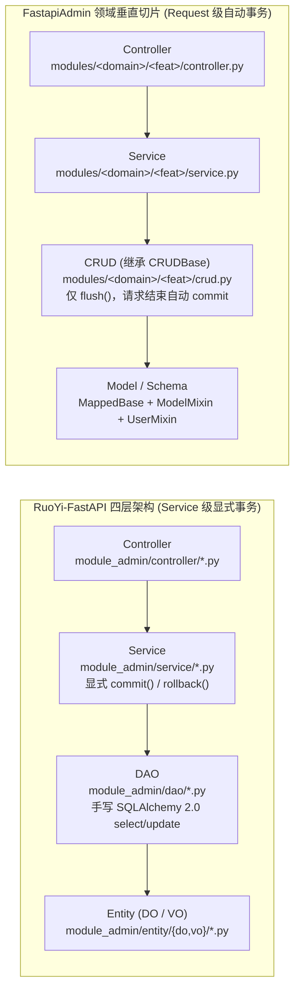
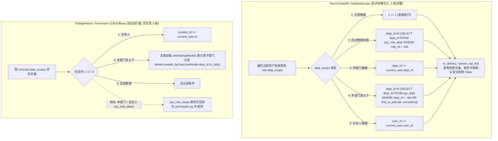
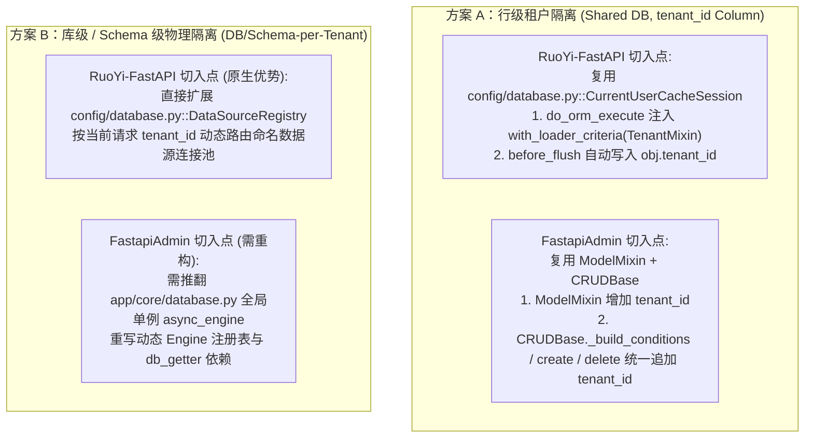
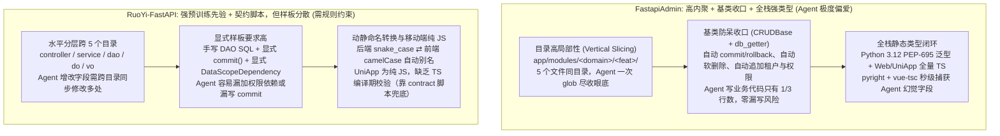

# RuoYi-FastAPI vs FastapiAdmin 源码级技术架构深度对比分析报告

> **适用项目**：工程监理取证系统（`wdgc-supervision-evidence`）技术基线选型
> **评估样本**：
> - `insistence/RuoYi-FastAPI`：`v2.0.0`（commit `7f7c66d`，2026-04-07）
> - `fastapiadmin/FastapiAdmin`：`v3.2.0`（commit `6828ba1`，2026-03-26）
> **评估维度**：工程基线与分层架构、RBAC 与数据权限引擎、多租户架构改造切入点与成本、UniApp 移动端（小程序优先 → App + H5）、FastAPI 异步架构与 AI/插件扩展能力。

---

## 1. 仓库与工程概览对比

| 维度 | `insistence/RuoYi-FastAPI` (v2.0.0) | `fastapiadmin/FastapiAdmin` (v3.2.0) |
| :--- | :--- | :--- |
| **开源协议** | MIT License | MIT License |
| **Python 版本要求** | Python `>=3.10` | Python `>=3.12`（全面采用 PEP-695 泛型语法 `class CRUDBase[ModelType: ...]`） |
| **包与环境管理** | `requirements.txt` / `requirements-pg.txt`（pip 标准管理） | `pyproject.toml` + `uv.lock`（现代 `uv` 工程管理） |
| **核心后端框架版本** | FastAPI `0.143.3`、Pydantic `2.14.1`、SQLAlchemy `2.0.55`、Alembic `1.20.0`、Redis `8.1.0`、APScheduler `3.11.3` | FastAPI `0.138.2`、Pydantic `>=2.12.5`、SQLAlchemy `2.0.51`、Alembic `1.18.4`、Redis `7.1.0`、APScheduler `3.11.0` |
| **数据库支持** | MySQL 8.x（`asyncmy`）+ PostgreSQL（`asyncpg`），提供完整双库 SQL 脚本（`sql/ruoyi-fastapi.sql`、`sql/ruoyi-fastapi-pg.sql`） | MySQL 8.x（`asyncmy`）+ PostgreSQL（`asyncpg`）+ SQLite（`aiosqlite`），启动期 `app/scripts/initialize.py` 自动执行 Alembic 迁移与 `backend/sql/*.json` 种子数据导入 |
| **核心系统表规模** | **54 张核心表**（含 RBAC 11 张、OIDC 统一认证中心 16 张、插件中心 4 张、企业级文件治理与防篡改对账 7 张、代码生成/监控/任务等） | **19 张核心表**（含 RBAC 9 张、AI 模块 2 张、任务与多云存储管理 4 张、代码生成 2 张、日志/参数/字典等） |
| **前端矩阵（Monorepo）** | `ruoyi-fastapi-frontend/` 下含 `vue3/{web,mobile}`、`vue2/{web,mobile}`、`react/{web,mobile}` 共 6 个子工程 | `frontend/` 下含 `web/`（Vue3 + TS + Element Plus + Tailwind4）、`app/`（`fastapp` UniApp + Vue3 + TS + Wot UI v2）、`docs/`（VitePress） |
| **CI/CD 与自动化测试** | `.github/workflows/ci.yml`（全栈契约校验 `fullstack_contract_check.py`、插件校验 `plugin_check.py`、移动端冒烟 `mobile_smoke.py`、pytest 单元测试） | `backend/tests/`（基于 `httpx.AsyncClient` 的路由集成测试骨架）、Prettier/ESLint 前端检查 |

---

## 2. 后端分层、事务边界与企业级基础设施深度对比

### 2.1 分层架构与事务边界

| 架构要素 | `RuoYi-FastAPI` | `FastapiAdmin` |
| :--- | :--- | :--- |
| **目录组织方式** | 按职责分层：`module_admin/{controller,service,dao,entity,annotation,aspect}` + `module_generator` + `module_task` + `module_identity` + `module_plugin` + `plugins/*` | 按业务领域垂直切片：`app/modules/{system,monitor,task,generator,ai,common}/<feature>/{controller,service,crud,model,schema}.py` |
| **ORM 基类设计** | 声明式 `Base(AsyncAttrs, DeclarativeBase)`（`config/database.py`），各 DO 表显式声明主键、审计字段与注释，无强制公共 Mixin | `app/core/base_model.py` 提供 `MappedBase`、`ModelMixin`（主键 `id`、软删除 `is_deleted`、`deleted_at`、`created_at`、`updated_at`、`description`）与 `UserMixin`（`created_id`、`updated_id` 及 `created_by`/`updated_by` 关联） |
| **通用 CRUD 抽象** | 无通用 `CRUDBase`，每个 DAO 显式编写 `select()` / `update()` / `delete()`，SQL 透明度高但样板代码较多 | `app/core/base_crud.py::CRUDBase[ModelType, CreateSchemaType, UpdateSchemaType]`（660 行），内置 `get`、`list`、`page`、`tree`、`create`、`update`、`delete`（支持软删除与物理删除切换）、`set`、`clear`、高级操作符过滤（`like`/`in`/`between` 等）及 `selectinload` 预加载 |
| **数据库事务边界** | **Service 方法级显式控制**：`config/get_db.py::get_db` 仅管理连接生命周期，写操作由 Service 显式 `await query_db.commit()` / `await query_db.rollback()`，适合一个接口内跨多步操作或局部异常回滚后继续记录审计日志 | **HTTP 请求级自动事务**：`app/core/dependencies.py::db_getter` 使用 `async with async_db_session() as session, session.begin(): yield session`，CRUD 层仅 `await self.db.flush()`，请求无异常退出时自动 `commit`，抛异常自动 `rollback` |
| **多数据源管理** | **原生内置 `DataSourceRegistry`**（`config/database.py`，38.5 KB）：支持多命名数据源注册、独立连接池配置、健康检查（`ping`）与 `DBSessionDependency(source_name)` 按需注入 | 单数据源单例：`app/core/database.py` 模块级全局 `async_engine` 与 `async_db_session`，无原生多数据源路由注册表 |
| **ORM 会话事件钩子** | **原生内置 `CurrentUserCacheSession(Session)`**（`config/database.py:72-358`）：挂载 `do_orm_execute`、`before_flush`、`after_commit`、`after_rollback` 钩子，精准追踪用户/角色/菜单/部门变更并在事务提交后自动失效对应用户的 Redis 权限缓存快照 | 未使用 SQLAlchemy Session 事件钩子；数据权限在 `CRUDBase._build_conditions()` 中显式调用 `Permission.filter_query()` |

### 2.2 高阶企业级基建差异（面向工程监理取证场景）

1. **`RuoYi-FastAPI` v2.0.0 独有高阶基建**：
   - **企业级文件全生命周期与防篡改对账子系统**（`module_admin/service/file_service.py`、`file_governance_service.py`、`entity/do/file_do.py`）：
     - `sys_file_info`：记录文件 SHA-256 哈希（`file_hash`）、存储引擎类型、生命周期状态（活跃/归档/隔离/删除）、法律保全锁定状态（`legal_hold`）。
     - `sys_file_reference`：业务实体与文件强引用绑定（防止取证照片/视频被误删，支持孤儿文件识别）。
     - `sys_file_retention_policy`：按业务分类配置保留期限与到期动作。
     - `sys_file_acl` & `sys_file_access_log`：文件级细粒度访问控制与下载/预览审计日志。
     - `sys_file_reconcile_run` & `sys_file_reconcile_issue`：**存储层防篡改对账引擎**，定期比对数据库记录与物理存储文件的存在性、字节大小及 SHA-256 哈希，发现篡改或丢失自动登记异常并支持移入隔离区（Quarantine）。**该特性与工程监理取证系统的“证据链防篡改、哈希固证、留痕审计”核心诉求高度吻合。**
   - **传输层请求/响应加解密与密钥轮换**（`middlewares/transport_crypto_middleware.py`、`utils/transport_crypto_util.py`）：支持对指定敏感路由强制启用混合加密（非对称密钥协商 + 对称载荷加解密）、请求重放保护（Nonce + Timestamp）及多版本密钥平滑轮换，且 Vue3 Web 与 UniApp Mobile 客户端均已内置自动加解密拦截器。
   - **OAuth 2.0 / OIDC 统一认证中心**（`module_identity/`，16 张表）：完整实现 Authorization Code + PKCE (`S256`)、JWKS 公钥发布、ID Token 签发、UserInfo 端点、多应用 SSO 授权同意书、动态客户端注册及 Back-channel / Front-channel 单点登出。
   - **热插拔插件运行时**（`module_plugin/` + `plugins/ai`）：基于 `plugin.yaml` 管理插件安装、依赖检测、SQL 迁移、前后端代码注入与启停控制。

2. **`FastapiAdmin` v3.2.0 独有高阶基建**：
   - **多云存储源动态管理与文件传输工作流**（`app/modules/task/storage/`、`app/core/storage.py`）：支持在后台界面动态配置本地存储、MinIO/S3、阿里云 OSS、腾讯云 COS、华为云 OBS、SFTP 存储源，并提供在线文件浏览、跨存储源复制/移动任务调度。
   - **跨 Worker Redis Pub/Sub 的 SSE 实时推送管理器**（`app/core/sse_manager.py`）：利用 Redis Pub/Sub 将后端任务进度、系统通知实时广播至任意 Uvicorn Worker 挂载的客户端 SSE 连接。

---

## 3. RBAC 与数据权限引擎源码级对比（关键差异点）

### 3.1 菜单/按钮/接口权限机制对比

| 维度 | `RuoYi-FastAPI` | `FastapiAdmin` |
| :--- | :--- | :--- |
| **权限模型表结构** | `sys_user`、`sys_role`、`sys_menu`、`sys_dept`、`sys_post` 及关联表 `sys_user_role`、`sys_role_menu`、`sys_role_dept`、`sys_user_post` | `sys_user`、`sys_role`、`sys_menu`、`sys_dept`、`sys_position` 及关联表 `sys_user_roles`、`sys_role_menus`、`sys_role_depts`、`sys_user_positions` |
| **菜单多端隔离** | `sys_menu` 统一管理目录（`M`）、菜单（`C`）、按钮（`F`） | `sys_menu.scope` 字段原生支持 `'web'`（管理端）与 `'app'`（移动端）双端菜单树独立下发 |
| **接口鉴权依赖项** | `common/aspect/interface_auth.py::CheckUserInterfaceAuth(perm, is_strict)`：支持单字符串或列表，`is_strict=True` 时要求同时具备全部权限（`AND`），`False` 为任一匹配（`OR`）；另有 `CheckRoleInterfaceAuth` | `app/core/dependencies.py::AuthPermission(permissions, check_data_scope)`：列表默认任一匹配（`OR`），通过 `RequestContext` 将 `CurrentUser` 与 `Permission` 实例挂载到请求上下文 |
| **权限缓存与即时失效** | 登录/首次访问构建 `CurrentUserModel` 写入 Redis；**当修改用户、角色、菜单、部门时，`CurrentUserCacheSession` 在事务提交后自动精准删除受影响用户的 Redis 缓存**，下一个请求立即生效最新权限与账号启停状态 | 登录时将用户角色、权限码列表写入 Redis 会话 `session_info`（TTL 7 天）；修改角色或停用账号时若未显式清理对应 `session_id`，存量会话在 TTL 内仍读取旧快照 |

### 3.2 数据权限（Data Scope）完整性与安全性源码剖析

#### （1）`RuoYi-FastAPI` 数据权限实现（`common/aspect/data_scope.py::GetDataScope`）
- **5 级数据权限全部落地**：
  - `DATA_SCOPE_ALL = '1'`：全部数据权限。
  - `DATA_SCOPE_CUSTOM = '2'`：自定数据权限（通过 `sys_role_dept` 子查询过滤指定部门集合，天然支持“总监理工程师分管多个非连续标段/项目部”的场景）。
  - `DATA_SCOPE_DEPT = '3'`：本部门数据权限。
  - `DATA_SCOPE_DEPT_AND_CHILD = '4'`：本部门及以下数据权限（基于 `sys_dept.ancestors` 物化路径 + `find_in_set`，PostgreSQL 脚本 `sql/ruoyi-fastapi-pg.sql:2397` 已内置 `find_in_set(int8, varchar)` PL/pgSQL 兼容函数）。
  - `DATA_SCOPE_SELF = '5'`：仅本人数据权限。
- **多角色组合逻辑严谨**：按角色逐一生成 SQLAlchemy 表达式列表 `param_sql_list`，最终通过 `or_(false(), *param_sql_list)` 求并集；若业务表缺少目标字段且角色要求对应范围，则安全退化为 `False`（拒绝访问）。
- **注意事项**：需在需要数据权限的 Controller 路由参数中显式声明 `data_scope_sql: ColumnElement = DataScopeDependency(query_ alias=..., user_alias=..., dept_alias=...)` 并传入 DAO。

#### （2）`FastapiAdmin` 数据权限实现（`app/core/permission.py::Permission`）及 4 处源码级缺陷
- **优点**：在 `CRUDBase._build_conditions()`（`app/core/base_crud.py:130`）中默认对所有读查询（`get`、`list`、`page`、`tree`）自动调用 `Permission.filter_query()`，避免开发人员在查询接口漏写数据权限。
- **源码级缺陷与安全隐患（需在选型或改造时重点修复）**：
  1. **自定义跨部门数据权限（`sys_role_depts`）与仅本部门权限未实现**：
     - 尽管 `app/modules/system/role/model.py` 定义了 `sys_role_depts` 关联表，且 `app/core/base_model.py:72` 注释写有 `1:仅本人 2:本部门 3:本部门及以下 4:全部 5:自定义`，但 `RoleModel.data_scope`（`role/model.py:42`）与 `app/core/permission.py:86-135` 实际只实现了 `1`（仅本人）、`2`（本部门及以下）、`3`（全部数据）三级，`sys_role_depts` 在 `permission.py` 中完全未被查询。
     - 多角色合并采用 `min(role.data_scope for role in user.roles)`（数值越小权限越窄的倒置逻辑或单值覆盖），无法表达“角色 A 看本部门 + 角色 B 看自定义标段集合”的并集语义。
  2. **写路径（修改/删除）绕过数据权限校验**：
     - `app/core/base_crud.py` 中的 `delete()`（第 424 行）、`set()`（第 472 行）、`clear()`（第 504 行）直接构造 `WHERE pk IN (...)` 执行更新或删除，**未调用 `self._build_conditions()`，从而绕过了 `Permission` 过滤与软删除过滤**；`update()` 虽先调用 `self.get(id=id)` 触发读权限校验，但批量写操作存在越权风险。
  3. **按创建人当前部门动态 JOIN 导致历史数据漂移与全表扫描开销**：
     - 对于非 `UserModel`/`DeptModel` 的业务表，`permission.py:114-121` 通过 `Model.created_by.has(UserModel.dept_id.in_(dept_ids))` 过滤，而非基于业务记录自身的 `dept_id`（或 `project_id`）快照。一旦监理员跨项目部调动，其历史录入的所有取证记录会自动转移至新部门可见范围。
     - 每次计算子部门时，`permission.py:152` 执行 `await self.db.execute(select(DeptModel))` 将全量部门表加载到 Python 内存递归，未利用物化路径或 CTE。
  4. **会话状态吊销滞后**：
     - `app/core/dependencies.py:168-225` 在校验 Token 时从 Redis 会话读取 `user_status`，回查数据库时仅过滤 `UserModel.is_deleted == False` 而未过滤 `UserModel.status == 0`，管理员停用账号后存量 Token 在 Redis 会话有效期内仍可访问。

---

## 4. 多租户（Multi-Tenancy）支持现状与改造架构评估

### 4.1 现状结论
两个项目的当前开源主分支 **均未内置开箱即用的多租户（Tenant）模块**（`FastapiAdmin` 虽在 V2 时期通过 PR `#226`/`#347` 尝试过插件化多租户，但在 V3 架构重构 PR `#348` 中已彻底移除）。对于工程监理取证系统（多监理公司 SaaS 入驻，或集团下属独立法人监理企业隔离），均需在此基线上实施多租户改造。

### 4.2 改造切入点与成本对比

| 改造维度 | `RuoYi-FastAPI` | `FastapiAdmin` |
| :--- | :--- | :--- |
| **行级隔离（`tenant_id`）读查询拦截** | **无需逐一修改 15 个 DAO**：直接扩展 `config/database.py::CurrentUserCacheSession` 已有的 `@event.listens_for(CurrentUserCacheSession, 'do_orm_execute')` 钩子，注入 SQLAlchemy 2.0 原生 `with_loader_criteria(TenantMixin, lambda cls: cls.tenant_id == get_current_tenant_id(), include_aliases=True)`，全局自动拦截所有 `SELECT`（含 JOIN 与子查询） | 在 `app/core/base_model.py::ModelMixin` 增加 `tenant_id` 字段，并在 `app/core/base_crud.py::CRUDBase._build_conditions()` 中统一追加 `tenant_id == current_tenant_id`；对绕过 `CRUDBase` 的少量直接 `db.execute` 补充 `do_orm_execute` 钩子兜底 |
| **行级隔离写操作拦截** | 在 `CurrentUserCacheSession` 已有的 `before_flush` 钩子中对新增 `TenantMixin` 实例自动赋值 `tenant_id`，对更新/删除实例校验 `tenant_id` 归属 | 在 `CRUDBase.create()` 自动注入 `tenant_id`，并修复 `delete()` / `set()` / `clear()` 使其必须携带 `tenant_id` WHERE 条件 |
| **库级/Schema 级隔离（VIP 政企专有租户）** | **具备压倒性优势**：`config/database.py::DataSourceRegistry` 已完整实现多数据源连接池管理、健康检查与按名获取 Session，仅需将 `source_name` 绑定至当前请求租户上下文即可支持“普通租户共享库 + 大型监理集团独立库”混合部署 | 改造成本高：`app/core/database.py` 为模块级单引擎单例，需重构底层数据库引擎管理、Alembic 迁移脚本与任务调度器连接获取方式 |
| **唯一约束与缓存隔离** | 需将 `sys_user.user_name`、`sys_role.role_key`、`sys_config.config_key` 等单列唯一索引改为 `(tenant_id, col)` 联合唯一；Redis Key 增加 `tenant:{id}:` 命名空间前缀 | 同样需将 `sys_user.username`、`sys_role.code`、`sys_dept.code` 等单列唯一索引改为 `(tenant_id, col)` 联合唯一，并隔离 Redis Key 前缀 |
| **预估改造工作量（行级多租户 + 租户套餐管理）** | **约 3 ~ 4 人周**（含租户表/租户套餐表、Session 钩子、联合唯一索引迁移、Redis 命名空间、代码生成模板适配） | **约 2 ~ 3 人周**（行级隔离改动集中于 `ModelMixin` 与 `CRUDBase`，但需额外投入约 1 人周修复其原有的 Data Scope 与写路径权限漏洞） |

---

## 5. UniApp 移动端（小程序优先 → App + H5）成熟度对比

工程监理取证系统的核心作业场景在施工现场（监理旁站拍照、隐蔽工程验收录像、定位打卡、问题整改工单流转、AI 规范问答），移动端定位于 **微信小程序优先，后续同一套代码编译发布 App 与 H5**。

| 维度 | `RuoYi-FastAPI` (`ruoyi-fastapi-frontend/vue3/mobile`) | `FastapiAdmin` (`frontend/app` / `fastapp` v3.1.0) |
| :--- | :--- | :--- |
| **核心框架版本** | `@dcloudio/uni-app` `3.0.0-5020620260917001` + Vue `3.4.21` + Vite `5.4.21` + Pinia `2.2.4` | `@dcloudio/uni-app` `3.0.0-4080520251106001` + Vue `3.4.38` + Vite `5.2.8` + Pinia `2.2.2` |
| **开发语言与工程化** | JavaScript 为主（经典 RuoYi-App 结构），配置简洁直观 | **全量 TypeScript `5.5.4`** + `@uni-helper/vite-plugin-uni-{pages,layouts,manifest,components}` 自动化工程链 |
| **UI 组件库与样式引擎** | `uni-ui` (`@dcloudio/uni-ui`) + **TailwindCSS `4.3.3`** + **`weapp-tailwindcss` `5.6.3`**（专门解决微信小程序 WXSS 不支持复杂 CSS 选择器的转译难题） | **Wot Design Uni v2 (`@wot-ui/ui ^2.2.0`)**（当前 UniApp Vue3 生态最活跃的高颜值组件库）+ **UnoCSS `66.0.0`** |
| **微信小程序 CLI 工具链** | **内置 `weapp-ide-cli`**（`package.json` 提供 `dev:mp-weixin:ide`、`upload:mp-weixin` 脚本，支持命令行直接唤起微信开发者工具与上传小程序代码包）+ `.github/scripts/mobile_smoke.py` 自动化冒烟测试 | 标准 `uni -p mp-weixin` / `uni build -p mp-weixin` 编译脚本；`manifest.config.ts` 已预设 `mp-weixin`（`lazyCodeLoading: 'requiredComponents'`）、`app-plus` 与 `h5` 多端配置 |
| **网络层与安全/Token 机制** | `src/utils/request.js` 基于 `uni.request` 封装，**原生支持与后端对齐的传输层请求加密与响应解密重试（`encryptTransportRequest` / `decryptTransportResponse`）** 及 `X-Timezone` 时区头 | `src/http/adapters/alova.ts` 基于 **Alova `^3.5.1` + `@alova/adapter-uniapp`** 封装，**完整实现并发 401 单飞 Token 刷新队列（`isRefreshing` + `pendingRequests` 挂起与重放）** |
| **微信小程序原生登录支持** | **后端未内置微信 `jscode2session` 接口**：移动端仅提供账号密码/验证码登录，需自行在后端补充微信 `code` 换取 `openid`/`unionid` 与手机号快捷登录接口（约 100~150 行代码） | **前后端均已原生内置微信小程序登录**：前端 `src/api/auth.ts` 封装 `wxLogin`/`wxPhoneLogin`，后端 `app/modules/system/auth/controller.py` 与 `wx_mini_service.py` 原生提供 `POST /auth/wx-login` 与 `POST /auth/wx-phone-login` |
| **现成移动端业务页面** | 登录、注册、首页、工作台、个人中心、头像裁剪、个人资料修改、密码修改、时区设置、常见问题（共 12 个基础页面） | 登录、工作台、个人中心、**AI 智能助手对话页（`subPages/module_ai/chat/index`）**、AI 会话列表、AI 模型管理、通知公告、工单管理列表与详情页、请求/反馈演示页（共 16 个页面，採用主包 + `subPages` 分包架构） |

---

## 6. FastAPI 后端与 AI 能力集成对比

两个项目在 AI 框架选型上不谋而合，均采用新一代高性能轻量级多模态 Agent 框架 **Agno**（原 Phidata），并将 AI 会话历史与状态直接持久化在业务数据库中（无需額外维护独立的向量/会话中间件即可起步）。但在工程形态、模型生态与流式协议上差异明显：

| 维度 | `RuoYi-FastAPI` (`plugins/ai/`) | `FastapiAdmin` (`backend/app/modules/ai/`) |
| :--- | :--- | :--- |
| **Agno 版本与交付形态** | `agno==2.8.6`；作为 **标准可插拔插件（`plugins/ai/plugin.yaml`）** 交付，独立声明前后端依赖与 MySQL/PG SQL 脚本，按需启停 | `agno==2.5.8`；作为 **内置核心模块（`app/modules/ai/`）** 交付，开箱即用 |
| **大模型提供商支持广度** | `plugins/ai/utils/ai_util.py` 内置 **32 种主流大模型提供商注册表**（OpenAI、Anthropic Claude、DeepSeek、阿里云 DashScope/通义千问、Google Gemini、智谱 GLM、Moonshot Kimi、MiniMax、Ollama、vLLM、SiliconFlow、LiteLLM、Azure、AWS Bedrock 等），且内置 **SSRF 内网地址安全阻断校验**（防止通过自定义 `base_url` 探测服务器内网） | `app/utils/ai_factory.py::AgnoFactory` 统一通过 `agno.models.openai.like.OpenAILike` 接入兼容 OpenAI 协议的模型端点 |
| **多模态（图片/视觉）能力** | **原生支持视觉多模态输入**：`ai_chat_service.py` 支持上传图片并封装为 `agno.media.Image(filepath=...)` 传入 Agent，非常适合 **工程监理现场隐患照片识别、施工质量视觉分析、铭牌/票据 OCR 提取** | 仅支持纯文本对话输入（`ws_chat` 仅接收文本 `message`） |
| **深度思考（Reasoning）与指标** | **原生支持**：流式输出独立推送 `reasoning`（深度思考过程，如 DeepSeek-R1 / QwQ 思考链）、`content`（正文）、`metrics`（Token 消耗与耗时统计）及主动中断运行（`acancel_run`） | 仅推送文本 `delta` 与页面动作指令 |
| **Agent 工具调用（Function Calling）** | 基础对话与知识问答就绪，业务 Tool 需按监理领域自行挂载到 Agno `Agent(tools=[...])` | **已内置 Agent Team 协同与 5 个闭包鉴权业务 Tool**（`app/modules/ai/tools/registry.py`）：在工具闭包内绑定当前请求 `db` 与 `CurrentUser`，安全查询服务器监控、存储源、文件列表、定时任务、Redis 缓存，并支持自然语言驱动前端路由跳转（`_extract_action`） |
| **流式通信协议（小程序适配性）** | **标准 HTTP SSE（`StreamingResponse` / `text/event-stream` NDJSON）**：天然兼容多 Worker 负载均衡，且在微信小程序中可通过 `uni.request({ enableChunked: true })` 直接消费分块流 | **WebSocket（`WS /api/v1/ai/chat/ws`）**：虽项目内有 Redis Pub/Sub `SSEConnectionManager`，但 AI 聊天未复用它而单独走了 WebSocket；在多 Worker 生产部署及微信小程序长连接保活下需额外处理网关 Sticky Session 与重连状态恢复 |

---

## 7. Agent Vibe Coding（AI 智能体主导开发）友好度深度对比

本项目明确以 **Agent Vibe Coding** 作为主要开发方式。AI Coding Agent 与人类工程师的认知瓶颈截然不同：Agent 不怕编写复杂的单点算法，但极易受困于 **跨目录文件遗漏、上下文窗口（Context Window）膨胀、隐式字段命名转换幻觉、漏写显式样板代码（如事务 `commit` 或权限依赖）、以及缺乏编译期静态类型自检反馈**。

从 Agent 视角对两个代码库进行源码级评估，结果如下：

### 7.1 六大 Agent 开发体验维度对比

| Agent 评估维度 | `RuoYi-FastAPI` (v2.0.0) | `FastapiAdmin` (v3.2.0) | Agent 友好度胜出方与原因剖析 |
| :--- | :--- | :--- | :--- |
| **1. 上下文局部性（Locality of Behavior）** | 水平分层（`module_admin/{controller,service,dao,entity/do,entity/vo}`），新增一个业务实体需跨 5~6 个目录创建/修改文件；不过 `plugins/` 支持独立目录闭环 | **按业务领域垂直切片**（`app/modules/<domain>/<feature>/{model,schema,crud,service,controller}.py`），同一业务特性的所有后端代码位于同一文件夹下 | **`FastapiAdmin` 大幅胜出**：Agent 只需聚焦单个目录即可掌握某业务模块的全貌，上下文读取精准、Token 消耗低、极少漏改文件 |
| **2. 样板代码密度与防呆机制（Guardrails）** | 无通用 `CRUDBase`，每个 DAO 需手写 `select`/`update` 与分页；事务需在 Service 显式 `await query_db.commit()`；数据权限需在路由显式注入 `DataScopeDependency` | `ModelMixin` + `CRUDBase` 自动封装增删改查、分页、树形、软删除；`db_getter` 请求级自动开启/提交事务；数据权限与未来 `tenant_id` 在 `CRUDBase` 底层统一拦截 | **`FastapiAdmin` 大幅胜出**：业务模块代码量减少约 50%，且把“事务提交、软删除、租户/权限过滤”收口在基类，**彻底消除 Agent 写新业务接口时漏写 `commit()` 或漏加权限过滤的高频事故** |
| **3. 全栈静态类型自检闭环（Self-Verification）** | 后端 Pydantic V2 强类型；但 **UniApp 移动端（`vue3/mobile`）为纯 JavaScript**，无 TS 类型定义 | 后端采用 **Python 3.12 PEP-695 原生泛型**（`CRUDBase[Model, CreateSchema, UpdateSchema]`）+ SQLAlchemy `Mapped`；**Web 端与 UniApp 移动端（`fastapp`）均为 100% TypeScript** | **`FastapiAdmin` 大幅胜出**：Vibe Coding 的核心是“Agent 写代码 → 跑类型检查 → 自动修错”。全栈 TS + PEP-695 让 `pyright` 与 `vue-tsc` 成为 Agent 的零成本实时护栏 |
| **4. 前后端字段命名一致性（防幻觉）** | 后端 Python 与数据库用 `snake_case`（如 `dept_id`），通过 Pydantic `alias_generator=to_camel` 自动转为前端 `camelCase`（`deptId`） | 数据库、后端 Model/Schema、前端 TS 接口 **全链路统一使用 `snake_case`**（如前后端均为 `dept_id`、`created_at`） | **`FastapiAdmin` 胜出**：全栈字段名 1:1 严格同名，Agent 跨前后端搜索（`grep`）和生成代码时零心智转换負擔，不会出现把 `user_name` 误传为 `userName` 或反之的幻觉 |
| **5. 大模型预训练语料先验（Pre-training Prior）** | **极强**：经典 RuoYi 命名体系（`sys_user`/`sys_role`/`sys_menu`/`del_flag`/`v-hasPermi`），所有主流大模型在预训练阶段均见过海量同类代码 | 中高：标准现代 FastAPI + SQLAlchemy 2.0 + Element Plus + Wot Design Uni 结构，结构清晰清晰易读，但非传统若依表字段命名 | **`RuoYi-FastAPI` 胜出**：Agent 对若依表结构、字典约定和前端 `v-hasPermi` 指令具有天然“肌肉记忆” |
| **6. 沙箱自启动与自动化契约校验** | 内置极佳的 **`.github/scripts/fullstack_contract_check.py`**（AST 静态校验前后端路由与参数契约）及 `mobile_smoke.py`；但运行后端强依赖外部 MySQL/PG 与 Redis | 原生支持 **SQLite (`aiosqlite`) + 启动期自动 Alembic 迁移 + `sql/*.json` 种子数据导入**（`initialize.py`）；Agent 新增菜单/角色只需改 JSON 种子并在沙箱内直接跑 `pytest` | **各有千秋**：`RuoYi-FastAPI` 的 AST 契约检查脚本非常适合作为 Agent Pre-commit 钩子；`FastapiAdmin` 的 SQLite + JSON 种子自动初始化更方便 Agent 独立跑通端到端测试 |

### 7.2 Agent Vibe Coding 视角下的关键洞察

引入 **Agent Vibe Coding** 维度后，选型逻辑发生了一个非常关键的化学反应：

1. **为什么人类评估时担心的 `FastapiAdmin` 底层缺陷，在 Agent 模式下反而容易解决？**
   - 前文指出 `FastapiAdmin` 的短板高度集中在 **4 个底层核心文件**（`app/core/permission.py` 缺自定义部门权限、`app/core/base_crud.py` 写方法缺权限过滤、缺少 `sys_file_info` 哈希对账表、AI 仅用 WebSocket）。
   - 在 Vibe Coding 模式下，**“修改 4 个高内聚底座文件（一次性任务）”的成本极低，而“在后续 50 个业务模块中防止 Agent 犯错（持续性任务）”的收益极高**。
   - 一旦在项目立项第 1 阶段由 Agent 定向修复加固 `FastapiAdmin` 的 `base_crud.py` 与 `permission.py`（并注入 `tenant_id` 多租户拦截），此后 Agent 开发所有监理取证业务模块时，都能在 **`app/modules/<domain>/<feature>/` 垂直切片 + 全栈 `snake_case` + 全栈 TS + `CRUDBase` 自动事务/权限/多租户** 的轨道上高速 Vibe Coding，代码生成体积减少一半，出错率大幅下降。
2. **如果选 `RuoYi-FastAPI` 进行 Agent Vibe Coding，需要做什么改造？**
   - 必须为 Agent 编写严格的 `CLAUDE.md` / `.cursorrules` 规范，强制提醒 Agent：每个写操作 Service 必须 `await query_db.commit()`、注意 VO 的 `to_camel` 转换、列表查询必须挂载 `DataScopeDependency`；同时建议封装一个通用 `BaseDao` 并为 `vue3/mobile` 引入 TypeScript 支持。

---

## 8. 面向 `wdgc-supervision-evidence`（工程监理取证系统）的选型决策矩阵与建议

### 8.1 核心能力综合评分对比表（含 Agent Vibe Coding 权重）

| 评估维度 | 权重 | `RuoYi-FastAPI` (v2.0.0) | `FastapiAdmin` (v3.2.0) | 胜出方与关键依据 |
| :--- | :---: | :---: | :---: | :--- |
| **证据链治理、文件防篡改与安全合规** | 20% | **9.5** | 6.5 | **`RuoYi-FastAPI`**：原生内置文件 SHA-256 哈希、法律保全锁定（`legal_hold`）、业务引用计数、防篡改对账（`sys_file_reconcile_*`）及传输层加解密 |
| **Agent Vibe Coding 友好度（关键新增）** | **20%** | 7.4 | **9.2** | **`FastapiAdmin`**：垂直切片目录（高局部性）、`CRUDBase` + 自动事务（少写 50% 样板代码且防漏写）、全栈 `snake_case` 零命名转换幻觉、Web + UniApp 全量 TypeScript 编译自检 |
| **RBAC 与数据权限（Data Scope）完备度** | 15% | **9.0** | 6.0 | **`RuoYi-FastAPI`**：完整实现 5 级数据权限（含 `sys_role_dept` 自定义跨部门/标段权限）与 `CurrentUserCacheSession` 即时失效；`FastapiAdmin` 需修补 `permission.py` 与 `CRUDBase` 写路径 |
| **多租户架构改造潜力（行级 + 库级）** | 15% | **9.0** | 8.0 | **行级隔离** `FastapiAdmin` 改 `ModelMixin`+`CRUDBase` 极快（对 Agent 透明）；**库级物理隔离** `RuoYi-FastAPI` 凭 `DataSourceRegistry` 具备压倒性优势 |
| **UniApp 移动端（小程序 + App + H5）体验** | 15% | 7.0 | **9.0** | **`FastapiAdmin`**：`fastapp` 采用全量 TS + Wot Design Uni v2 + Alova（并发 401 刷新队列）+ 分包架构，且前后端已原生打通微信小程序登录与移动端 AI 对话页 |
| **FastAPI 工程现代感与 AI 监理场景适配** | 15% | **8.5** | 8.3 | **`RuoYi-FastAPI`** 胜在 Agno 2.8.6 视觉多模态图片输入（隐患识图）与 HTTP SSE；**`FastapiAdmin`** 胜在 Python 3.12 + `uv` + 多云存储（OSS/COS/S3）+ 闭包鉴权 AI Tool 注册模式 |
| **加权总分** | **100%** | **8.40** | **7.91** | **开箱即用合规度 `RuoYi-FastAPI` 领先（8.40）；但若做 1 周底座加固，在 Agent Vibe Coding 长期研发效率上 `FastapiAdmin` 反超（加固后可达 8.85+）** |

### 8.2 两条高可行性的架构融合路线（供结合业务需求拍板）

基于 **“工程监理取证业务特性” + “Agent Vibe Coding 开发模式”** 双重约束，我们提炼出两条极具实操性的融合路线：

#### 路线 A（Vibe Coding 效率优先）：以 `FastapiAdmin v3.2.0` 为主基线 + 移植 `RuoYi-FastAPI` 合规与多模态组件
- **适用场景**：多租户以 **SaaS 行级隔离（`tenant_id`）** 为主；团队高度依赖 **Agent Vibe Coding 快速迭代 Web + 微信小程序/App 双端业务**；希望利用全栈 TypeScript + 垂直切片目录 + `CRUDBase` 让 Agent 以最少的代码量、最低的出错率交付业务模块。
- **立项第 1 周由 Agent 执行“底座加固工程”（一次性收敛，后续业务永久受益）**：
  1. **加固 `app/core/base_crud.py` 与 `app/core/permission.py`**：补齐 5 级数据权限（接入 `sys_role_depts` 自定义标段/部门权限，多角色改为 `or_()` 并集），在 `ModelMixin` 中固化 `tenant_id` 与 `dept_id`，并修复 `delete()` / `set()` / `clear()` 使其强制经过 `_build_conditions()` 权限与租户校验。
  2. **移植 `RuoYi-FastAPI` 的文件证据链模型与 AST 契约检查器**：将 `RuoYi-FastAPI` 的 `sys_file_info`（SHA-256 哈希、引用绑定、防篡改对账）移植为 `app/modules/common/evidence_file/` 模块，并引入 `.github/scripts/fullstack_contract_check.py` 作为 Agent 自检脚本。
  3. **升级 AI 模块支持 SSE 与多模态识图**：借鉴 `RuoYi-FastAPI` 的 `plugins/ai`，为 `FastapiAdmin` 的 `app/modules/ai/` 增加 HTTP SSE 流式端点与 `agno.media.Image` 现场照片多模态识别能力。

#### 路线 B（政企重度合规与多库隔离优先）：以 `RuoYi-FastAPI v2.0.0` 为主基线 + 注入 Agent 工程护栏与 `fastapp` 移动端
- **适用场景**：存在大型政企/国企客户要求 **独立数据库/Schema 物理隔离**（必须依赖 `DataSourceRegistry`）、要求启用 **传输层报文加解密（`transport_crypto`）** 或 **OIDC 统一认证中心（`module_identity`）**。
- **立项第 1 周由 Agent 执行“Vibe Coding 提效工程”**：
  1. **建立 Agent 专属基类与目录约定**：新增监理业务统一采用独立模块按领域子目录组织，封装通用 `BaseDao`（收口分页与软删除）和 Session 级自动租户/数据权限注入，减少 Agent 手写样板代码。
  2. **融合 `FastapiAdmin` 的移动端与微信登录**：移动端直接采用或对齐 `FastapiAdmin` 的 `frontend/app`（全量 TS + Wot Design Uni v2 + Alova），并将 `wx_mini_service.py` 微信小程序登录与闭包鉴权 AI Tool 模式移植入 `RuoYi-FastAPI`。
  3. **固化 `CLAUDE.md` 与契约自检流水线**：将 `.github/scripts/fullstack_contract_check.py` 配置为 Agent 每次修改路由后的必跑校验命令，消除 `snake_case` ⇄ `camelCase` 转换带来的字段不一致问题。

---

## 9. 最终架构拍板决议（2026-11-12 已定稿）

经结合业务需求与多租户边界深入研讨，正式敲定以下最终基线架构方案（详见 `docs/03-architecture/system-architecture-design.md` 与 `docs/02-prd/PRD_v2.0_架构对齐版.md`）：

1. **主骨架选型**：正式选定 **`FastapiAdmin (v3.2.0)` 为主工程骨架基线**，并在底座搭建阶段吸收融合 **`RuoYi-FastAPI (v2.0.0)` 的文件证据防篡改对账子系统、接口防重放签名、Agno 多模态视觉 SSE 引擎与全栈 AST 契约检查脚本**，同时完成 `FastapiAdmin` 原有 `base_crud.py` / `dependencies.py` / `permission.py` 的加固。
2. **多租户与分库分表策略**：采用 **方案 A（共享 MySQL 8.0 数据库 + `tenant_id` 行级逻辑隔离 + 阿里云 OSS 顶层企业编码路径隔离）**，由 `TenantCRUDBase` 底层统一强制拦截；预留后续随数据量增长按 `tenant_id` 分表/分区演进能力。
3. **“一后端三前端”物理分离架构**：
   - **平台管理端 (`frontend/platform-web`)**：直接延用 `FastapiAdmin` 自带前端（Vue3 + TS + Element Plus），服务平台管理员与超级管理员（支持 SaaS 标准 **Impersonation 跨租户穿透令牌 + 只读审计**）；
   - **租户监理工作台 (`frontend/tenant-web`)**：直接采用产品团队 **Figma Make 产出的 React + TS + Tailwind + shadcn/ui 工程**，100% 保护已有原型资产；
   - **现场移动取证端 (`frontend/mp-app`)**：采用 `FastapiAdmin` 自带 `fastapp`（UniApp + Vue3 + 全量 TS + Wot Design Uni v2 + Alova）。
4. **租户内角色模型**：采用 **“企业级角色（企业管理员）+ 项目级成员角色（项目总监 / 专监+所辖多类危大 `01~12` / 现场监理员）”** 两级解耦授权模型。
