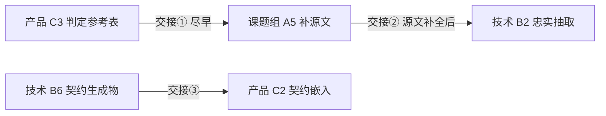

# 分发与协调备忘（项目负责人专用 · 2026-11-20）

> 本页只给您（项目负责人）看，用于分发与统筹。非技术视角，照着做即可。

## 一、哪份文件给谁

| 文件 | 给谁 | 用途 |
| :--- | :--- | :--- |
| `work-orders-2026-11-19.md`（**总表**） | **您自己**＋技术负责人 | 统筹底稿：全任务＋依赖＋状态跟踪。课题组/产品**不发** |
| `notices-2026-11-19/notice-课题组-2026-11-19.md` | 课题组 | 执行件（自包含，无需仓库） |
| `notices-2026-11-19/notice-技术团队-2026-11-19.md` | 技术团队/技术负责人 | 执行件（仓库内，走 git） |
| `notices-2026-11-19/notice-产品团队-2026-11-19.md` | 产品团队 | 执行件（自包含，无需仓库） |
| `01-review-reports/third-party-review-2026-11-19-50-ambiguity-and-v2.5.md`（评审报告） | 备查 | 技术团队可查；课题组/产品如需由您转发 |

## 二、启动顺序（F1 已批准，四方同时启动）

| 谁 | 立即做什么 | 备注 |
| :--- | :--- | :--- |
| 课题组 | A1~A5：修 4 处源文缺陷＋**补齐 347 风险等级** | **关键路径上游，优先催** |
| 技术团队 | B1 修脚本＋B6 契约生成器 | 不等课题组 |
| 产品团队 | C1 业务血肉修订＋**C3 判定参考表（尽快）** | C3 要早交课题组作 A5 参考 |
| 技术负责人 | D1 FastapiAdmin ADR 裁决 | 不阻塞别人 |

## 三、您只需中转的三个交接点

1. **交接①**：产品 C3 判定参考表 → 您 → 课题组（补源文的参考）。**越早越好**，课题组 A5 等着它。
2. **交接②**：课题组补全的源文（覆盖 347）→ 您 → 技术（B2 抽取的前置）。**没它技术不能重生成**。
3. **交接③**：技术 B6 契约生成物 → 您 → 产品（C2 嵌入的前置）。**没它产品契约部分不能定稿**。

## 四、您只需拍/盯的事

**两个业务决策（您会同产品/技术定）：**
- **扩展节点（A-01-E01）一期做不做？** 做→要留系统内确认机制；不做→review_status 简化为溯源标记即可。
- **Occurrence 重建模（双实体＋版本快照）一期做不做？** 核心（按实例算＋时间剔除）必须；重建模可缓。

**三个风险盯一下：**
- 课题组源文补全进度（关键路径上游，卡住全链）。
- 产品**别手改契约**，等技术 B6 生成物（这次回归就是手改造成的）。
- 技术重生成**必须用课题组补全后的源文**，否则错抄/空白被继承。

**不用您管的：** 字段/脚本/编码等技术细节（技术团队）；具体节点★/△判定（课题组权威）。

## 五、什么时候算闭环（完成标志）

- [ ] 347 节点全部 CONFIRMED 入库＋CI 通过＋原 292 错配清零。
- [ ] v2.5 五个 blocker 清零＋契约由生成器产出（零手改）。
- [ ] 第三方 E 复审通过。
- → 三项齐了，**才谈冻结 v2.5 为 SSOT 与两团队成果合仓**。在此之前 v2.5 不冻结、原型继续做。

## 六、状态跟踪

直接在总表 `work-orders-2026-11-19.md` 第九节的状态表里填（待启动/进行中/完成）。您只需在三个交接点发生时更新对应行。