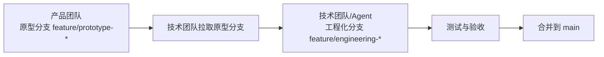

# 产品团队与技术团队前端协作开发指南（双分支分工版）

> **适用对象**：产品负责人团队、技术负责人团队、评审专家  
> **核心原则**：**产品团队只做原型，技术团队负责工程化；两条分支分工，最后由技术团队合并。**  
> **目的**：避免产品团队被 Git、数据库、后端环境、分支冲突等问题困扰。

---

## 一、协作总原则



### 一句话理解
- **产品团队**：只在原型分支上做页面、样式、交互，使用本地 Mock 数据；
- **技术团队**：从原型分支拉取代码，在工程化分支上接真实接口、权限、数据库，测试后合并到 main。

---

## 二、分支分工

| 分支类型 | 使用团队 | 主要工作 | 是否需要数据库/后端 |
| :--- | :--- | :--- | :--- |
| **原型分支** `feature/prototype-tenant-web` / `feature/prototype-mp-app` | 产品团队 | Figma Make / Agent 原型开发、页面样式、交互、Mock 数据 | **不需要** |
| **工程化分支** `feature/engineering-tenant-web` / `feature/engineering-mp-app` | 技术团队/Agent | 接真实 API、权限、路由、数据库、测试 | 需要 |
| **主分支** `main` | 技术团队 | 验收通过后合并 | 需要 |

---

## 三、产品团队操作规则

### 1. 工作环境
- 在本地电脑工作；
- 使用本地 Node 环境；
- 使用 Mock 数据查看原型效果；
- 不需要 MySQL、Redis、FastAPI 后端。

### 2. 工作分支
- 只在 `feature/prototype-tenant-web` 或 `feature/prototype-mp-app` 上开发；
- 不需要拉取技术团队的工程化分支；
- 不需要合并到 main。

### 3. 每次工作节奏
```bash
git pull origin feature/prototype-tenant-web
# 修改原型
git add .
git commit -m "更新原型页面"
git push origin feature/prototype-tenant-web
```

### 4. 不需要做的事
- 不需要配置数据库；
- 不需要连接真实后端；
- 不需要学习工程化；
- 不需要处理合并冲突。

---

## 四、技术团队操作规则

### 1. 拉取产品团队原型分支
```bash
git fetch origin
git checkout -b feature/engineering-tenant-web origin/feature/prototype-tenant-web
```

### 2. 在工程化分支上完成
- 接入真实 API；
- 接入登录、权限、项目切换；
- 接入数据库与测试；
- 保留原型页面和交互效果。

### 3. 测试与合并
- 完成类型检查、接口联调、页面验收；
- 发起 Pull Request 合并到 main；
- 记录变更摘要和测试结果。

---

## 五、变更摘要与沟通方式

- 产品团队不需要手写长篇变更文档；
- 技术团队/Agent 根据原型分支的 Git 差异自动生成变更摘要；
- 变更摘要包括：修改页面、组件、字段、交互及需要后端配合的事项。

---

## 六、为什么这样不会乱？

1. **产品团队永远在原型分支上工作**，不会被工程化后的数据库/后端依赖影响；
2. **技术团队在独立工程化分支上工作**，不会破坏产品团队的原型环境；
3. **main 只接受测试通过的工程化结果**，保证主分支稳定；
4. **双方职责清晰**，不会出现“拉下来没数据库就没法开发”的问题。

---

## 七、最终协作口诀

> **产品团队管原型分支，技术团队管工程化分支，测试通过后由技术团队合并到 main。**
