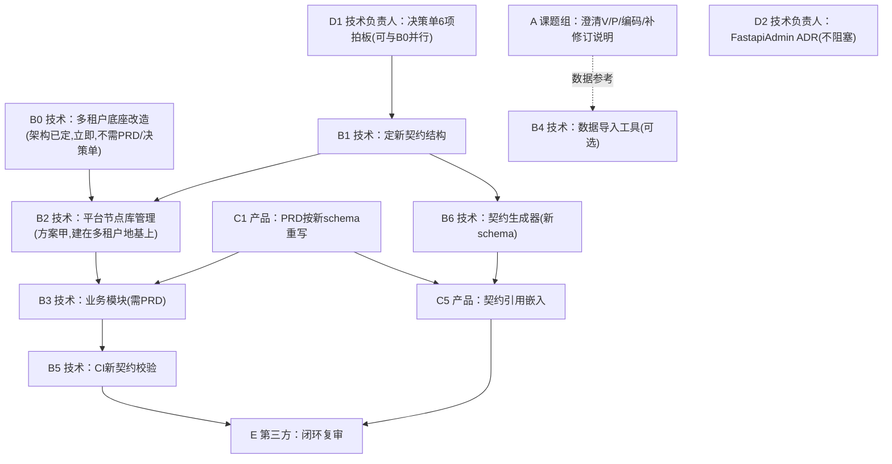

# 下一步工作任务分发单（2026-11-20 · 新路径，取代 11-19 版）

| 项目 | 内容 |
| :--- | :--- |
| 发件方 | 第三方专家评审（经项目负责人确认分发） |
| 依据 | `新契约结构决策单-2026-11-20.md`；新源文 `docs/temp/修订原始文件/修订成果文件11.20/`；`docs/temp/修订源文问题核对清单-2026-11-20.md` |
| 取代说明 | 11-19 版"★/△＋347＋脚本忠实抽取"路径作废（课题组已重构源文为 V/P＋215） |

## 前提决议（已定）

| 项 | 决议 |
| :--- | :--- |
| 一期范围 | MVP；区块链/五方/政府/AI/多设备 后置 |
| 节点库治理 | **方案甲**：平台全局基线（含 V/P）＋租户继承扩展 |
| 数据维护 | 管理端录入维护、**手标 V/P**；系统只存储不推导 |
| 数据与开发 | **解耦**：结构先行、节点值后填；课题组清单作数据参考，不阻塞开发 |

## 依赖关系

## A 课题组（项目负责人组织，沟通走《问题核对清单》）

| ID | 任务 | 交付物 | 性质 |
| :--: | :--- | :--- | :--- |
| A1 | 按《修订源文问题核对清单》§7 回复 8 问（V/P 唯一规则、A-1-13 定性、64 关键节点、应急编码、A-4 阶段、补《修订说明》＋新旧对照表） | 澄清结论＋修订源文 | **数据参考，不阻塞开发** |
| A2 | 提供最终节点清单＋逐节点 V/P 标注（建议附录 A 加"采集形态"列）＋347↔215 对照表 | 节点数据参考表 | 供管理端录入/导入 |

> 11-19 版课题组通知（A1~A5 修 4 缺陷＋补★/△）已被《问题核对清单》取代。

## B 技术团队（技术负责人）

| ID | 任务 | 交付物 | 验收 |
| :--: | :--- | :--- | :--- |
| B0 | 多租户底座改造（架构已定，立即；TenantCRUDBase 行级隔离/平台租户域分离/tenant_id 贯穿） | 多租户隔离底座 | 跨租户隔离测试通过；**不需 PRD/决策单，B2 地基** |
| B0-收尾 | **在职单企业唯一校验**（排入 B0 收尾/B1，**不阻塞合并 main**）：保留 `biz_tenant_member (tenant_id, user_id)` 联合唯一以支持离职复用原账号；在开通租户绑定已有账号、平台/租户新增成员（及未来重新启用成员）时校验该 `user_id` 不存在其他企业启用中（`status=0`）成员，命中返回 409 拦截（含并发防竞态） | 业务校验＋单测 | 同时在职多企业拦截 409；原企业停用后复用原账号加入新企业成功 |
| B1 | 依决策单 D-1~D-6 定新契约（节点身份/V/P留存/应急编码/字段/命名/治理） | 数据模型＋字典＋契约 | 6 项有结论 |
| B2 | 平台节点库管理（方案甲）：platform-web 基线 CRUD＋手标 V/P；tenant-web 继承＋扩展 A-册-E序 | 节点库管理功能 | 录入/标 V/P/继承扩展可用 |
| B3 | 按新契约开发采集/审核/归档/出证＋隐患闭环＋法定七实体＋Occurrence 时间剔除 | 业务模块 | 核心闭环跑通 |
| B4 | 数据导入工具（从源文导入节点＋V/P 参考） | 导入工具 | **可选，不阻塞** |
| B5 | CI 新契约校验 | CI 报告 | 通过 |
| B6 | 契约生成器（新 schema 产出 PRD 契约章节） | 契约生成物 | 与字典一致 |

## C 产品团队（产品负责人）

| ID | 任务 | 交付物 | 验收 |
| :--: | :--- | :--- | :--- |
| C1 | PRD 按新 schema 重写（V/P/A-册-序/新字段/新命名/留存/方案甲治理） | 新 PRD | 新 schema 落实 |
| C2 | 一期 MVP 裁剪（区块链/五方/政府/AI/多设备后置；EXIF→毫秒） | 裁剪落实 | 与决策单一致 |
| C3 | 保留有效业务规则（表号/法定七实体/Occurrence/暂停令签发/隐患三段/超管只读） | 规则保留 | 无遗漏 |
| C4 | 业务血肉保留＋节点库管理交互 | 交互稿 | 含节点库管理 |
| C5 | 契约章节用 B6 生成物嵌入（禁手改） | 新 PRD 契约部分 | 零手改 |

## D 技术负责人（决策）

| ID | 任务 | 交付物 |
| :--: | :--- | :--- |
| D1 | **决策单 D-1~D-6 拍板**（系统开发前置） | 拍板结论 |
| D2 | FastapiAdmin ADR 裁决（不阻塞） | ADR |

## E 第三方评审

| ID | 任务 | 验收 |
| :--: | :--- | :--- |
| E1 | 复审新契约＋节点库管理＋新 PRD | 新 schema 一致、MVP 裁剪落实、有效规则保留 |

## F 项目负责人

| ID | 任务 |
| :--: | :--- |
| F1 | 已拍：方案甲＋MVP＋数据解耦 |
| F2 | 组织课题组按《问题核对清单》沟通（数据参考） |
| F3 | 分发本单＋决策单＋通知，协调依赖 |
| F4 | 督促 D1 拍板（系统开发前置） |

## 状态跟踪

| 任务 | 责任方 | 状态 | 完成日期 | 备注 |
| :--: | :--- | :--- | :--- | :--- |
| D1 决策单拍板 | 技术负责人 | | | 数据层/节点库前置（B0 可先行） |
| B0~B6 | 技术团队 | 进行中 | | **B0/ADR-001 已实施，E 复审附条件通过（2026-11-25）：C1~C3 修复＋复验后合并 main**；B1 等 D1 拍板；另增 B0-收尾待办「在职单企业唯一校验」（2026-11-26 业务拍板，排入 B0 收尾/B1，不阻塞合并） |
| C1~C5 | 产品团队 | 待启动 | | **PRD 第一段（租户/权限/项目）按《产品交接-租户身份与权限体系-2026-11-25》现在可开工**（2026-11-26 已更正六-9 为「历史可跨多企业、在职仅限单企业」，不做企业切换器） |
| A1~A2 | 课题组 | 沟通中 | | 数据参考，不阻塞 |
| E1 | 第三方 | 进行中 | | B0/ADR-001 已复审（附条件）；待 C1~C3 复验、B1 契约与 PRD 第二段复审 |

> **关键路径（2026-11-25 更新）**：技术修复 C1~C3 → E 复验 → 合并 main → D1 拍板 → B1 → B2 → B3（需 PRD）；产品 PRD 第一段现在并行开工；课题组数据（A）不阻塞。详见《专业推进文档与统一开发口径-2026-11-25》。