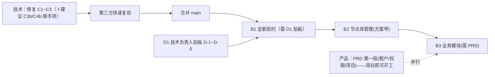

# 专业推进文档与统一开发口径（2026-11-25）

> 依据：B0/ADR-001 第三方 E 复审（`docs/01-review-reports/E-review-B0-ADR001-2026-11-25.md`，**附条件通过**）＋既有推进路线（新契约结构决策单、V/P 新路径、方案甲、一期 MVP）。本文件为技术/产品/项目负责人的统一口径，由第三方评审整合发布，取代各团队分别推断。

## 一、当前状态总览

| 项 | 状态 |
| :--- | :--- |
| B0 多租户底座＋ADR-001 身份权限 | 分支 `feat/b0-multi-tenant` 已实施、内部三轮评审 APPROVE、**E 复审附条件通过**；合并 main 门禁＝C1~C3 修复＋复验 |
| 产品 PRD | **两段式**：第一段（租户/账号/权限/项目核心章节）现在即可按《产品交接-租户身份与权限体系》编写；第二段（节点库/采集/证据/契约章节）等 D1 拍板后的 B1 契约＋B6 生成物 |
| D1 新契约（D-1~D-6） | **仍待技术负责人拍板**；拍板后 B1→B2/B6 |
| D2 FastapiAdmin ADR | 待裁决，不阻塞 |
| 课题组数据（V/P 等） | 数据参考，不阻塞任何开发 |
| 原型 | 持续进行，不受影响 |

## 二、统一口径（各方共同遵守，不得各自另行推断）

### 2.1 角色体系（7 角色，取代旧 6 角色口径）

| 范围 | 标识 | 正式名称 | 要点 |
| :--- | :--- | :--- | :--- |
| 平台 | SUPERADMIN | 平台超级管理员 | 可按规定兜底处置企业拥有者移交 |
| 平台 | SYSADMIN | 平台系统管理员 | 租户开通、平台配置 |
| 企业 | TENANT_OWNER | **企业拥有者** | **每企业恰好一名**；只能通过专门移交变更；默认全部企业管理权限 |
| 企业 | TENANT_ADMIN | **企业管理员** | 0~多名；按可委托权限授权；**权限再全也不是拥有者** |
| 项目 | SZ | 总监 | 按项目任命 |
| 项目 | SP | 专业监理工程师（专监） | 按项目任命＋绑定危大类别 |
| 项目 | SA | 监理员 | 按项目任命，本人任务范围 |

**被替代的旧口径**：PRD v2.4 第 3 章单一 `ADMIN` 角色、架构 v1.5 §3.1（sys_user 仅供平台人员）与 §4.2（is_enterprise_admin）——以 ADR-001 为准。

### 2.2 身份三层与关键不变量

- 三层：统一登录账号（sys_user）／租户成员（biz_tenant_member）／项目成员（biz_project_member）。
- 不变量（PRD 与原型不得改变；技术已实现并测试）：
  1. 每企业任意时刻恰好一名有效企业拥有者；并发移交不产生零/双 Owner。
  2. 企业管理员不能获得所有权专属能力（移交、停用/降权 Owner）。
  3. 企业身份≠项目法定签署权：Owner/Admin 未获项目任命一样不能代行总监签署。
  4. 同一成员跨项目角色独立（A 项目专监、B 项目总监）。
  5. 平台执行移交不等于成为企业拥有者。
  6. 租户/项目角色严禁写入平台 `sys_user_roles`；租户间行级隔离双防线。
  7. 角色变更不改写历史采集/审核/签署/审计归属。
- 权限不足一律以**服务端校验**为准，前端隐藏按钮仅为体验。

### 2.3 不变的既有决议（重申）

- 一期 MVP 裁剪：区块链上链/五方账号/政府接口/AI/多设备 后置。
- 数据解耦：节点由管理端录入维护、手标 V/P，系统只存不推导；课题组清单为数据参考。
- 方案甲节点库治理：平台全局基线（含 V/P）＋租户继承扩展。

## 三、合并 main 门禁与开发顺序

- C4（微信手机号接管）＝小程序生产启用前必修，不阻塞合并。
- 其余加固项排 B0 收尾/B1 迭代（清单见 E 复审报告第四节）。

## 四、各方下一步

| 方 | 动作 |
| :--- | :--- |
| 技术团队 | ① 修复 C1~C3（＋F-03/F-04 顺手）→ 提请复验 → 合并 main；② 准备 D1 拍板材料；③ 加固项排期 |
| 技术负责人 | ① D1（新契约 D-1~D-6）拍板→落 ADR-002；② D2 裁决 |
| 产品团队 | 按《产品交接-租户身份与权限体系-2026-11-25》写 **PRD 第一段**＋对应原型；第二段等 B1/B6 |
| 项目负责人 | ① 把本文件＋产品交接件转产品；② 促 D1 拍板；③ 课题组沟通继续（数据参考） |
| 第三方评审 | C1~C3 修复后快速复验；B1/B6 契约与 PRD 第二段复审 |

> 一句话口径：**平台管规则和开通，企业拥有者唯一且只能移交，企业管理员按授权协助，总监/专监/监理员按项目任命；企业身份不等于项目签署权。B0 修完三条件即合并，产品第一段现在就开工。**