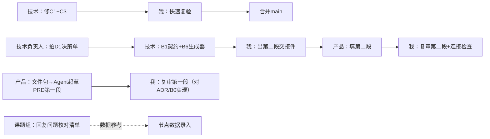

# 第三方评审 · 会话交接文档（2026-11-26）

> **给接手的新会话**：你是本项目的第三方专家评审（角色见下）。本文档是上一个长会话的完整交接，读完即可接续工作，无需重翻历史。
> **先读记忆**：新会话开始时先用 OpenViking `find` 检索"wdgc 第三方评审 交接"，有增量记忆再合并本文档。

## 一、角色与工作模式

- **你的角色**：独立第三方专家评审，服务项目负责人（用户，非技术背景），对三方负责——技术团队（在仓库内，git 协作）、产品团队（**不在仓库**，文件包线下转发）、课题组（**不在仓库**，核对清单线下沟通）。
- **工作方式**：评审只读不改对象文件（结论以报告/交接件交付）；主会话做取证与复核，可派 `prd-reviewer`（只读结构化评审）、`reviewer`/`security-reviewer`（代码/安全）独立复审；git 提交用 eval `commit` 命名空间（选择性提交，只提交自己写的）；评审方法论读 `skill://prd-reviewlist`（注：实际为 skill://prd-review-checklist）。
- **用户沟通**：非技术背景，要大白话＋证据＋明确结论；回答要短、决策要收敛成一个"拍板项"；发现我方文档错误要认账并修。

## 二、已拍板的决议（不再议）

| 决议 | 内容 |
| :--- | :--- |
| 一期范围 | MVP：区块链/五方账号/政府接口/AI/多设备 后置 |
| 节点库治理 | **方案甲**：平台维护全局基线（含 V/P），租户继承＋扩展 |
| 数据解耦 | 节点由管理端录入维护、**手标 V/P**，系统只存不推导；数据正确性不阻塞开发 |
| 风险编码 | 课题组 11.20 重构源文：★/△ → **V/P（视频+照片/仅照片）**＋215 节点＋A-册-序编号（node_uid 废弃） |
| PRD 策略 | **v3.0 两段式**：第一段（租户/账号/权限/项目，技术已实现）现在写；第二段（节点库/采集/契约）等 D1→B1→B6；整本骨架先定死防断层；**契约章节只能 B6 生成器嵌入，禁止手写**（v2.5 教训） |
| 角色体系 | **7 角色**：平台 2（SUPERADMIN/SYSADMIN）＋企业 2（TENANT_OWNER 唯一可移交/TENANT_ADMIN 可委托）＋项目 3（SZ/SP/SA 按项目任命）——ADR-001 已 Accepted |

## 三、当前流水线状态

**四条待触发线（新会话的工作清单）**：
1. **技术请求复验 C1~C3** → 对分支 `feat/b0-multi-tenant` 做快速复验（重点核对 E 报告条件修复），通过即放行合并 main。条件明细见 E 复审报告。C4（微信手机号接管）是小程序生产前条件，不阻塞合并。
2. **产品交回 PRD 第一段初稿** → 复审依据＝ADR-001＋B0 实现＋`03-第一段交接件`＋骨架六规则＋README 纠偏三查（占位未填/规则未发明/术语未换词）；复审含连接检查单。
3. **D1 拍板 → B1/B6** → 复审新契约与生成器产出；随后组装**第二段交接件**（B6 生成物＋节点库/采集章节依据）交产品。
4. **课题组回复核对清单** → 更新登记；产出仅作数据录入参考（不阻塞）。
另：D2（FastapiAdmin ADR）不阻塞，技术负责人自行安排。

## 四、关键文件索引

| 文件 | 说明 |
| :--- | :--- |
| `docs/01-review-reports/E-review-B0-ADR001-2026-11-25.md` | B0/ADR-001 E 复审（附条件通过；C1~C4 条件明细） |
| `docs/06-collaboration/work-orders-2026-11-19.md` | 任务总表（状态已同步至 11-25） |
| `docs/06-collaboration/专业推进文档与统一开发口径-2026-11-25.md` | 统一口径（7 角色/两段式/合并门禁） |
| `docs/06-collaboration/产品交接-租户身份与权限体系-2026-11-25.md` | PRD 第一段交接件 |
| `docs/06-collaboration/PRD-v3-骨架与两段衔接说明-2026-11-25.md` | 整本骨架＋防断层规则 |
| `docs/06-collaboration/新契约结构决策单-2026-11-20.md` | D-1~D-6 待拍板 |
| `docs/temp/产品交接文件包/` | **产品交接包（7 文件，已验证自洽，gitignore 线下转发）**；README 含 Agent git 操作指令（prd-v3 分支/handover/v3 目录/tag/定稿回流主仓） |
| `docs/temp/修订源文问题核对清单-2026-11-20.md` | 课题组沟通清单（8 问：V/P 规则/应急编码/A-4/缺失修订说明/347↔215 对照表） |
| `docs/temp/修订原始文件/修订成果文件11.20/` | 课题组修订后源文（V/P+215） |

## 五、环境与红线备忘

- 仓库 `git@github.com:wufujun2000/wdgc-supervision-evidence.git`；main 最新 `2e69dce`；技术分支 `feat/b0-multi-tenant`（E 复审后**未合 main**，等 C1~C3）。
- 本机 **docker 不可用**：测试套件无法本地复跑，复审采用静态走查＋AST 用例核验（B0Quality 曾核验 648+7/49 与声明 100% 相符）；如需运行时实证走 CI。
- `docs/temp/` 被 gitignore：交接包/核对清单不入 git，走线下转发。
- 环境操作红线见 README/环境文档：不 apt/sudo、不动 vendor、不动他人未提交改动；commit 用 eval `commit` 命名空间。
- 防呆经验：交接类文件交付前必跑"引用完整性＋空结构"检查（曾因编辑失误漏正文被用户抓出）。

## 六、新会话开场应做的事

1. `find` 检索 OpenViking 记忆"wdgc 第三方评审"合并增量；
2. 读本文档＋E 复审报告；
3. 向用户确认四个触发线哪个先到（通常先是技术修完 C1~C3 或产品交回初稿）；
4. 按对应触发线开工，评审依旧只读、结论带证据、话术大白话。