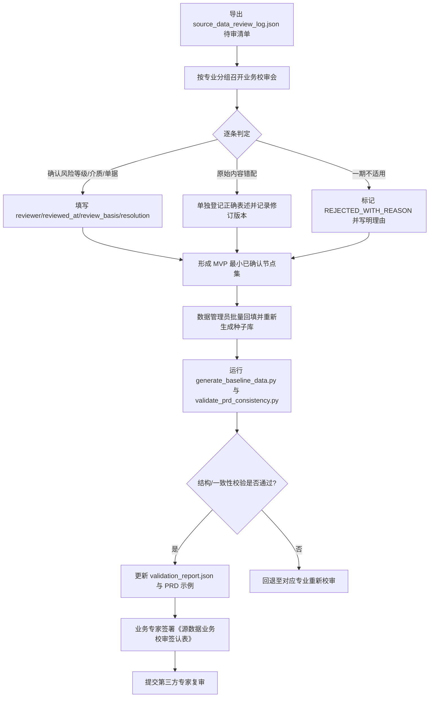

# 危大工程监理履职证据链系统 —— 源数据业务校审工作清单（V1.0）

> **文档定位**：供产品负责人组织业务专家完成源数据业务校审使用，是解除 `business_readiness=BLOCKED` 的必要前置工作。  
> **关联文件**：`docs/baseline-data/source_data_review_log.json`、`docs/baseline-data/hazard_nodes_seed.json`、`docs/baseline-data/validation_report.json`  
> **当前状态**：347 条基线记录中，CONFIRMED=16 条，PENDING_REVIEW=331 条；另有 1 条原始内容错配待校审。  
> **校审原则**：原始材料忠实可溯源、空白不擅自补值、每项确认均有审核人/依据/时间/版本记录。

---

## 一、校审目标与完成标准

### 1.1 校审目标
在不改变课题原始材料事实的前提下，由业务专家对每条采集基线记录完成风险等级（★/△）、适用范围、采集介质、关联单据及原始内容错配的正式确认，形成可进入正式采集任务与履职完整度考核的最小已确认节点集。

### 1.2 完成标准（Definition of Done）
- [ ] `source_data_review_log.json` 中全部 332 项待审事项均已处理并标记为 `CONFIRMED` 或 `REJECTED_WITH_REASON`；
- [ ] 每条记录均填写 `reviewer`（审核人）、`reviewed_at`（审核时间）、`review_basis`（审核依据）、`resolution`（处理结论）；
- [ ] 形成目标 MVP 专业类别的**最小已确认节点集**（建议优先：基坑、脚手架、模板支撑、起重吊装及通用应急模块）；
- [ ] 明确校审后种子版本升级规则及既有任务发生实例（Occurrence）快照迁移规则；
- [ ] 输出《源数据业务校审签认表》（含业务专家签字/电子签认记录）。

---

## 二、校审组织与职责分工

| 角色 | 建议人员 | 核心职责 |
| :--- | :--- | :--- |
| **校审负责人** | 产品负责人 / 课题研发负责人 | 组织校审会议、确认校审范围、裁定争议项、签署最终校审结论 |
| **专业校审专家** | 基坑/模板/起重/脚手架等专业监理工程师、总监代表 | 逐条确认风险等级、采集要求、关联单据与原始内容错配 |
| **数据管理员** | 技术负责人 / 研发 Agent 协助 | 提供 JSON 待审清单、批量回填审核结果、重新生成并校验种子库 |
| **法务/合规复核人** | 法务或企业技术质量负责人 | 复核强制留存、个人信息、验收签认与报告流程合规性 |

---

## 三、校审范围与优先级

### 3.1 当前待审数据分布

| 类别 | 基线记录数 | 当前已确认 | 当前待审 | 校审优先级 |
|:---|:---:|:---:|:---:|:---:|
| 01 基坑工程 | 25 | 0 | 25 | **P0（MVP 首选专业）** |
| 02 模板工程及支撑体系 | 41 | 0 | 41 | **P0（MVP 首选专业）** |
| 03 起重吊装及安拆 | 24 | 0 | 24 | **P0（MVP 首选专业）** |
| 04 脚手架工程 | 74 | 0 | 74 | **P0（MVP 首选专业）** |
| 05 拆除工程 | 24 | 0 | 24 | P1 |
| 06 暗挖工程 | 63 | 0 | 63 | P1 |
| 07 建筑幕墙安装 | 17 | 0 | 17 | P1 |
| 08 钢结构、网架和索膜 | 13 | 11 | 2 | P1（含 2 项原始风险空白） |
| 09 人工挖孔桩 | 23 | 0 | 23 | P2 |
| 10 水下作业 | 20 | 0 | 20 | P2 |
| 11 装配式构件安装 | 18 | 0 | 18 | P2 |
| 12 通用应急兜底 | 5 | 5 | 0 | 已确认，复核保留 |
| **合计** | **347** | **16** | **331** | — |

### 3.2 特殊待审事项
- **原始内容错配**：`附录A-2模板工程及支撑体系监理影像采集清单.docx` 表 3（飞模工程）第 9 行（序号 8）《混凝土浇筑与监护》的“监理履职”列错抄了爬模工程“爬升后架体固定与维护”的内容，须由业务专家确认正确表述后单独修订并记录版本。

---

## 四、逐条校审字段与判定规则

每条基线记录校审时，必须完成以下字段确认：

| 校审字段 | 填写要求与判定规则 |
| :--- | :--- |
| `risk_level` | 仅允许 **`★`（强制采集）** 或 **`△`（常规巡视）**。原始空白时由业务专家依据工序风险、法规要求、验收/旁站/隐蔽性质及事故后果确定，不得留空或写 `UNSPECIFIED`。 |
| `suggested_media_type` | 节点级建议采集介质：`照片` / `视频` / `照片+视频`。与单个证据文件 `media_type`（仅照片/视频）严格区分。 |
| `applicable_scope` | 明确该节点适用的危大子类别、楼栋/部位、施工阶段与是否需按批次重复发生。 |
| `related_document_suggestion` | 确认关联单据名称及标准表号（如 GB/T 50319 表 A.0.1/A.0.3/A.0.5/A.0.6/B.0.1/B.0.9），不得使用错误表号。 |
| `review_status` | 校审完成后改为 `CONFIRMED`；若判定该节点不适用于一期，标记为 `REJECTED_WITH_REASON` 并写明理由。 |
| `reviewer` | 审核人姓名/工号。 |
| `reviewed_at` | 审核时间（ISO 8601）。 |
| `review_basis` | 审核依据（法规条款、课题研究报告页码、专项方案、地方标准、企业制度或专家评审意见）。 |
| `resolution` | 处理结论说明（如“确认为★强制采集，需在浇筑全过程旁站并留存视频”）。 |
| `seed_version` | 校审后种子库版本号（如 `v1.4-confirmed-202611xx`）。 |

---

## 五、校审工作流程

---

## 六、MVP 最小已确认节点集建议

为支持首期试点闭环，建议优先完成以下最小集合的校审：

1. **基坑工程（01）**：专项方案编审与论证、分包/人员资质、材料设备进场验收、测量放线复核、支护桩/墙钢筋笼隐蔽验收、混凝土灌注旁站、土方分层开挖巡视、降排水运行巡视、基坑监测、基坑底部地基验槽；
2. **脚手架工程（04）**：按落地式、附着升降、悬挑式、吊篮、卸料平台等子类别分别确认方案审查、构配件验收、搭设过程巡视、分段/整体验收、连墙件/剪刀撑/安全网检查、验收挂牌与混凝土浇筑前复查；
3. **模板工程及支撑体系（02）**：按滑模/爬模/飞模/混凝土模板支撑分别确认方案论证、材料验收、搭设过程、浇筑旁站、拆除条件与支撑体系验收；
4. **起重吊装及安拆（03）**：方案与资质审查、设备进场验收、吊装/安拆过程旁站、特种作业人员核验与验收；
5. **通用应急模块（12）**：隐患闭环、险情预警、物资演练、主管督查、事故保护 5 条已确认记录的复核与版本签认。

---

## 七、校审后版本与快照迁移规则

1. **种子版本升级**：每次校审批次完成后，将 `hazard_nodes_seed.json` 的 `metadata.version` 递增（如 `1.3.0 → 1.4.0`），并记录 `generated_on` 与校审批次号；
2. **既有 Occurrence 快照**：已创建的 `biz_task_occurrence.node_version_snapshot` 不自动覆盖；如需采用新校审结果，由专监/总监发起版本升级评估并留痕；
3. **完整度分母**：仅将 `review_status=CONFIRMED` 且已进入施工时点的任务发生实例纳入分母；待审节点一律不参与正式强制采集与完整度考核；
4. **复审留痕**：校审后的 JSON、PRD 示例、校验报告及《源数据业务校审签认表》一并提交第三方专家复审。

---

## 八、校审签认表（模板）

| 校审批次 | 专业类别 | 记录范围 | 审核人 | 审核依据 | 审核时间 | 处理结论 | 业务专家签认 |
|:---|:---|:---|:---|:---|:---|:---|:---|
| 第 1 批 | 基坑工程 | 附录 A-1 全部 25 条 |  |  |  |  |  |
| 第 2 批 | 模板工程及支撑体系 | 附录 A-2 全部 41 条 |  |  |  |  |  |
| 第 3 批 | 起重吊装及安拆 | 附录 A-3 全部 24 条 |  |  |  |  |  |
| 第 4 批 | 脚手架工程 | 附录 A-4 全部 74 条 |  |  |  |  |  |
| 第 5 批 | 通用应急模块 | 研究报告 4.13 节 5 条 |  |  |  |  |  |
| 专项 | 原始内容错配 | 附录 A-2 飞模表第 9 行 |  |  |  |  |  |

---

> **说明**：本清单用于指导业务校审，不替代业务专家的专业判断。校审完成后，请将签认结果回填至 `docs/baseline-data/source_data_review_log.json` 并重新运行生成与校验脚本，再提交第三方复审。
