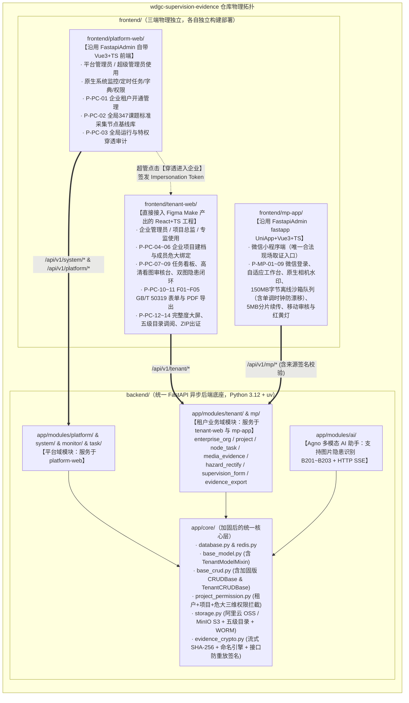
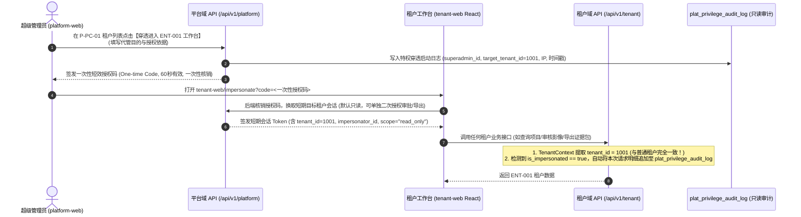
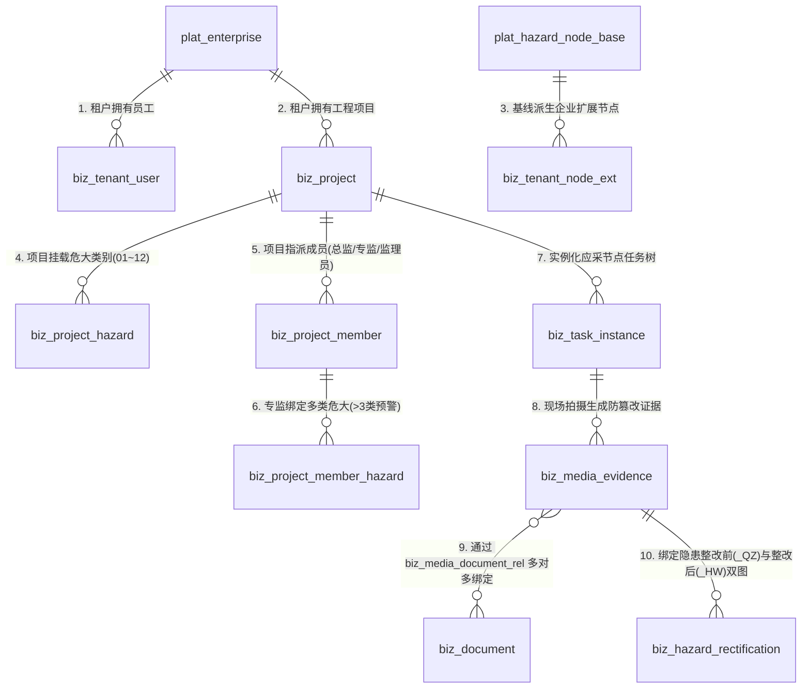

# 危大工程监理履职数字化证据链系统（`wdgc-supervision-evidence`）
# 总体技术架构与基线融合设计说明书（v1.3 评审整改中版本）

> **文档状态**：评审整改中版本（依据 `docs/01-review-reports/prd-v2.2-follow-up-review-2026-11-15.md` 完成真实 SSOT 驱动与 CI 校验闭环，待源数据业务校审、真机 PoC 与法务复核通过后签收为可开发基线）
> **编制日期**：2026-11-12；**v1.3 评审整改日期**：2026-11-15
> **审查与复审依据**：`docs/document-feasibility-review-2026-11-12.md`、`docs/01-review-reports/prd-v2.1-follow-up-review-2026-11-14.md` 及 `docs/01-review-reports/prd-v2.2-follow-up-review-2026-11-15.md`
> **机器可读数据字典**：`docs/baseline-data/hazard_nodes_seed.json`（347 条基线记录，347 个唯一 node_uid） & `docs/baseline-data/metadata_and_forms_dictionary.json`（24 个标准编号字段 + 28 个内部扩展列 + F01~F05 表单映射）
> **开发模式**：AI Agent Vibe Coding 主导开发（文档驱动、强类型护栏、垂直切片高内聚）
> **基线选型决议（锁定完整 Commit SHA）**：以 **`fastapiadmin/FastapiAdmin`（项目包版本 v3.2.0，固定提交 `6828ba16a5c14fbce8479fe1b09b9e8d6ee540c2`）** 为主工程骨架；吸收借鉴 **`insistence/RuoYi-FastAPI`（固定提交 `7f7c66d373b6b344899961a42249ff51285cd865`）** 的文件防篡改治理、接口防重放签名、Agno 视觉多模态 SSE 设计思想，在本底座中构建对应的自研增强模块。
> **关联需求文档**：`docs/PRD_v2.3_评审整改中.md`（历史版本完整保留于 `docs/PRD_v1.0_正式版.md`、`docs/PRD_v2.0_架构对齐版.md`、`docs/PRD_v2.1_评审闭环版.md` 与 `docs/PRD_v2.2_评审整改中.md`）

---

## 1. 架构决策总览与“一后端三前端”工程拓扑

### 1.1 核心架构决策汇总

| 决策维度 | 最终拍板方案 | 决策理由与工程收益 |
| :--- | :--- | :--- |
| **1. 后端主骨架基线** | **`FastapiAdmin` (v3.2.0) + 吸收 `RuoYi-FastAPI` (v2.0.0) 核心长处** | 兼具 `FastapiAdmin` 的 Python 3.12 PEP-695 泛型 `CRUDBase`、请求级自动事务、领域垂直切片目录（极度适合 Agent Vibe Coding）与 `RuoYi-FastAPI` 的司法级文件 SHA-256 防篡改对账、多模态 AI 能力。 |
| **2. 多租户数据库隔离** | **方案 A：共享 MySQL 8.0 数据库 + `tenant_id` 行级逻辑隔离（预留分表/分区演进）** | 针对 100+ 家入驻监理企业（前期试点先行），单库运维成本最低、Alembic 迁移最稳；通过 `TenantCRUDBase` 在 ORM 层 100% 强制锁死 `WHERE tenant_id = current_tenant_id`；未来单表上千万行时可直接按 `tenant_id` 哈希分区或分表，业务层零改动。 |
| **3. 平台与租户后台分离** | **“一后端三前端”物理分离架构**： ① 平台管理端 (`platform-web`) ② 租户监理工作台 (`tenant-web`) ③ 现场移动采集端 (`mp-app`) | 彻底消除平台运营管理与监理企业日常业务的逻辑耦合。租户端上下文永远只有唯一确定的 `tenant_id`，无需在业务页面和小程序里编写“超级管理员跨租户切换”特例代码。 |
| **4. 前端技术栈分工** | · **`platform-web`**：直接延用 `FastapiAdmin` 自带前端（Vue3 + TS + Element Plus） · **`tenant-web`**：直接采用产品团队 **Figma Make 产出的 React + TS + Tailwind + shadcn/ui 工程** · **`mp-app`**：采用 `FastapiAdmin` 自带 **`fastapp`（UniApp + Vue3 + 全量 TS + Wot Design Uni v2 + Alova）** | 100% 保护已有产出：平台端仅 3 个核心业务页，用自带前端零成本上线；租户端直接复用 Figma Make 的 React 原型工程，杜绝重复开发；小程序端使用成熟的全量 TS 工程应对离线沙箱与分片续传。 |
| **5. 租户内权限模型** | **“企业级角色 + 项目级成员角色（RBAC on Project & Hazard）”两级解耦** | 企业管理员为租户级角色；**项目总监（`SUPERVISOR`）、专业监理工程师（`ENGINEER` + 绑定多类危大 `01~12`）、监理员（`MONITOR`）** 挂载在“项目-成员表”上，完美支持同一监理工程师在不同工程项目中担任不同角色的真实业务场景。 |
| **6. 超级管理员跨租户穿透（安全加固版）** | **SaaS 标准“受控代管（Impersonation）+ 一次性短效授权码换短期会话 + 默认只读 + 独立 Append-Only/WORM 审计”** | 超级管理员仅在 `platform-web` 发起代管，通过一次性授权码换取短期目标租户会话打开 `tenant-web`；**默认只读**，导出/审批/督办单独二次授权，**原始取证文件与哈希记录严禁修改或物理删除**，100% 自动写入 `plat_privilege_audit_log` 只读审计表。 |

---

### 1.2 全景工程拓扑图（Monorepo 目录与通信架构）

---

## 2. `FastapiAdmin` 底座加固与 `RuoYi-FastAPI` 核心能力移植蓝图

在编写任何具体业务功能前，第 1 阶段（底座搭建期）必须由 Agent 完成以下 **6 项底座加固与能力融合**，将两个开源框架的优势合二为一：

### 2.1 `FastapiAdmin` 原生缺陷清零清单（必修加固）

| 编号 | 目标文件 | 原生问题（源码锚点） | 加固改造方案 |
| :---: | :--- | :--- | :--- |
| **H-01** | `backend/app/core/base_crud.py` | `delete()`(L424)、`set()`(L472)、`clear()`(L504) 直接构造 `WHERE id IN (...)`，绕过了 `_build_conditions()` 中的软删除与数据权限过滤。 | 强制所有写/删方法（`update`、`delete`、`set`、`clear`）统一合并 `await self._build_conditions()` 生成的租户与数据权限条件，杜绝跨租户/跨项目越权修改或删除。 |
| **H-02** | `backend/app/core/dependencies.py` | `_authenticate()` 从 Redis 会话读取用户状态，回查数据库时仅校验 `is_deleted == False`，未校验账号启用状态与租户冻结状态。 | 认证依赖同时校验 **`user.status == 0`（正常启用，`FastapiAdmin` 源码中 0=启用，1=停用）** 及所属租户 `enterprise.status == 1`（正常未冻结）；一旦平台冻结某监理企业租户或企业停用某员工，立即清理其 Redis Token 会话并实时阻断请求。 |
| **H-03** | `backend/app/core/permission.py` | 原 `Permission` 仅实现 3 级且通过 `created_by.has(UserModel.dept_id...)` 动态关联，不契合监理工程按“项目 + 危大分类”授权的业务模型。 | 平台域保留基础权限；租户域新增专门的 **`TenantProjectPermission`**（见第 4 节），基于业务表固化的 `(tenant_id, project_id, hazard_code)` 进行高性能索引过滤。 |

### 2.2 从 `RuoYi-FastAPI` (v2.0.0) 吸收移植的 4 大核心模块

| 编号 | 吸收自 `RuoYi-FastAPI` 的源模块 | 移植入本底座的目标位置 | 赋能本项目的具体业务价值 |
| :---: | :--- | :--- | :--- |
| **M-01** | **企业级文件证据治理与防篡改对账设计（自研增强模块）** （借鉴 `RuoYi-FastAPI` 文件治理模型，在本底座基于阿里云 OSS / MinIO 重新实现全量流式对账） | `backend/app/modules/tenant/media_evidence/reconcile_service.py` 及存证对账表 | 直接赋能 PRD 7.3 节司法防篡改要求： 1. 固化归档摘要 `file_sha256` 与原始帧摘要 `raw_frame_sha256` 双哈希分离，以及 `worm_locked_status` / 长期留存保护状态； 2. 图单强引用计数（防止已被 F01~F05 表单引用的现场照片被误删）； 3. **后台定时防篡改对账任务（`reconcile_run`）**：定期抽检或全量重算 OSS 文件流 SHA-256 与数据库比对，发现 1-bit 篡改立即锁定标红并生成 `reconcile_issue` 安全告警。 |
| **M-02** | **接口防重放签名与客户端通道鉴权中间件** （源：`middlewares/transport_crypto_middleware.py`） | `backend/app/core/middlewares/evidence_guard_middleware.py` | 直接赋能 PRD 5.4 / 7.3.5 / 7.4.3 刚性红线： 1. 校验请求头 `X-Timestamp`（与服务端 NTP 时间差 >15 分钟自动打上“时间异常漂移”标记）、`X-Nonce`（Redis 防重放）、`X-Sign`（HMAC-SHA256 签名）； 2. **PC 端禁拍取证硬拦截**：现场影像上传接口 `/api/v1/mp/evidence/upload` 强制校验微信小程序专属通道签名与设备硬件元数据，PC 端直接调用一律返回 `403 Forbidden`。 |
| **M-03** | **Agno 多模态视觉 Agent + HTTP SSE 流式引擎** （源：`plugins/ai/service/ai_chat_service.py`、`ai_util.py`） | `backend/app/modules/ai/` | 弥补 `FastapiAdmin` AI 仅支持纯文本 WebSocket 的短板： 1. 引入 `agno.media.Image` 多模态输入，现场照片上传后可异步或实时调用视觉大模型自动生成 **B201 AI 风险识别标签、B202 置信度、B010 风险简述建议**； 2. 增加标准 HTTP SSE 流式端点，完美兼容微信小程序 `enableChunked: true`； 3. 保留 `FastapiAdmin` 原有的 `tools/registry.py` 闭包鉴权工具机制，让 AI 助手能安全查询当前项目的危大节点规范与未闭环隐患。 |
| **M-04** | **全栈前后端路由与字段契约 AST 静态检查器（本项目自研工具）** （基于 FastAPI 路由 Schema 与三套前端 AST 扫描实现） | `scripts/fullstack_contract_check.py` | 专为 Agent Vibe Coding 打造的防幻觉护栏：自动扫描 FastAPI 路由 Schema 与 `platform-web` (Vue3)、`tenant-web` (React)、`mp-app` (UniApp) 的接口调用代码，确保 URL、Method、请求/响应字段 100% 对齐。 |

---

## 3. 轻量多租户与“平台域 vs 租户域”完全解耦设计

### 3.1 平台域与租户域的账号与表空间划分

为彻底避免平台管理与租户业务相互干扰，数据库表按前缀划分为三大命名空间（共存于同一个 MySQL 8.0 实例中）：

1. **`sys_*`（框架原生平台系统表，无 `tenant_id`）**：
   - `sys_user`、`sys_role`、`sys_menu`、`sys_dept`、`sys_dict_*`、`sys_log`：100% 留给 **平台管理端 (`platform-web`)** 的平台运维管理员（`ROLE_SYSADMIN`）和超级管理员（`ROLE_SUPERADMIN`）使用。
2. **`plat_*`（平台级危大业务基线表，无 `tenant_id` 或 `tenant_id=0`）**：
   - `plat_enterprise`（监理企业租户主表：管理入驻企业 `ENT-001`、社会信用代码、状态 `1正常/0冻结`、存储配额、OSS 根路径前缀）。
   - `plat_hazard_node_base`（课题研究成果 12 大类 347 个危大采集节点只读基线库，含 11 类专业危大 342 项 + 通用应急 5 项，版本号 `v1.1`，由 `docs/baseline-data/hazard_nodes_seed.json` 导入）。
   - `plat_privilege_audit_log`（超级管理员跨租户穿透调阅与特权操作 WORM 只读审计日志表）。
3. **`biz_*`（租户业务域表，100% 强制包含 `tenant_id` 字段）**：
   - 所有表继承 `TenantModelMixin`，包含 `tenant_id: Mapped[int] = mapped_column(BigInteger, index=True, nullable=False, comment="所属监理企业租户ID")`。
   - 涵盖：
     - 租户组织与人员：`biz_tenant_user`（监理企业员工表，含工号 `emp_no`、手机号、微信 `openid`、`is_enterprise_admin`）、`biz_tenant_dept`；
     - 租户扩展节点库：`biz_tenant_node_ext`（企业基于课题 347 项基线库派生的地方/企业扩展节点，编码如 `A-01-E01`）；
     - 项目与成员权限：`biz_project`、`biz_project_hazard`（项目挂载的危大类别）、`biz_project_member`（项目成员角色：总监/专监/监理员）、`biz_project_member_hazard`（专监在该项目绑定的多类危大 `01~12`）；
     - 核心业务流转：`biz_task_instance`（应采节点任务实例）、`biz_media_evidence`（现场防篡改影像证据主表）、`biz_document`（F01~F05 核心表单与纸质扫描单据表）、`biz_media_document_rel`（图单多对多关联表）、`biz_hazard_rectification`（安全隐患下发 `_QZ` 与复查 `_HW` 闭环台账表）、`biz_evidence_export_task`（证据包异步打包导出任务表）、`biz_retention_destroy_approval`（常规影像到期销毁审批表）、`biz_tenant_audit_log`（租户内全生命周期操作审计表）。

### 3.2 `TenantCRUDBase` 自动租户隔离与超级管理员“代管穿透（Impersonation）”机制

- **设计核心优势**：
  1. `TenantCRUDBase` 内部 **永远只有一条铁律**：`conditions.append(self.model.tenant_id == TenantRequestContext.get_tenant_id())`。
  2. 租户业务代码（Service、CRUD、React 前端、微信小程序）完全不需要知道“超级管理员”的存在，却天然支持超级管理员在平台端受控代管穿透进入任意监理企业执行调阅、审批、督办与出证（默认只读，原始证据严禁修改删除），且 100% 留存不可篡改的跨租户特权审计轨迹！

---

## 4. 租户内“企业 + 项目 + 危大类别”三维数据权限引擎设计

### 4.1 为什么传统的部门树（`sys_dept`）不适用？
在工程监理行业中：
- 一家监理企业同时在监多个工程项目（如 `TJ-2026-0089`、`TJ-2026-0092`）；
- **同一名监理工程师（如张工）在项目 A 可能是“专业监理工程师（负责 01 基坑 + 03 起重）”，而在项目 B 可能是“项目总监”**；
- 权限边界取决于用户在 **当前激活项目（`current_project_id`，通过请求头 `X-Project-Id` 传递）** 中的项目角色与危大绑定关系。

### 4.2 三维数据权限过滤矩阵（`TenantProjectPermission`）

当请求进入 `/api/v1/tenant/*` 或 `/api/v1/mp/*` 时，系统自动根据当前用户在 `biz_tenant_user` 与 `biz_project_member` 中的身份注入过滤条件：

| 用户身份层级 | 判定依据 | 自动注入的 SQL 过滤条件（在 `tenant_id == X` 基础上） |
| :--- | :--- | :--- |
| **1. 企业管理员** （或超管穿透态） | `user.is_enterprise_admin == True` | 可查看/管理本企业（`tenant_id = X`）下的所有工程项目；若前端顶部选定了某个 `X-Project-Id`，则按该 `project_id` 过滤。 |
| **2. 项目总监** （`PROJECT_SUPERVISOR`） | 在当前 `project_id` 的 `biz_project_member.role == 'SZ'` | 强制 `project_id == current_project_id`；可查看、审批、督办该项目下 **全部 12 类危大工程** 的任务、影像、隐患与表单。 |
| **3. 专业监理工程师** （`PROJECT_ENGINEER`） | 在当前 `project_id` 的 `biz_project_member.role == 'SP'` | 强制 `project_id == current_project_id` **且 `hazard_code IN (该专监在本项目绑定的危大编码集合)`**（来自 `biz_project_member_hazard`）。 |
| **4. 现场监理员** （`PROJECT_MONITOR`） | 在当前 `project_id` 的 `biz_project_member.role == 'SA'` | 强制 `project_id == current_project_id` 且仅限 **分派给本人（`assignee_id == user.id`）或本人采集提交（`shooter_user_id == user.id`）** 的任务与记录。 |

---

## 5. 核心数据库物理表结构设计（解决原 PRD 字段冲突后的统一标准）

### 5.1 原 PRD 内部 3 处冲突的官方裁定与统一标准

1. **裁定 1：统一为 24 个标准编号字段（`B001~B304`）+ 数据库内部扩展列（消除原 PRD 6.2 节与 10.3 节编号错位及 26/32/34 口径混乱）**：
   - 严格对齐课题原始材料《附录B 标准化数据字段表.docx》的 **24 个标准编号**（`B001~B011`、`B101~B106`、`B201~B203`、`B301~B304`）作为对外交互与台账导出标准；
   - 数据库表 `biz_media_evidence` 的 25 个内部扩展管理列（如 `tenant_id`、`project_id`、`task_instance_id`、`gps_status`、`client_clock_verified`、`is_offline_queued`、`raw_frame_sha256`、`watermarked_file_path`、`retention_policy_code` 等）不占用 B 系列标准编号；
   - 唯一事实来源为 **`docs/baseline-data/metadata_and_forms_dictionary.json`**，字段命名全栈统一采用 `snake_case`。
2. **裁定 2：统一标准化文件重命名公式（消除原 PRD 6.3.1 节与 10.4.2 节公式冲突）**：
   - 统一采用信息量最完整的 **第 6.3.1 节公式** 作为主规范：
     $$\text{影像文件名} = \text{project\_code}\_\text{hazard\_code}\_\text{stage\_code}\_\text{node\_code}\_\text{risk\_level}\_\text{yyyyMMddHHmmss}[\_\text{suffix}].\text{JPG|MP4}$$
     - 示例：`TJ-2026-0089_01_03_A-01-25_★_20261014143218_QZ.JPG`
   - 配套纸质单据/PDF 命名公式：
     $$\text{单据文件名} = \text{project\_code}\_\text{hazard\_code}\_\text{stage\_code}\_\text{node\_code}\_\text{doc\_code}[\_\text{suffix}].\text{pdf}$$
3. **裁定 3：统一危大工程 12 大类编码为 `01` ~ `12`**：
   - `01` 基坑、`02` 模板支撑、`03` 起重吊装、`04` 脚手架、`05` 拆除、`06` 暗挖、`07` 幕墙、`08` 钢结构、`09` 人工挖孔桩、`10` 水下作业、`11` 装配式、`12` 应急抢险与特殊工序（兼容读取旧编码 `99`）。

### 5.2 核心表全景 ER 关系与关键字段定义

---

## 6. 核心业务规则引擎技术实现方案

### 6.1 现场移动取证防篡改流水线（`mp-app` + `evidence_crypto.py`）
1. **端侧强制实时相机与 Canvas 水印压印（`P-MP-04`）**：
   - 使用微信小程序原生 `<camera>` 组件（禁用 `uni.chooseImage` 相册入口），快门触发后先获取原始相机帧并计算 **原始帧摘要 `raw_frame_sha256`**；通过离屏 `Canvas 2D` 将防伪水印（企业编码、项目名称及编码、危大及节点号+`★/△`、UTC+8 时间、姓名工号、WGS-84 经纬度及电子围栏状态、**`media_guid` + `raw_frame_sha256` 前 16 位**）硬编码绘制到图片像素层（**彻底消除“将最终文件自身 SHA-256 写入自身水印”的自引用悖论**），耗时控制在 `300ms ~ 800ms`。
   - 坐标系转换：内置纯算法 `gcj02_to_wgs84(lng, lat)`，将 `uni.getLocation({ type: 'gcj02' })` 实时转换为司法标准 WGS-84 大地坐标并计算与项目中心点的 Haversine 球面距离（判定是否在电子围栏内）。
2. **离线沙箱队列与 5MB 分片断点续传（`P-MP-05` / `P-MP-09`）**：
   - 本地沙箱通过 `uni.getFileSystemManager()` 存储离线文件，严格遵守微信小程序 **200MB 本地文件系统硬限制**，Pinia 持久化队列执行 **“150MB 字节硬红线（预留 50MB 系统余量）+ 数量软上限（最多 40 张照片或 3 段离线短视频）”** 双重配额拦截，并支持重启恢复与断点续传。
   - 网络恢复（`uni.onNetworkStatusChange`）后自动按 FIFO 激活上传队列；超过 20MB 的视频按固定 **5MB 分片** 调用后端 `/api/v1/mp/evidence/multipart/{init,upload,complete}` 对接阿里云 OSS / MinIO Multipart Upload，失败按 `1s → 2s → 4s` 指数退避重试。
3. **服务端三重 SHA-256 核验与时间漂移检测**：
   - **入库核验与离线单调时钟校验**：服务端接收文件流时边写边算最终归档 `hashlib.sha256()`（对应标准字段 `B301`）；结合端侧单调时钟（`performance.now()`）与最近 NTP 基准时间校验拍摄设备时钟，**区分“正常离线排队上传（`is_offline_queued=1` 不误报）”与“设备系统时间人为拨改 >15 分钟（`time_drift_warning=1`）”**，彻底消除地下室正常离线作业误报。
   - **调阅实时全文件核验**：查看影像详情或出证时，后端从 OSS / MinIO 拉取全文件流执行 **全文件 SHA-256** 与入库 `file_sha256` 比对（不使用无法证明全文件一致性的 ETag/CRC64 或抽样哈希替代），返回 `integrity_verified: true/false` 驱动前端展示绿色安全印章或红色【证据失效】警报。
   - **出证离线核验工具注入**：异步打包 ZIP 证据包时，自动在根目录生成《影像元数据总台账.xlsx》、《SHA-256防篡改指纹校验清单.csv》，并注入单文件版 **`verify_evidence.py`** 与纯前端 Web Crypto API 版 **`verify_tool.html`**。

### 6.2 F01~F05 核心表单 GB/T 50319 版式还原与矢量 PDF 导出
- 后端使用 **Jinja2 HTML 模板（严格按 GB/T 50319-2013 A4 表格 CSS 网格排版）+ WeasyPrint（或 Playwright 无头渲染）** 生成矢量 PDF；
- 顶部右上角通过 Python `qrcode` 库动态生成嵌入 **表单 `doc_guid` + 表单结构化内容摘要 + 核验标识** 的 SVG 防伪二维码（**不直接嵌入最终 PDF 自身 SHA-256**，最终 PDF 文件摘要独立写入数据库与《SHA-256防篡改指纹校验清单.csv》）；
- 表单内关联的现场验收举牌照片自动排版嵌入缩略图、拍摄时间、GPS 与哈希前 8 位，生成后的 PDF 自动同步归档至 OSS 五级目录的同级 `paper/` 文件夹下。

---

## 7. Figma Make (`tenant-web` React 工程) 无损接入规范

针对产品负责人正在使用 Figma Make 调优产出的租户端 React 工程，待其定稿移交后，采用 **“保皮换骨、零 UI 重写”** 策略接入 `frontend/tenant-web/`：

1. **目录落位**：直接将 Figma Make 导出的 React + TypeScript + Tailwind + shadcn/ui 工程放入 `frontend/tenant-web/`。
2. **契约自动同步**：后端 FastAPI 启动后暴露 `/api/v1/tenant/openapi.json`，在 `tenant-web` 中配置 `npx openapi-typescript` 一键生成全量后端 Schema 的 TypeScript 接口定义 `src/types/api-schema.d.ts`。
3. **注入 3 个核心基础设施文件（不动任何视觉组件）**：
   - `src/lib/http.ts`：统一封装请求客户端，自动在 Header 注入 `Authorization: Bearer <token>` 与当前选中的工程项目 `X-Project-Id: <project_id>`，并处理并发 401 Token 刷新与跨租户 Impersonation 顶栏提示条。
   - `src/context/TenantWorkspaceContext.tsx`：维护当前登录的监理企业信息、用户所绑定的工程项目列表、当前激活项目、以及用户在该项目下的角色（`SZ` 总监 / `SP` 专监+所辖危大列表 / `SA` 监理员）。
   - `src/router/index.tsx`：将 Figma Make 的页面组件映射到标准路由表（对应 `P-PC-04` ~ `P-PC-14`）。

---

## 8. Agent Vibe Coding 研发护栏与实施路线图

### 8.1 Agent 编码铁律（写入项目根 `CLAUDE.md`）
1. **字段命名一刀切铁律**：数据库物理列、SQLAlchemy Model、Pydantic Schema、API JSON 载荷、前端 TS 类型 **全链路统一使用 `snake_case`**（如 `tenant_id`、`project_code`、`node_code`、`sha256_hash`），严禁开启隐式 `to_camel` 转换。
2. **租户隔离铁律**：所有 `app/modules/tenant/` 下的业务模型必须继承 `TenantModelMixin`，所有 CRUD 类必须继承 `TenantCRUDBase`，严禁手写绕过 `TenantCRUDBase` 的裸 `session.execute(select(...))`。
3. **双端职责红线铁律**：`platform-web` 与 `tenant-web` 严禁提供任何相机调用或本地图片作为现场工序证据上传的入口；现场工序照片/视频唯一上传通道为 `/api/v1/mp/evidence/*`。
4. **每次改动必跑自检**：后端修改跑 `pyright` + `pytest`；前端修改跑 `tsc --noEmit`；跨端接口修改必跑 `python scripts/fullstack_contract_check.py`。

### 8.2 分阶段实施路线图（Roadmap）
- **Phase 1：基础框架搭建与底座加固（当前准备启动）**
  - 拉取 `FastapiAdmin v3.2.0` 建立 `backend/`、`frontend/platform-web/`、`frontend/mp-app/`；
  - 完成 `H-01 ~ H-03` 底座漏洞修补，实现 `TenantModelMixin`、`TenantCRUDBase`、`TenantProjectPermission` 与超管 Impersonation 穿透机制；
  - 从 `RuoYi-FastAPI` 移植文件防篡改对账模块、接口防重放签名中间件、Agno 多模态 SSE 及 `fullstack_contract_check.py`。
- **Phase 2：平台管理端（`platform-web`）与全局种子数据交付**
  - 通过 `scripts/generate_baseline_data.py` 从 `docs/00-source-materials/` 导入课题研究 **12 大类 347 个标准采集节点（11 类专业危大 342 项 + 通用应急 5 项）** 种子数据；
  - 在 `platform-web` 完成 `P-PC-01`（监理企业租户开通）、`P-PC-02`（标准节点库管理）、`P-PC-03`（全局与特权穿透审计日志）。
- **Phase 3：租户核心后端 API 与微信小程序端（`mp-app` `P-MP-01~09`）交付**
  - 完成租户后端 6 大业务中心 API；
  - 在 `mp-app` 完成微信登录、自适应工作台、原生相机 + Canvas 双哈希水印、150MB 字节离线沙箱队列 + 单调时钟防漂移、5MB 分片续传、单据胶囊、专监移动审核与总监红黄灯看板。
- **Phase 4：Figma Make 租户工作台（`tenant-web` `P-PC-04~14`）接入与联调**
  - 接收产品负责人定稿的 Figma Make React 工程放入 `frontend/tenant-web/`；
  - 执行“保皮换骨”注入路由与 API 层，完成高清看图审核台、双图同屏隐患闭环、GB/T 50319 表单 PDF 导出、五级目录调阅与异步 ZIP 证据包（含离线校验工具）全链路联调验收。

---

## 9. v1.2 复审整改根治补充：节点全局唯一身份、原始数据忠实溯源与法定履职全闭环

### 9.1 节点全局唯一身份模型（`node_uid`）与原始数据溯源
- 针对原始附录 A 清单按子类别（如脚手架的落地式、附着升降、悬挑式、吊篮、卸料平台等）分别编号导致 `node_code` 重复的问题，本底座引入 **全局稳定唯一身份编码 `node_uid`**（格式：`WDGC-A-{hazard_code}-{subcategory_code}-{seq:02d}`，如 `WDGC-A-04-SC03-01`）；
- 每条采集记录保留 `subcategory_code`、`source_document`、`source_table_index`、`source_row_no`，实现从数据库到原始 Word 表格行级的完整溯源；
- `raw_risk_level` 忠实保留原始值，空白值标记为 `UNSPECIFIED` 并进入 `PENDING_REVIEW` 业务校审队列，严禁程序擅自补值。

### 9.2 法定履职全闭环数据与状态机支持
在 `biz_hazard_rectification` 与任务实例基础上，补齐以下法定履职实体：
1. **停工与送达**：`biz_stop_work_order`（工程暂停令，GB/T 50319 表 A.0.4，含停工范围、签发人、签发时间）与 `biz_document_delivery_record`（送达方式、签收/拒收凭据）；
2. **报告与拒不整改独立事件**：`biz_authority_report_record`（报告建设单位/住建主管部门的对象、文号、附件与签收凭据）及 `biz_refusal_to_rectify_event`；
3. **多轮复查与复工审查**：`biz_rectification_review_round`（多轮复查意见、复查人、复查时间、`_HW` 影像）与 `biz_resumption_review`（复工申请、条件核验与总监签署意见）；
4. **验收双签与工序放行门禁**：`biz_acceptance_signoff`（施工单位技术负责人 + 总监双签、验收标识牌公示照片）与 `biz_process_gate_rule`（验收合格且公示完成后解锁下一道工序任务实例）。

### 9.3 任务发生实例（`biz_task_occurrence`）与证据链完整度算法
- 引入 `biz_hazard_entity`（危大实体/楼栋/部位实例）与 `biz_task_occurrence`（含 `occurrence_id`、`node_uid`、`node_version_snapshot`、`scheme_version_snapshot`、`building_zone`、`batch_no`、`applicable_status`、`planned_due_at`、`workflow_status`）；
- 完整度分母为“已进入施工时点且经确认适用的应采任务发生实例”，分子为“其中已采集且审核闭环的实例数”，剔除不适用与未到工序时点项。

### 9.4 数据与文档一致性 CI 断言
- 通过 `scripts/generate_baseline_data.py` 自动生成 `docs/baseline-data/` 下的 `hazard_nodes_seed.json`、`metadata_and_forms_dictionary.json`、`source_data_review_log.json` 与 `validation_report.json`；
- CI 强制断言：`node_uid` 唯一率 100%、标准字段与 PRD 表格完全一致、无残留旧规则（50张/5段视频、超管进入小程序、旧完整度公式等）。

---

## 10. v1.3 复审整改补充：真实 SSOT 驱动、业务准入状态拆分与 CI 一致性校验

### 10.1 标准字段语义严格分离
- **B004** 恢复为原始附录清单业务编号 `legacy_node_code`（非唯一键），内部全局身份 `node_uid` 作为独立扩展列；
- **B005** 风险等级仅允许 `★/△`，原始空白仅通过 `review_status` 与 `raw_risk_level` 表达，严禁将 `UNSPECIFIED` 作为业务风险等级；
- **B006** 单文件介质仅允许“照片/视频”，节点建议介质独立为 `suggested_media_type`；
- 所有字段名、类型、长度与生成主体由 `docs/baseline-data/metadata_and_forms_dictionary.json` 统一驱动。

### 10.2 验证报告业务准入状态真实拆分
`docs/baseline-data/validation_report.json` 分别输出：
- `structural_status`：结构校验状态（记录数、唯一 node_uid、字段数量）；
- `source_review_status`：源数据业务校审状态（CONFIRMED / PENDING_REVIEW 数量）；
- `business_readiness`：业务准入状态（存在 PENDING_REVIEW 节点时为 BLOCKED）。

**业务准入门禁**：仅 `review_status=CONFIRMED` 的节点允许进入正式强制采集任务与履职完整度考核分母。

### 10.3 真实 CI 一致性校验链路
- `scripts/generate_baseline_data.py`：从原始 Word/Excel 生成四份机器可读 JSON；
- `scripts/generate_prd_v23.py`：从字典自动生成 PRD 字段表、节点统计、真实示例与法定履职验收用例；
- `scripts/validate_prd_consistency.py`：实际执行 37 项断言（节点唯一性、字段契约、示例真实性与状态、命名公式一致性、权限旧词与离线旧配额扫描、法定履职用例覆盖、性能与隐私口径），校验结果输出至 `docs/baseline-data/prd_consistency_report.json`。
